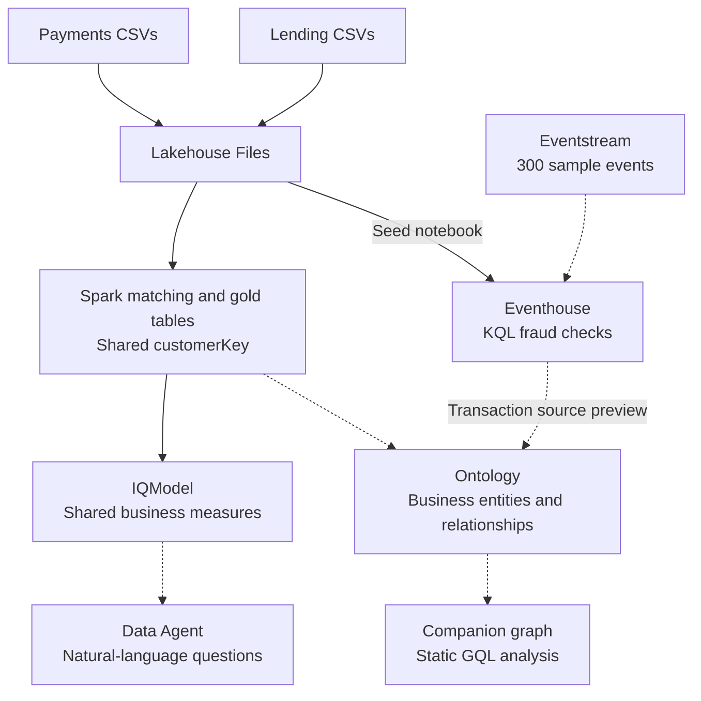

# Fabric IQ Banking POC - Use Case and Design

**Scenario:** Northwind Financial, a retail bank and payments processor.
**Hands-on guide:** [Lab instructions](LAB.md).
**Updated:** 2026-10-14.

## The Business Story

Northwind's payments team investigates card fraud. Its lending team tracks overdue loans. The same person can appear in both systems under different IDs, making it difficult to see the full customer picture.

Consider a customer with a card-fraud alert and a loan delinquency event. The bank wants to recognize this as one customer and coordinate a review, rather than investigate two unrelated records.

**The main question: How many customers have both a delinquency event and a fraud alert?**

The lab brings the two datasets together, establishes a shared customer identity, and answers that question. Fraud analysts can then investigate merchant connections, risk teams can review affected customers, and finance users can ask about consistently defined KPIs.

The synthetic sample has **2,000 payments/deposit customers** and **900 lending customers**. With **600 people in both systems**, these resolve to **2,300 distinct customers**. Of those, **13 have both a delinquency event and a fraud alert** across the supplied data.

## How the Solution Fits Together

1. **Connect the customer records.** Upload both source datasets into the Lakehouse. Spark matches emails and assigns a shared `customerKey` to the customer records and related facts.
2. **Agree on the answer.** IQModel connects payments and lending data through that key. Saved measures define the customer overlap, fraud loss rate, and delinquency rate.
3. **Investigate the activity.** KQL checks transaction patterns in Eventhouse. Optional ontology and graph exercises show how customers, merchants, loans, and events connect.
4. **Make the insights accessible.** Optional AI preparation and Data Agent exercises let business users ask questions while reviewers inspect the underlying measures, queries, and filters.

Solid arrows show the core data flow; dashed arrows show optional branches. Customer matching happens in Spark. The graph is a static projection; the Eventhouse binding adds a live-source preview, not automatic graph refresh.

The business relationship behind the main question is **FraudAlert -> Customer -> Loan -> DelinquencyEvent**.

## How Each Feature Helps

Follow the linked lab sections for the hands-on exercises. Complete the core path first; add optional branches to explore further.

| Business need | Feature and hands-on activity | Lab section |
|---|---|---|
| Recognize the same customer | **Lakehouse + Spark:** combine uploaded sources, match emails, and build ten gold tables with a shared customer key. **Core.** | [2: Gold build](LAB.md#2-lakehouse-and-gold-build-module-0) |
| Count customers affected by both issues | **Direct Lake IQModel:** configure nine relationships and save the cross-domain count and KPI measures. **Core.** | [3.1: Semantic model](LAB.md#31-build-or-repair-iqmodel) |
| Give finance focused, reviewed answers | **LOB models + Prep for AI:** prepare PaymentsDepositsModel, select relevant fields, add instructions, and register reviewed report visuals as verified answers. **Optional.** | [3.2: LOB models](LAB.md#32-retain-or-rebuild-the-lob-models), [4: Prep for AI](LAB.md#4-prep-for-ai-module-2) |
| Find suspicious transaction patterns | **Eventhouse + KQL:** check cross-border activity, rapid card use, impossible travel, and high-risk merchants. **Core.** | [5.3: Fraud checks](LAB.md#53-fraud-detection-rules) |
| Describe the customer context | **NorthwindOntology:** bind nine entity types and nine relationship types to the mastered gold data. **Optional.** | [6: Ontology](LAB.md#6-ontology-two-subject-areas-modules-3-4) |
| Investigate connected activity | **Graph + GQL:** follow the cross-domain path, rank merchants, count customers with seeded ring labels, and assess customer reach. **Optional.** | [9: Graph analysis](LAB.md#9-graph-analysis-module-6) |
| Inspect a newly arriving transaction | **Eventstream + time-series binding:** send 300 events once, verify ingestion, and match an exact event in the ontology's source preview. **Optional.** | [5.2: Streaming](LAB.md#52-load-livetransactions), [6.5: Binding](LAB.md#65-time-series-binding-ties-rti-into-the-ontology) |
| Ask questions without writing DAX | **NorthwindDataAgent:** ask IQModel about joint-risk customers, merchants, and KPIs; inspect the executed DAX and raw output. **Optional, Standard draft.** | [8: Data Agent](LAB.md#8-data-agent-module-8) |
| Explore continuous monitoring | **Operations Agent:** review a single `amount > 10000` playbook and its source query. **Setup only; current source review failed.** | [6.6: Operations Agent](LAB.md#66-action-layer--operations-agent-fabric-iq) |
| Explore deposit planning | **Planning:** use Payments actuals for scenarios and SQL forecast writeback. **Deferred; needs actuals access and a valid forecast baseline.** | [10: Planning](LAB.md#10-planning-module-9) |
| Extend Q&A into another assistant | **Foundry / Copilot Studio:** consume a separately published Data Agent. **Excluded from this run; separate authorization and testing required.** | [11: Agent grounding](LAB.md#11-agent-grounding-module-10) |

## What You Should See

These are sample-data checkpoints, not a claim that every optional exercise has passed in your workspace.

| Check | Reference result |
|---|---|
| Customer matching | 2,300 distinct customers, including 600 shared across the sources. |
| Cross-domain question | `[Delinquent With Fraud] = 13`, counting customers rather than alerts or loans. |
| KQL fraud checks | 500 cross-border alerts; 194 velocity cards; 148 impossible-travel cards; 1,373 high-risk-merchant transactions. |
| Optional graph checks | Cross-domain count 13; merchant MER-0026 has 69 fraud transactions; MER-0041 has 7 customers with seeded ring labels; 1,800 customers used 11 high-risk merchants. |
| Governed rates | Fraud loss rate 76.9730%; delinquency rate 15.4661%, using loan rows with `dpd >= 30`. |
| Optional streaming | 300 rows and 300 unique transaction IDs after one send; match one exact event in the bound-source preview. |

The fraud checks count different things, so do not add them together. Graph ring queries count supplied labels, not newly discovered fraud rings. The rates are synthetic demonstration values, not production targets. Unless requested, answers use all supplied data rather than a last-90-days filter.

## Run the Lab

Start with [prerequisites](LAB.md#0-prerequisites-and-workspace), the data upload, and [the data overview](LAB.md#1a-understand-the-data-read-before-building). Then follow **2 -> 3.1 -> 5 -> Final proof** for the core experience. No local Python or PowerShell setup is needed.

For optional branches, check the following before claiming success:

- **AI answers:** confirm the selected model, saved measures, filters, and raw results. Verified-answer matching is a separate check; the model owner applies Prep changes. A payments-only model cannot answer lending questions.
- **Live events:** ingestion and source preview do not prove graph freshness or automated detection. Send the sample events only once; follow the guide before resetting data.
- **Monitoring:** keep Operations Agent stopped while its source review is failing. Notifications and actions need separate approval and observed runtime evidence; the four KQL checks remain independent.
- **Planning:** current deposit balances are snapshots, not monthly history. Supply authorized dated balances or choose an explicit snapshot-based scenario before forecasting. Actuals, scenarios, and writeback remain deferred.

Use an isolated workspace: rebuilds can overwrite data. This is an investigation lab, not a production fraud-control system. Record your actual results, including blocked or skipped branches, in [Final proof](LAB.md#final-proof).