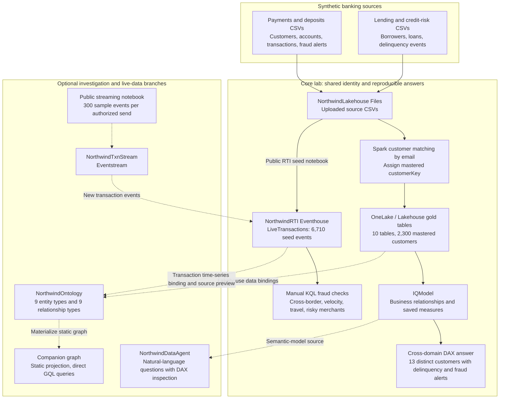
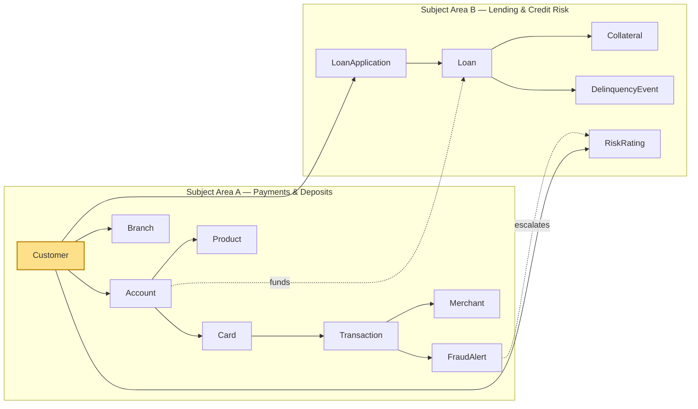
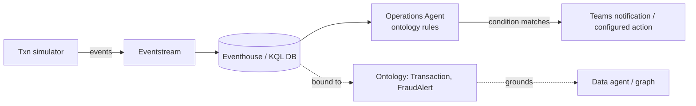

# Fabric IQ Banking POC - Current Lab Design

**Scenario:** *Northwind Financial* — a retail bank + payments processor
**Purpose:** Business use case, solution architecture, and scope of the banking lab.
**Updated:** 2026-10-14.
**Execution guide:** follow [the lab instructions](LAB.md). The historical appendix below is not a deployment guide or a claim of completed coverage.

## Business Use Case

Northwind Financial runs deposit accounts, processes card payments, and manages consumer loans. The POC connects payments fraud and lending delinquency around one customer identity, helping risk teams see issues that separate line-of-business reports can miss.

### The Business Problem

The payments system knows customers by a payments customer ID; the lending system knows them by a borrower ID. A fraud analyst sees suspicious transactions, while a credit analyst sees missed repayments. Without a shared identity, neither view reliably identifies customers affected by both.

The central question is **How many customers have both a delinquency event and a fraud alert?** The demonstration identifies the overlap for human investigation. It does not establish that fraud caused delinquency, calculate combined financial exposure, or automatically change a customer's account or credit status.

### Who Uses the Results

| Audience | Business question | Decision supported |
|---|---|---|
| Credit-risk and relationship teams | Which delinquent borrowers also have fraud alerts? | Coordinate a customer review across payments and lending. |
| Fraud analysts | Which merchants have the most fraudulent transactions or customers with seeded fraud-ring labels? | Prioritize merchant and customer investigation. |
| Risk managers | How many customers transacted at high-risk merchants? | Understand the breadth of customer exposure, not a monetary loss estimate. |
| Finance and business users | What are the fraud loss rate and loan delinquency rate? | Review consistently defined KPIs rather than inventing different calculations in each answer. |

### A Customer Journey

1. A customer holds a deposit account and makes card payments in the payments system, while also holding a loan under a different ID in the lending system.
2. A transaction has a fraud alert, and the loan has a delinquency event. Each source records its own part of the story.
3. Spark matches the synthetic customer records by email and assigns a shared `customerKey`. The customer remains one person even though the source-system IDs differ.
4. IQModel uses that mastered key to connect the fraud and delinquency facts. Its saved measure counts the customer once in the cross-domain overlap.
5. An analyst can review the result in DAX and, optionally, explore related entities in the graph or ask the Data Agent a natural-language question. Any follow-up customer action remains outside this lab.

### What the Sample Demonstrates

The synthetic data contains **2,000 payments/deposit customers** and **900 lending customers**, with **600 people present in both systems**. Entity resolution produces **2,300 distinct customers**, rather than treating all 2,900 source records as different people.

The cross-domain reference answer is **13 customers** with both a delinquency event and a fraud alert across all supplied data. This is a distinct-customer count, not a count of alerts, loans, or transactions. No last-90-days or open-alert-only restriction is implied.

Optional graph examples rank merchant fraud activity, count customers with seeded `Ring` labels, and find **1,800 customers at 11 high-risk merchants**. A separate real-time branch queries transaction events in Eventhouse. These examples add investigation context; they do not prove automated fraud prevention or discover fraud rings algorithmically.

### Why These Fabric Components

| Component | Role in the business story |
|---|---|
| OneLake / Lakehouse and Spark | Bring the two uploaded source datasets together and master customer identity before analysis. |
| Power BI semantic model | Define relationships and reusable business measures so cross-domain counts and KPIs have explicit meanings. |
| Ontology and companion graph, optional | Express customers, accounts, merchants, loans, and events as connected business entities for relationship-based investigation. |
| Eventhouse and Eventstream, optional streaming | Query transaction events and inspect newly arriving samples independently of the batch semantic model. |
| Fabric Data Agent, optional | Ask questions against IQModel and inspect the generated DAX; a fluent answer alone is not proof of correctness. |

**Success means** reconciling customer identities, reproducing the cross-domain count, and checking fraud signals with traceable queries. It does not mean deploying a production fraud service. Automated notifications/actions, Planning, external agents, and security certification have separate limitations described below.

## Current Scope

The lab demonstrates how two synthetic banking source systems can share one mastered customer identity. Its core route builds gold tables, proves a cross-domain customer count in Spark and IQModel DAX, and validates four fraud queries in Eventhouse KQL.

**Core route:** lab sections 0, 1, 1a, 2, 3.1, 5, and Final proof. Ontology, graph, AI enrichment, agents, streaming, and Planning are separate optional branches. Completing the core route does not demonstrate every Fabric IQ capability or certify production readiness.

The headline question is **How many customers have both a delinquency event and a fraud alert?** The supplied sample returns **13** over the full available data. This is not a rolling last-90-days calculation, an open-alert-only calculation, or a combined financial-exposure measure.

## Canonical Artifacts

| Role | Lab item |
|---|---|
| Tenant and workspace | `YOUR_TENANT.onmicrosoft.com`, `YOUR_WORKSPACE_NAME` |
| Gold Lakehouse | `NorthwindLakehouse`, schema `gold` |
| Combined semantic model | `IQModel`, all ten gold tables |
| Optional LOB models | `PaymentsDepositsModel`, `LendingCreditRiskModel` |
| Ontology and companion graph | `NorthwindOntology`, its static Lakehouse projection |
| Eventhouse/KQL database and table | `NorthwindRTI`, `LiveTransactions` |
| Optional Eventstream | `NorthwindTxnStream` |
| Data Agent | `NorthwindDataAgent` |
| Operations Agent | `NorthwindFraudOpsAgent` |
| Optional Plan and writeback destination | `PaymentsDepositsPlan`, `NorthwindPlanDB` |

Replace all `YOUR_*` values and sample GUIDs before running. Names such as `NorthwindGold` and `DemoOntology` in the appendix describe older deployments, not the current attendee route.

## Architecture

The diagram shows the current lab paths, not the broader historical vision. Solid arrows describe the core batch and query route; dashed arrows describe optional branches. Uploads are copies, identity resolution happens in Spark, and the graph is a materialized static projection.



**How to read the paths:** the semantic model answers the cross-domain count, the graph supports direct relationship queries, and Eventhouse runs the fraud checks. The Data Agent connects directly to IQModel. No automatic graph/Eventhouse query federation, live graph refresh, or Eventhouse-to-semantic-model refresh is implied by these arrows.

**Business relationship:** `FraudAlert -> Customer -> Loan -> DelinquencyEvent`. The shared customer links a payments fraud signal to a lending delinquency event. This supports coordinated investigation without introducing an unsupported account-to-loan funding relationship or an automated credit-review action.

### Implementation Flow

1. Upload the packaged payments, lending, and truth CSVs into Lakehouse Files. Both source systems are uploaded; this lab does not configure lending shortcuts or mirroring.
2. Run the gold-build notebook. Spark matches synthetic customer emails, creates `gold.dim_customer`, and propagates the mastered `customerKey` into the facts. The truth crosswalk scores the resolution; it is not the match input. No bronze/silver layer is built.
3. Create IQModel from all ten gold tables, configure nine relationships, refresh, and save the cross-domain measure. Optional LOB models support focused Payments Copilot and Planning exercises.
4. Load 6,710 reference events into Eventhouse and run the four fraud queries manually in KQL. Optional streaming sends 300 enriched events with fresh timestamps; it does not itself prove detection or notification delivery.
5. Optionally bind nine entity types and nine relationship types to the mastered Lakehouse tables, then materialize the static graph. The entity types are Customer, Account, Merchant, Products, Branch, Transaction, FraudAlert, Loan, and DelinquencyEvent. Card, LoanApplication, Collateral, and RiskRating are not separate ontology entities in this lab.
6. Add Transaction's Eventhouse time-series binding only after static graph acceptance. This binding does not make Eventhouse part of the materialized graph. Graph materialization ingests a static projection; do not describe it as a zero-copy live view or rematerialize the unsupported multi-source Transaction projection.
7. Demonstrate natural-language answers through NorthwindDataAgent connected directly to IQModel. Inspect the executed DAX. Ontology attachment is a separate blocked branch; direct graph GQL is independently executed and does not prove automatic GQL/KQL federation.

The implemented cross-domain relationship path is **FraudAlert -> Customer -> Loan -> DelinquencyEvent**. `Account funds Loan` and `FraudAlert escalates RiskRating` belong to the historical vision and are not implemented relationships.

## Feature Coverage

Coverage describes the supplied lab, not the availability of features in Microsoft Fabric. Optional means a separate exercise, not a passed acceptance check.

| Scope | Capability | Implementation and evidence boundary |
|---|---|---|
| Core | Gold build and entity resolution | Ten gold tables; email matching in Spark; 2,300 customers and 600 source-system overlaps. |
| Core | Combined semantic model | IQModel with nine relationships and saved `[Delinquent With Fraud] = 13`. |
| Core | Fraud detection queries | Seed-data KQL results: 500 cross-border alerts, 194 velocity cards, 148 impossible-travel cards, and 1,373 high-risk-merchant transactions. These are query results, not automated actions. |
| Optional | Eventstream | One 300-event send and matching KQL/bound-source preview evidence; no monitor/action acceptance implied. |
| Optional | LOB models and Prep for AI | Payments instructions, schema selection, two verified-answer visuals, and approval checks; broader correctness remains bounded or waived. Default context is all available data unless a date filter is requested. |
| Optional | Ontology and graph | Nine entity/relationship types; static GQL customer, hub, ring-label, and exposure checks. Identity resolution is upstream, not ontology-level multi-source matching. |
| Optional | Data Agent | Published standalone IQModel/DAX answers observed. Ontology attachment is blocked; the combined two-KPI question has an unresolved query/output mismatch. |
| Optional | Operations Agent | Supported single `amount > 10000` playbook saved; Start/Stop and matching test rows observed. Detection and Teams delivery remain unverified; no custom actions configured. |
| Optional | Planning | Payments-only proposed forecast/scenario/writeback exercise; deferred, with actuals connection and downstream acceptance incomplete. Monthly deposit history is not supplied. |
| Optional | External agent grounding | Foundry/Copilot Studio procedures depend on a published Data Agent; skipped and not validated. |
| Not Implemented | Lending shortcut/mirroring and ontology identity matching | Both source CSV sets are loaded into the Lakehouse and mastered in Spark. |
| Not Implemented | Generated-ontology comparison | Removed from the current lab; use the hand-curated NorthwindOntology. |
| Not Implemented | Full fraud automation and business-system actions | The four compound/window fraud rules are KQL checks, not an accepted Operations Agent monitor. No BlockCard, case creation, AML, or credit-review integration is built. |
| Not Implemented | Advanced graph algorithms and inferred edges | The hub query is an aggregation and the ring query counts seeded `Ring` labels. No community detection, shortest-path algorithm, or derived-edge engine is demonstrated. |
| Not Implemented | Governance/security and ALM exercises | No attendee RLS/OLS, sensitivity-label, provenance/temporal-validity, Git integration, deployment-pipeline, or one-command reset procedure is supplied. AI schema exclusions are not security controls. |
| Not Implemented | Extended financial questions | No last-90-days combined exposure measure, historical deposit growth, live RTI-to-Plan actuals feed, or cross-LOB funding-driver relationship is supplied. |

## Acceptance and Limits

Use the lab's **Final proof** and dated evidence as the acceptance record, not the older tables in the appendix. Those records include failures and waivers as well as passes. They are reference-deployment observations, not validation of an attendee's placeholder-configured environment.

**Core completion:** record the gold/Spark checks, saved IQModel DAX result of 13, and the Eventhouse seed count and four KQL results. The recorded Spark evidence was inspected saved output, not a new execution. Record optional branches separately as Passed, Pending/Blocked, or Skipped.

Check seed baselines before optional streaming/test ingestion, or use the documented seed interval afterwards. The raw Eventhouse total grows when the three Operations test rows and 300 streaming events are added; 6,710 is not the expected unrestricted count after those additions.

The recorded reference values include fraud loss rate **76.9730%** and delinquency rate **15.4661%**. A raw fraud-loss ratio near 0.77 is not 0.77%. These are synthetic demonstration values, not realistic production loss targets. Hub/ring GQL checks independently returned MER-0026/69, MER-0041/7, and 1,800 customers at 11 high-risk merchants; counting seeded ring labels is not discovering a community algorithmically.

Fresh native notebook import and the full cloud regression were waived, not passed. Operations notifications/actions, Planning, external grounding, production security, production scale, and comprehensive AI correctness are not certified. Do not infer these outcomes from saved configuration or matching answers in another engine.

## Planning Boundary

The optional Plan connects to **one semantic model**, PaymentsDepositsModel. A Fabric SQL database is the forecast writeback destination, not a prerequisite for creating Plan metadata. Follow the actual tenant connection flow described in the lab.

Deposit Balance is a current account snapshot, not monthly history. Before following the monthly forecast exercise, provide authorized dated balance snapshots and a model measure at that grain, or explicitly seed a scenario from the current balance. Do not treat repeated current balances as historical observations. Without this input, defer the monthly deposit forecast.

Fraud Loss Amount in the Plan is the Payments semantic model's batch/gold measure. No Eventhouse-to-Plan actuals feed or automatic connection between deposit forecasts and lending capacity is implemented. Any future loan-origination plan is a separate extension, not this lab's completion requirement.

## Prerequisites and Delivery

Use an authorized Fabric workspace and capacity with item-creation permissions. Copilot and optional agent branches need their additional eligible-capacity, tenant-setting, source-access, and model permissions as documented in the lab; missing AI eligibility does not make the independent core checkpoints pass or fail automatically. Foundry and Copilot Studio resources are needed only for their optional integrations.

The public bundle contains README.md, LAB.md, this design document, six notebooks, the synthetic data ZIP, and .gitignore. It does not contain a local generator, module deployment/reset folders, a CI test suite, or developer archives. All notebook execution occurs in Fabric; local Python and PowerShell are not attendee prerequisites.

Use an isolated workspace for rebuilds: gold writes overwrite tables, RTI setup drops/reloads its target, and Eventstream creation replaces a same-name stream. Do not change capacity, tenant settings, permissions, notifications, or executable actions without authorization. The full local repository retains supporting development/reference material separately.

## Historical Appendix

The original broader vision and reference-deployment notes are retained below for context. Proposed features, module folders, old artifact names, historical status tables, and product assumptions in this appendix are **not current lab requirements, supported-workflow guarantees, or completed acceptance claims**. The current scope and coverage table above take precedence.

<details>
<summary>Original design vision and historical reference deployment</summary>

> **Current-state override (2026-10-09):** the canonical environment is tenant `YOUR_TENANT.onmicrosoft.com`, workspace `YOUR_WORKSPACE_NAME` (`00000000-0000-0000-0000-000000000003`). `IQModel` is the combined cross-domain model; `PaymentsDepositsModel` and `LendingCreditRiskModel` are LOB models. The live data item is `NorthwindGold`, and the live ontology is `DemoOntology`. Earlier references in this design to `NorthwindModel`, workspace `Fabric-IQ-Banking-POC`, medallion construction, mandatory Activator, or ontology MCP are preserved only as historical design context.

---

## 1. Goals & audience

| Goal | Detail |
|---|---|
| **Complete coverage** | Every Fabric IQ item and integration is exercised by at least one hands-on module. |
| **One coherent story** | A single banking scenario threads through all modules — no disconnected toy demos. |
| **Two subject areas** | The ontology deliberately spans **two lines of business** to prove cross-domain reasoning. |
| **Real-time fraud** | Real-Time Intelligence (RTI) is the backbone of the fraud-analysis narrative. |
| **Repeatable** | The canonical notebook/portal path is rerunnable in an isolated workspace; archived deployment/reset scripts must not target shared `YOUR_WORKSPACE_NAME`. |
| **Audience** | Field/CSA teams running customer hands-on labs; customers evaluating Fabric IQ. |

---

## 2. What "all of Fabric IQ" means (feature inventory)

Fabric IQ (preview) is a **workload**, not a single tool. It delivers business context through three layers — unified data (OneLake), business intelligence (Power BI semantic models), and operational intelligence (ontologies) — plus connected reasoning (Graph), planning (Plan), and agent consumption.

| Layer | Item / feature | Must be demonstrated |
|---|---|---|
| Data foundation | OneLake, Lakehouse, **Eventhouse** | Gold Delta tables + live stream landing zone |
| Multi-source unification | Entity-resolved synthetic sources | Two source systems unified into one mastered customer key |
| Business intelligence | **Power BI semantic models** | Combined `IQModel` plus LOB-specific measures and KPIs |
| BI trust layer | **Verified answers + custom instructions** | Curated, governed Q&A on the model |
| Operational intelligence | **Ontology** | Entity types, properties, relationships, rules, **actions**, **data bindings (no copy)** |
| Identity | **Entity resolution / identity keys** | One `Customer` materialized in `gold.dim_customer` and propagated by `customerKey` |
| Model → ontology | Generate ontology from semantic model | Keep BI + operational language consistent |
| Connected reasoning | **Graph** | Traversal + **graph algorithms** (paths, centrality, community) for fraud rings |
| Real-time | **Eventstream + Eventhouse** | Live transaction stream landing |
| Operational agent | **Operations agent** | Monitor ontology signals, notify Teams, and invoke supported configured actions; Activator is optional |
| Planning | **Plan** | Driver-based forecast/budget + plan-vs-actuals |
| Consumption | **Fabric data agent** (NL2Ontology) | Conversational Q&A grounded in ontology, **published to M365/Foundry/Copilot Studio/apps** |
| Agent grounding | **Foundry / Copilot Studio / published Fabric data agent** | External agents use the data agent's supported tool/MCP integration |
| Federated query | **NL2Ontology → GQL/KQL auto-routing** | One business question, federated across Graph + Eventhouse |
| Governance | Provenance, temporal validity, data-quality checks, RLS, sensitivity labels, lineage | Explainable, governed answers end-to-end |
| ALM | **Git integration + deployment pipelines** | Repo-driven, promotable, resettable POC |

> Product behavior changes during preview. The current walkthrough, not this historical inventory, is authoritative for UI names and prerequisites.

---

## 3. Business narrative

Northwind Financial issues debit/credit cards, runs deposit accounts, originates consumer loans, and processes millions of card transactions through merchants. Three audiences ask questions of the same data in different "languages":

- **Finance / exec** — deposit growth, net interest margin, fee income, loan book health.
- **Risk / fraud ops** — real-time card fraud, AML review, fraud-ring exposure.
- **Branch / relationship managers** — customer 360, cross-sell, retention.

Today these live in separate reports and separate vocabularies. With Fabric IQ we build **one governed business context** so people *and* agents reason in terms of `Customer`, `Account`, `Card`, `Transaction`, `Merchant`, `Loan`, `FraudAlert` — then report, forecast, detect fraud rings, and **act in real time**.

**Why banking is the ideal Fabric IQ story:** it needs *both* analytical intelligence (semantic-model KPIs) *and* operational intelligence (ontology rules + real-time action). Fabric IQ is the only layer that unifies both.

---

## 4. Two subject areas (the cross-domain ontology)

The ontology spans **two lines of business**, joined by a shared `Customer`. The current combined `IQModel` can answer the cross-domain measure in DAX; the ontology and graph provide an independent relationship-centric route to the same answer.

### Subject Area A — Payments & Deposits
> Day-to-day banking and card payment processing. High-volume, real-time.

| Entity | Key properties |
|---|---|
| `Customer` *(shared)* | customerId, name, segment, riskScore, region |
| `Account` | accountId, type, balance, status, openedDate |
| `Card` | cardId, network, status, issuedDate |
| `Transaction` | txnId, amount, currency, timestamp, channel, geo, mcc |
| `Merchant` | merchantId, name, category, country, riskFlag |
| `Branch` | branchId, name, region |
| `Product` | productId, name, family (checking/savings) |
| `FraudAlert` | alertId, type, severity, status, raisedAt |

### Subject Area B — Lending & Credit Risk
> Loan origination and credit-risk management. Slower cadence, exposure-driven.

| Entity | Key properties |
|---|---|
| `Customer` *(shared)* | *(same entity as above)* |
| `LoanApplication` | applicationId, requestedAmount, status, submittedDate |
| `Loan` | loanId, principal, rate, term, balance, dpd (days past due) |
| `Collateral` | collateralId, type, value |
| `DelinquencyEvent` | eventId, dpdBucket, flaggedAt |
| `RiskRating` | ratingId, grade, pdScore, asOfDate |

### Cross-subject-area relationships (why the unified ontology matters)
- `Customer` **holds** `Account` (A) **and owns** `Loan` (B) → one customer, two LOBs.
- `Account` **funds** `Loan` disbursement / repayment (A↔B money flow).
- **Cross-domain rule:** a `Customer` with an open `FraudAlert` (A) who also holds a `Loan` (B) escalates credit-risk review — *fraud signal informs lending exposure*.
- **Cross-domain question the demo answers:** *"Which delinquent borrowers also had card-fraud alerts in the last 90 days, and what's our combined exposure?"* — spans both subject areas via the shared `Customer`.

### Two source systems + entity resolution (the real cross-domain glue)
The point is not just "one diagram with two boxes" — the two subject areas come from **two different source systems**, and Fabric IQ unifies them:
- **Area A (Payments & Deposits)** lands as native Lakehouse/Eventhouse tables (core banking + card switch).
- **Area B (Lending & Credit Risk)** is brought in via **OneLake shortcut/mirroring** from a separate lending system — demonstrating OneLake multi-source unification **without ETL or copying**.
- The shared `Customer` is achieved through **entity resolution**: the `Customer` entity type has **multi-source data bindings** with **identity keys** mapping `payments.customerId` and `lending.borrowerId` to one governed entity instance. This is what makes the cross-domain question answerable — and it's a headline governance/identity demo beat.



---

## 5. Real-Time Intelligence for fraud (the RTI spine)

Fraud analysis is built on RTI end-to-end, showing streaming → detection → action:



**RTI fraud rules (authored on the ontology, executed by the Operations Agent over Eventhouse):**

| Rule | Logic | Action |
|---|---|---|
| High-value cross-border | `Transaction.amount > $10,000` AND `geo != home country` | Notify fraud team / recommend AML review |
| Card velocity | Same `Card` used at ≥3 `Merchant`s within 5 min | Velocity FraudAlert (high severity) |
| Impossible travel | Two `Transaction`s, same `Card`, geographies too far apart for elapsed time | Block-card recommendation |
| High-risk merchant | `Transaction` at `Merchant.riskFlag = true` | Watchlist FraudAlert |

The **Operations Agent** reasons over live and historical Eventhouse data mapped through the ontology, then notifies Teams or invokes a supported configured action with business context.

**Ontology actions (not just alerts).** Beyond entities, relationships, and rules, the ontology declares **governed actions** that agents know how to invoke. The Operations Agent doesn't only raise an alert — it recommends/triggers a defined action with business context:

| Action | Invoked when | Effect |
|---|---|---|
| `BlockCard(cardId)` | Impossible-travel / high-severity velocity | Card status → blocked, notify customer |
| `OpenFraudCase(customerId)` | Any high-severity FraudAlert | Create case, assign to fraud ops |
| `EscalateAMLReview(txnId)` | High-value cross-border rule | Route to AML queue |
| `EscalateCreditReview(customerId)` | Cross-domain: FraudAlert on a borrower | Flag RiskRating for re-review (Area A→B) |

Actions make the demo end at *"the system acted,"* not *"the system noticed"* — and the cross-domain `EscalateCreditReview` action is the moment the two subject areas visibly connect in real time.

---

## 6. Module map (hands-on labs)

Each module = a lab folder with deploy script + facilitator guide + attendee guide + reset script.

| # | Module | Fabric IQ feature | Demo outcome |
|---|---|---|---|
| 0 | **Foundation** | OneLake + Lakehouse | Ten gold banking tables from the synthetic generator |
| 1 | **Semantic model** | Power BI semantic models | Combined `IQModel` plus LOB-specific KPIs and hierarchies |
| 2 | **Trusted Q&A** | Verified answers + custom instructions | Curated answers + default time scope; governed BI Q&A |
| 3 | **Ontology — Area A** | Entity types, properties, relationships, rules, bindings | Payments & Deposits entities bound to Gold tables (no copy) |
| 4 | **Ontology — Area B + cross-domain** | Second subject area + cross-area relationships | Lending entities added; shared `Customer` unifies both LOBs |
| 5 | **Model → ontology** | Generate ontology from semantic model | Show BI + operational layers staying consistent |
| 6 | **Graph** | Graph nodes/edges/traversal | Fraud-ring detection: Card→Merchant→Card→Customer walks |
| 7 | **RTI fraud** | Eventstream + Eventhouse + Operations Agent | Live transaction → rule matches → Teams/configured action |
| 8 | **Data agent** | NL2Ontology conversational Q&A | Cross-domain NL question grounded in ontology |
| 9 | **Planning** | Plan (no-code, driver-based forecast/budget) | Payments & deposits operating plan (balances, volume, fee income, fraud-loss provision) vs actuals + loan-origination plan |
| 10 | **Agent grounding** | Foundry / Copilot Studio / published Fabric data agent | External agent calls the supported Fabric data-agent tool/MCP endpoint |
| 11 | **Governance & lineage** | Provenance, temporal validity, data-quality checks, RLS, sensitivity labels, connection-identity | Explainable, governed answer traced end-to-end |
| 12 | **ALM / CI-CD** | Git integration + deployment pipelines (`fabric-cicd`) | Repo-driven provision, promote dev→test, one-command reset |

**Suggested session flow (half-day hands-on):** 0 → 1 → 2 (BI track) → 3 → 4 → 5 (ontology track) → 6 → 7 (reasoning + real-time) → 8 → 10 (consumption) → 9 → 11 (planning + governance wrap). Modules 9, 11, 12 are optional depending on time.

---

## 7. Artifact specifications (for scaffolding)

### 7.1 Semantic model (Module 1)
- **Measures:** Delinquent With Fraud (combined model); Fee Income, Transaction Volume, Fraud Loss Rate, Fraud Loss Amount, Deposit Balance (payments model); Loan Book Balance and Delinquency Rate (lending model).
- **Hierarchies:** Date (Year→Quarter→Month→Day), Geography (Region→Branch), Product (Family→Product).
- **Custom instructions:** default time scope = last complete quarter; always express fraud as a rate unless asked for $.
- **Verified answers:** "Top merchants by fraud loss", "Fraud loss rate by region", "Deposit growth QoQ", "Delinquency rate by product".

### 7.2 Ontology (Modules 3–5)
- Two subject areas as in §4; entity types bound to Gold Lakehouse/Warehouse tables and Eventhouse (`Transaction`, `FraudAlert`).
- **Multi-source bindings + entity resolution:** `Customer` bound across the payments source and the (shortcut/mirrored) lending source via identity keys → one governed entity instance.
- **Properties** carry semantic annotations (identifier), units, and **data-quality checks** (nullability, ranges, uniqueness).
- **Relationships** carry attributes (`confidence`, `effectiveAt`) and cardinality rules (e.g., one `Customer` → many `Account`s).
- Cross-area relationships: `Account funds Loan`, `FraudAlert escalates RiskRating`.
- **Rules:** the four RTI fraud rules (§5) + `Account.balance < minimum → fee event` + `Loan.dpd > 30 → delinquency watchlist`.
- **Actions:** `BlockCard`, `OpenFraudCase`, `EscalateAMLReview`, `EscalateCreditReview` (§5) — governed, agent-invocable.
- **Entity instances** track provenance (source system) and temporal validity ("when it was true").

### 7.3 Graph (Module 6)
- Nodes: Customer, Card, Merchant, Account, Loan. Edges: asserted (from bindings) **and derived** (inferred fraud links).
- **Graph algorithms:** community detection (fraud rings sharing merchants/devices), centrality (highest-risk hub merchant/customer), shortest path / traversal (money-flow, "customers within 2 hops of a flagged merchant").
- **Federated routing demo:** the same NL question resolves to GQL (Graph) vs KQL (Eventhouse) automatically via NL2Ontology.
- Note the **manual graph refresh** gotcha after upstream data changes.

### 7.4 Data agent (Module 8)
**Question bank:**
- "What's our fraud loss rate by region last quarter?" *(BI)*
- "Show cards used at 3+ merchants in under 5 minutes yesterday." *(ontology/real-time)*
- "Which delinquent borrowers also had card-fraud alerts in the last 90 days?" *(cross-subject-area)*
- "What's our combined credit + fraud exposure for customer segment X?" *(cross-domain)*

**Publishing surfaces:** demonstrate the data agent published to **Microsoft 365 / Teams, Azure AI Foundry, Copilot Studio, and a custom app** — same governed answers, multiple front ends.

### 7.5 Planning (Module 9)
A **driver-based Payments & Deposits operating plan** (Subject Area A) plus a loan-origination plan (Subject Area B), so planning spans both LOBs like the ontology does.

**Payments & Deposits plan lines (driver-based):**

| Plan line | Planned by | Driver logic |
|---|---|---|
| Deposit balances | Product (checking/savings) × Region/Branch × Quarter | `# accounts × avg balance/account` |
| Payment volume | Channel / network × Quarter | `# active cards × txns/card × avg ticket` |
| Fee / interchange income | Product × Quarter | `payment value × interchange bps + account fees` |
| Fraud-loss provision | Region × Quarter | `payment value × expected fraud bps` |

**What makes it a Fabric IQ planning story (not a spreadsheet):**
1. **Actuals vs Plan from the same governed context** — deposit balances, transaction volume, and fee income actuals come from the **Gold semantic model**; **actual fraud losses come from the RTI/Eventhouse fraud stream**. The plan's fraud-loss provision is compared against real-time detected fraud, closing the loop between Module 7 (RTI) and Module 9.
2. **Cross-subject-area driver linkage** — planned deposit balances drive fundable loan capacity, so the Payments/Deposits plan and the Lending origination plan share drivers through the ontology's `Account funds Loan` relationship.

**Inputs:** historical deposit balances, card transaction volume, fee income, fraud-loss actuals, loan originations.
**Demo beat:** "We provisioned 8 bps of fraud loss; RTI shows 11 bps this quarter — here's the variance and the merchants driving it."

### 7.6 Agent grounding (Module 10)
- Foundry agent using the published Fabric data agent as a tool.
- Custom MCP client using the published Fabric data agent's supported endpoint.
- Optional Copilot Studio agent for a business-user front end.

---

## 8. Synthetic data

A deterministic generator (`data/generator/`) produces referentially-consistent banking data:
- Customers with segments/regions; a subset span both LOBs (hold accounts *and* loans).
- **Two source systems with different keys** — payments emits `customerId`, lending emits `borrowerId`; an overlap set maps to the same real customer so **entity resolution** has something to resolve.
- Accounts, cards, products; loans, applications, collateral, delinquency, risk ratings.
- Transactions with realistic MCC/geo/channel, plus **seeded fraud patterns** (velocity bursts, cross-border high-value, **fraud rings sharing merchants/devices**) so every rule, action, and graph algorithm (community/centrality/path) has hits.
- A **streaming mode** replays transactions to the Eventstream for the RTI module.
- No PII; fully synthetic; seedable for reproducibility.

---

## 9. Proposed repo structure

```
fabric-iq-banking-poc/
├── README.md                     # scenario, architecture, lab index, prerequisites
├── docs/
│   ├── Fabric-IQ-Banking-POC-Design.md   # this document
│   └── architecture.md           # diagrams + data dictionary
├── data/generator/               # synthetic banking data (batch + streaming modes)
├── 00-foundation/                # notebook + historical automation for the gold build
├── 01-semantic-model/            # TMDL / measures / KPIs / hierarchies
├── 02-verified-answers/          # verified answers + custom instructions
├── 03-ontology-payments/         # subject area A: entities, rels, rules, bindings
├── 04-ontology-lending/          # subject area B + cross-area relationships
├── 05-model-to-ontology/         # generate ontology from semantic model
├── 06-graph/                     # graph build + traversal (ring detection)
├── 07-realtime-fraud/            # eventstream + eventhouse + operations agent
├── 08-data-agent/                # data agent config + NL question bank
├── 09-planning/                  # plan setup + forecast inputs
├── 10-agents/                    # Foundry / Copilot Studio through a published data agent
├── 11-governance/                # lineage / access / provenance / RLS / labels walkthrough
├── 12-alm/                       # Git integration + deployment pipelines (fabric-cicd)
├── deploy/                       # az/fab CLI + REST deploy + reset scripts (idempotent)
└── labs/                         # facilitator + attendee guides per module
```

---

## 10. Deployment approach
- **Idempotent** deploy scripts (PowerShell + `fab` CLI / Fabric REST) so a session can be provisioned and reset repeatedly.
- Workspace-parameterized (capacity, workspace name, region) via a single config file.
- Each module can run standalone *or* as part of the full chain.
- A top-level `deploy/provision-all.ps1` and `deploy/reset-all.ps1`.

---

## 11. Prerequisites (to confirm)
- Fabric capacity with the **IQ (preview)** workload enabled.
- Power BI / Fabric admin toggles: Copilot/AI, Data agent, Fabric IQ MCP endpoint.
- Permissions to create Lakehouse, Eventhouse, Eventstream, Semantic model, Ontology, Graph, Plan, Data agent, and **Operations Agent**.
- Ability to create **OneLake shortcuts / mirroring** for the lending source system (Module 4).
- **Git integration** (Azure DevOps / GitHub) enabled on the workspace + deployment pipelines (Module 12).
- (Module 10) Azure AI Foundry project for the Foundry IQ / custom agent; Copilot Studio (optional).

---

## 12. Open questions / assumptions
1. **Target tenant/capacity** — which Fabric workspace + capacity should the POC deploy into? (Cross-tenant considerations noted from existing workspace assets.)
2. **Preview availability** — confirm Ontology, Graph, Plan, and Data agent are all enabled on the target capacity/region.
3. **Deploy tooling preference** — `fab` CLI vs raw REST vs Terraform for the provisioning scripts.
4. **Session length** — half-day vs full-day determines whether Planning + Governance are core or optional.
5. **Data volume** — demo-scale (thousands) vs stress-scale (millions of transactions) for the RTI stream.

---

## 13. Feature coverage matrix (completeness check)

Fine-grained confirmation that no Fabric IQ capability is orphaned. Each row maps to the module(s) that exercise it.

| Fabric IQ capability | Covered in |
|---|---|
| OneLake, Lakehouse, gold build | 0 |
| Multi-source unification (shortcut / mirroring / catalog) | 0, 4 |
| Power BI semantic model — measures, hierarchies, KPIs | 1 |
| Verified answers | 2 |
| Custom instructions | 2 |
| Ontology entity types & properties | 3, 4 |
| Property semantic annotations, units, data-quality checks | 3, 11 |
| Relationships (attributes, confidence, effectiveAt, cardinality) | 3, 4 |
| Business rules | 3, 7 |
| **Ontology actions** (BlockCard, OpenFraudCase, Escalate…) | 3, 7 |
| Data bindings (no copy) | 3, 4 |
| **Entity resolution / multi-source identity keys** | 4 |
| Entity instances — provenance & temporal validity | 4, 11 |
| Cross-subject-area relationships (two LOBs) | 4 |
| Generate ontology from semantic model | 5 |
| Graph traversal | 6 |
| **Graph algorithms** (community, centrality, path) | 6 |
| Derived edges / rule-driven inference | 6 |
| Federated query routing (NL2Ontology → GQL/KQL) | 6, 8 |
| Eventstream + Eventhouse (live stream) | 7 |
| **Operations agent** | 7 |
| **Operations Agent** notifications/configured actions | 7 |
| Real-time + historical reasoning over ontology | 7 |
| Fabric data agent (NL2Ontology Q&A) | 8 |
| Data agent publishing (M365 / Foundry / Copilot Studio / apps) | 8, 10 |
| Plan — driver-based forecast/budget | 9 |
| Plan-vs-actuals (incl. RTI fraud actuals) | 9 |
| Foundry agent using the published Fabric data agent | 10 |
| Copilot Studio agent | 10 |
| Custom agent via the published Fabric data agent | 10 |
| Governance — provenance, lineage, grounding | 11 |
| Security — RLS, sensitivity labels, connection-identity | 11 |
| Manual graph refresh (operational gotcha) | 6, 11 |
| ALM — Git integration + deployment pipelines | 12 |

**Deliberately out of scope (call out to customers):** OneLake external data-source authoring beyond shortcut/mirror demo; production-grade fraud ML models (we use rule + graph heuristics); Purview end-to-end catalog integration (mention, don't build); Work IQ / Web IQ (part of Microsoft IQ but outside Fabric IQ).

---

## 14. Next step
On approval of this design, scaffold the repo per §9: `README.md`, `data/generator/` (batch + streaming synthetic data), the module folders with lab guides, and the idempotent `deploy/` scripts — starting with Module 0 (foundation) and Module 7 (RTI fraud) as the two anchor labs.

---

## 15. Build-status and documentation-review history

The tables in §15.1-15.4 record the September 2026 reference deployment. They are historical evidence, not the status of the current `YOUR_WORKSPACE_NAME` implementation.

### 15.1 Historical reference verification (API-built and confirmed)

| Module | Status | Proof |
|---|---|---|
| 0 Foundation (medallion + entity resolution) | ✅ verified | 2,300 masters; 600 both-LOB customers |
| 1 Semantic model (Direct Lake, KPIs) | ✅ verified | NIM/DelinqRate/etc.; cross-domain DAX = 13 |
| 3–4 Ontology (2 subject areas, 9 entities/9 rels, static bindings to gold) | ✅ verified | GQL walk = 13 |
| 6 Graph (ring detection / centrality) | ✅ verified | ring merchant 7 members; 1,800 exposed |
| 7 RTI fraud **detection** (Eventhouse + 4 KQL rules) | ✅ verified | 500 / 194 / 148 / 1,373 alerts |
| 8 Data agent (scaffold + AI instructions) | ✅ verified | instructions round-trip |

**Historical headline proof:** the archived `NorthwindModel` deployment returned **13** identically from Spark, DAX, and GQL. Re-run the `IQModel` measure and current graph before making this claim about `YOUR_WORKSPACE_NAME`.

### 15.2 Portal / preview by product design (not fully API-verifiable)
- **Data agent** — attach data source(s) + publish + ask (portal "Add a data source"; the `datasource.json` ALM schema has no API artifact-binding).
- **RTI action layer** — Eventstream topology wiring and **Operations Agent** notifications/actions. Activator is optional for a separate workflow.
- **Prep for AI** (see §15.3) — authored in Power BI Desktop / service.
- **Planning** — entirely no-code portal (see §15.3).
- **Agent grounding** — Foundry IQ / Copilot Studio; **ontology MCP** for custom agents.
- **Governance** — RLS / sensitivity labels / lineage; **ALM** — Git + deployment pipelines.

### 15.3 Newly-identified topics from the doc review (add to hands-on)

| Topic | Where | Buildability |
|---|---|---|
| **Ontology time-series binding to Eventhouse** (bind `Transaction`/`FraudAlert` TS props to `NorthwindRTI`) — ties RTI *into* the ontology | 3–4 + 7 | **API** (updateDefinition) ⭐ |
| **Generate ontology from a semantic model** (`concepts-generate`) — BI↔operational alignment | 5 | Portal/API |
| **Prep for AI** = the real Module 2: **Verified answers**, **AI instructions**, **AI data schemas**, **Approved for Copilot** (Power BI Q&A) | 2 | Portal (Power BI) |
| **Operations Agent rules and configured actions** (Teams/actions grounded in ontology) | 3 + 7 | Portal |
| **Standalone Graph item + visual query builder** (vs. only the ontology companion graph) | 6 | Portal/API |
| **Real-Time dashboard / KQL queryset** over `LiveTransactions` | 7 | API/Portal |
| **Operations agent grounded in ontology** (`how-to-create-operations-agent`) | 7 | Portal |
| **Foundry IQ agent** + **Copilot Studio agent** + **custom agent via ontology MCP** | 10 | Portal/Foundry |
| **Data agent 5-source mix** incl. **Microsoft Graph**; publish to M365/Teams/Copilot Studio/apps | 8, 10 | Portal |
| **Planning full track**: planning sheets, **PowerTable**, **Intelligence sheets**, **Infobridge** (blend live measures), **Optimizer**, **Predict** (statistical forecast), **scenarios**, **Measure/Row model** builders, **Cube measures**, **write-back to Fabric SQL DB**, plan-vs-actuals | 9 | Portal (no-code) |
| **Multi-source via shortcut/mirroring** — physically ingest Area B (lending) via mirror/shortcut (currently both LOBs loaded as native CSV) | 0, 4 | API |
| **Ontology limitations to note**: no versioning; manual graph refresh; OneLake-security & column-mapped delta unsupported as binding sources; keys must be String/BigInt | 3, 11 | Doc |
| **Tenant-setting prerequisites** for Ontology + Data agent (admin-enabled) | prereq | Doc |

### 15.4 Module renames / corrections
- **Module 2** is properly **"Prep for AI"** (Power BI): Verified answers + AI instructions + AI data schemas + Approved for Copilot — not a generic "verified answers" step.
- **Module 9 (Planning)** expands well beyond the driver-based plan in §7.5 into a full EPM/CPM track (PowerTable / Intelligence / Infobridge / Optimizer / Predict / scenarios / Measure & Row model / Cube / SQL write-back).
- **Module 7** uses an Operations Agent grounded in the ontology. Treat Activator as an optional adjacent workflow capability, not a required dependency.

### 15.5 Current acceptance status (2026-10-09)

| Area | Current status |
|---|---|
| Gold data and deterministic expected values | historical outputs available; rerun notebook in selected workspace |
| `IQModel` all 10 tables | live item exists |
| `IQModel` nine relationships + full refresh | notebook authored; execution evidence pending |
| `IQModel` cross-domain DAX = 13 | acceptance criterion; current evidence pending |
| LOB models | both live items exist; payments rebuild notebook authored |
| Ontology/graph | `DemoOntology` and companion graph exist; rerun counts/GQL |
| RTI | `NorthwindRTI` and `NorthwindTxnStream` exist; rerun KQL counts |
| Data agent | multiple live candidates; select one, publish it, and capture answer 13 |

The current demo is fully validated only after these pending checks are captured from tenant YOUR_TENANT.

</details>

