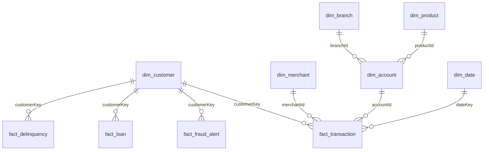
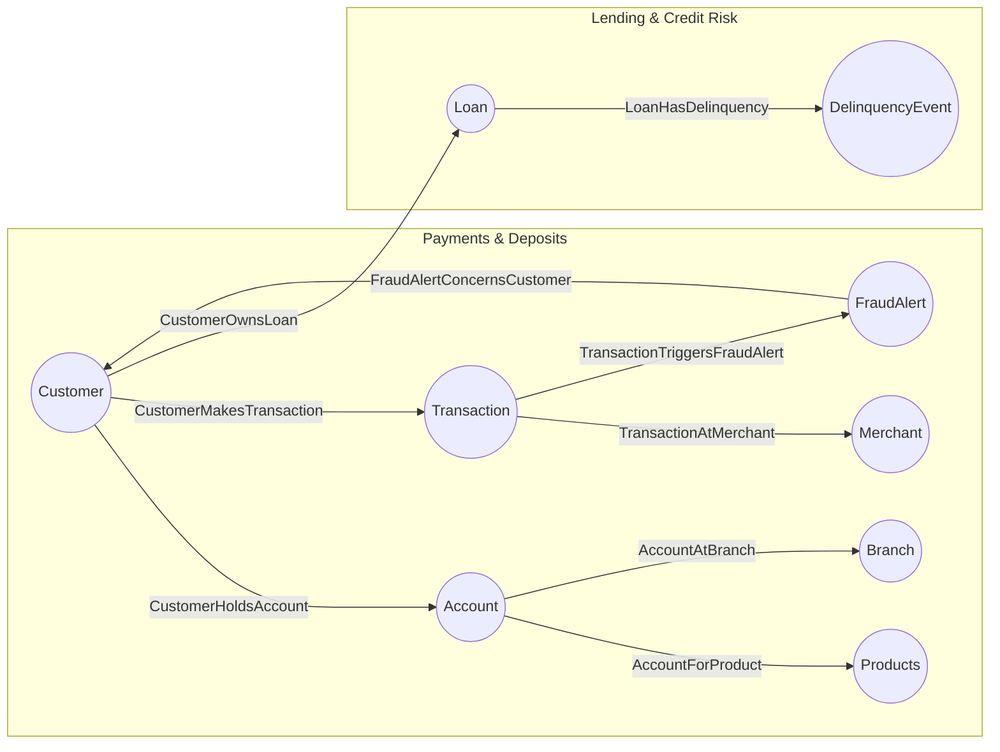

# Fabric IQ Banking POC — End-to-End UI Walkthrough

Build or validate the **Northwind Financial POC in Microsoft Fabric**. The canonical environment is tenant **YOUR_TENANT.onmicrosoft.com** (`00000000-0000-0000-0000-000000000001`), workspace **`YOUR_WORKSPACE_NAME`** (`00000000-0000-0000-0000-000000000003`). Core acceptance is the headline cross-domain answer **13** in Spark and `IQModel` DAX, plus the Eventhouse fraud-rule results. Ontology graph (GQL) and data-agent answers extend that proof through optional preview branches. Record each checkpoint only after executing it in this workspace; core completion is not full-lab completion.

**Audience:** facilitators and hands-on attendees.
**Start here:** this is the single attendee guide, including prerequisites, sample-data upload, notebook execution, checkpoints, and troubleshooting. Use the supplied data ZIP and execute the notebooks in Fabric; no local Python or PowerShell is required.
**Time:** ~3–4 hours for modules 0–8; the portal-only modules (Planning §10 and Agent grounding §11) add ~1–2 hours.
**Note:** Fabric IQ features are in preview — screen names and button placement change. Treat each step as *intent + sequence* and adapt to the current UI. Where a step is inherently code (synthetic data, Spark transforms, DAX, GQL, KQL), you author it in a Fabric **browser** editor (notebook / model / query set) and paste the snippet from this repo — that is still the UI path.

Values to expect at each checkpoint (demo scale, default seed):
`2300` mastered customers · `600` in both LOBs · `48,710` transactions · cross-domain **`13`** · fraud rules `500 / 194 / 148 / 1373` · Eventhouse rows `6,710`.

## Canonical names

| Role | `YOUR_WORKSPACE_NAME` item |
|---|---|
| Gold Lakehouse | `NorthwindLakehouse` |
| Combined semantic model | `IQModel` |
| LOB semantic models | `PaymentsDepositsModel`, `LendingCreditRiskModel` |
| Ontology | `NorthwindOntology` |
| Eventhouse/KQL database | `NorthwindRTI` |
| Eventstream | `NorthwindTxnStream` |
| Data agent | `NorthwindDataAgent` |

Use these names throughout the run; do not switch workspaces or mix names from another deployment.

> **Build order:** the sections below are ordered so you can run them **top to bottom** with no forward jumps. The **Module N** tag on each heading is the *curriculum* label; the *section number* is the *build* order. Notably, **RTI (Module 7)** is built **before** the ontology (so the Transaction time-series binding works in place), and the **data agent (Module 8)** is built **before** graph analysis (so the natural-language questions work).

## How to follow this walkthrough

### Notebook Checklist

Start with sections 0 and 1 below, upload the packaged synthetic data in section 2.2, then import the notebooks below into your configured workspace. Replace `YOUR_*` values and sample GUIDs, and set each notebook's default lakehouse where needed. Local Python and PowerShell are not attendee prerequisites. Follow this walkthrough's build order; do not run every notebook indiscriminately.

| Walkthrough section | Notebook | Before running / expected checkpoint |
|---|---|---|
| 2 | [Load files into gold tables](notebooks/01-load-gold-tables.ipynb) | Attach the upload lakehouse; expect 10 gold tables, 2,300 mastered customers, and 48,710 transactions. **Rebuilds gold tables.** |
| 3.1 | [Configure IQModel relationships](notebooks/02-configure-iqmodel.ipynb) | Create combined IQModel in the UI first. Then add/check the walkthrough's cross-domain measure; reference result: 13. |
| 3.2, optional alternative | [Payments model only](notebooks/optional-payments-model.ipynb) **or** [both LOB models](notebooks/optional-two-lob-models.ipynb) | Choose one builder; the two-model notebook also creates PaymentsDepositsModel. Neither is a replacement for combined IQModel. Review overwrite behavior on existing models. |
| 5 | [Seed RTI](notebooks/03-load-rti.ipynb) | Configure the source lakehouse and KQL database; expect 6,710 seed events. **Drops/reloads the target table.** Apply the fraud-rule KQL from section 5 separately. |
| 5, optional streaming | [Configure Eventstream](notebooks/04-create-eventstream.ipynb) | Requires the target KQL database/table. **Replaces the same-name stream and sends 300 events once.** Verify ingestion with queries instead of rerunning the send. |

Use an isolated lab for rebuilds and replacements. Prep for AI, ontology, time-series bindings, agents, and Planning remain UI procedures below; they do not require separate developer automation.

### Navigation Conventions

These instructions assume only basic Fabric navigation. Use the following conventions throughout:

1. Start each procedure from **Workspaces → YOUR_WORKSPACE_NAME** unless it names a different starting screen.
2. A path such as **More options (… ) → Settings → General** means select each control in order. Do not search for the whole phrase.
3. **Workspace** means the item list for `YOUR_WORKSPACE_NAME`. Select the workspace name in the left navigation to return there.
4. **Explorer** means the left pane inside an open Fabric item. Expand a parent item with its chevron before looking for a child.
5. If a left or right pane is collapsed, select its edge arrow or pane icon to expand it. At narrow browser widths, Fabric moves some commands under **More options (… )** or **More…**.
6. When two rows have the same name, use the **Type** column or icon. In particular, choose the `NorthwindLakehouse` **Lakehouse**, not its SQL analytics endpoint, unless a step explicitly says SQL analytics endpoint.
7. After selecting **Create**, **Save**, **Apply**, **Refresh**, or **Run**, wait for the success notification or idle/completed status before continuing.
8. Do not create a second same-named item when one already exists. Open the existing item, compare it with the checkpoint, and resume at the first missing step.
9. On trial capacity, stop a Spark session after a notebook finishes: **Run → More items → Stop session**. Do not mark paid Copilot, data-agent, or operations-agent checkpoints as passed on Trial.
10. Record the value shown at every **Checkpoint**. A procedure is complete only when its checkpoint matches.

### Core flow and preview branches

**Core route:** sections **0 → 1 → 1a → 2 → 3.1 → 5 → Final proof**. Keep the existing build order when taking retained optional branches. The generated-ontology comparison exercise is removed at the user's request; section numbers are retained.

| Label / section | Hands-on scope | If unavailable or blocked |
|---|---|---|
| **CORE**: sections 2, 3.1, and 5 | Gold build, saved cross-domain DAX, Eventhouse/KQL fraud rules | Record the affected core checkpoint as blocked; do not replace it with a preview result. |
| **PREVIEW DEPENDENCY**: Lakehouse schemas in 2.1; TMDL repair in 3 | This build requires the existing `gold` schema; TMDL is one repair method | Reuse the prepared lakehouse/model where available. Otherwise stop the affected core checkpoint for facilitator setup; do not silently change schemas or claim success. |
| **OPTIONAL AI ENRICHMENT**: section 4 | Prep for AI and Copilot; section 3.2 LOB models support these focused demos | Record pending and continue to section 5. This does not classify all Copilot functionality as preview. |
| **OPTIONAL PREVIEW**: sections 6.1-6.5 | Hand-curated ontology, static graph, and time-series binding | Preserve existing items; continue to section 7 or Final proof. Section 9 requires a usable hand-curated graph. |
| **OPTIONAL PREVIEW**: section 6.6 | Operations Agent playbook and actions | Without a valid playbook, leave the agent stopped and continue to section 7. Teams/actions still require approval. |
| **REMOVED**: section 7 | Generated-ontology comparison exercise | Use the working NorthwindOntology from section 6; continue to section 8. |
| **OPTIONAL PREVIEW**: section 8 | Fabric Data Agent | Continue to section 9 if its graph prerequisite is met; otherwise Final proof. No agent answer is required for core completion. |
| **OPTIONAL PREVIEW**: section 9 | Ontology graph investigation | Continue to section 10 or Final proof; retain Spark/DAX evidence. |
| **OPTIONAL PREVIEW**: section 10 | Fabric IQ Planning | Continue to section 11 or Final proof. Currently deferred in this run. |
| **OPTIONAL INTEGRATION / PREVIEW-DEPENDENT**: section 11 | External grounding depends on a published Fabric Data Agent | Continue to Final proof. Currently skipped; this does not label every Foundry or Copilot Studio feature as preview. |

Record each optional branch as **Passed**, **Pending/Blocked** (with the reason), or **Skipped**. A missing command, capacity restriction, unsupported binding, or failed generation is a branch exit, not a reason to repeat unchanged attempts. Preserve its artifacts and return to the route above. Preview availability and labels can change; check the current tenant UI before delivery.

---

## Contents
- [0. Prerequisites and workspace](#0-prerequisites-and-workspace)
- [1. Get the data files](#1-get-the-data-files)
- [1a. Understand the data (read before building)](#1a-understand-the-data-read-before-building)
- [2. Lakehouse and gold build (Module 0)](#2-lakehouse-and-gold-build-module-0)
- [3. Direct Lake semantic models (Module 1)](#3-direct-lake-semantic-models-module-1)
- [4. Prep for AI (Module 2) - optional AI enrichment](#4-prep-for-ai-module-2)
- [5. Real-Time Intelligence: fraud (Module 7)](#5-real-time-intelligence-fraud-module-7)
- [6. Ontology: two subject areas (Modules 3-4) - optional preview](#6-ontology-two-subject-areas-modules-3-4)
- [7. Working ontology route](#7-working-ontology-route)
- [8. Data agent (Module 8) - optional preview](#8-data-agent-module-8)
- [9. Graph analysis (Module 6) - optional preview](#9-graph-analysis-module-6)
- [10. Planning (Module 9) - optional preview](#10-planning-module-9)
- [11. Agent grounding (Module 10) - optional preview-dependent integration](#11-agent-grounding-module-10)
- [Final proof](#final-proof)

---

## 0. Prerequisites and workspace

**Goal:** confirm tenant YOUR_TENANT has the required features and use the existing `YOUR_WORKSPACE_NAME` workspace.

**Feature:** *Fabric tenant settings & workspaces* — admin toggles switch on the preview workloads (Ontology, Data agent, Operations agent, Copilot) and a capacity-backed **workspace** is the security, collaboration, and billing boundary for everything you build.

### 0.0 Get the repository and sign in

1. Open [the public repository](https://github.com/kollasriram/fabric-iq-banking-poc) and select **Code → Download ZIP**, then extract it locally. Cloning the repository is an optional alternative.
2. Open the extracted project folder in File Explorer. Confirm it contains `README.md`, `LAB.md`, `notebooks`, and `data`; keep it available for notebook imports and CSV uploads.
3. Open **https://app.fabric.microsoft.com** in a browser and sign in with your work account in the tenant you will use for the lab.
4. Configure the public placeholders for your own environment. `YOUR_*` strings and `00000000-0000-0000-0000-*` GUIDs are examples, not a working deployment. Workspace and lakehouse IDs are available in each item's browser URL.

**Checkpoint:** the project files are available locally and you are signed in to the intended Fabric tenant. Notebook execution occurs in Fabric, not in local Python.

### 0.1 Tenant settings (Fabric admin)
> **Optional-branch prerequisites:** enable Ontology, Data Agent, Operations Agent, and Copilot settings only for the branches you intend to run. Teams setup is needed only for approved Operations Agent notifications. Missing preview toggles or AI eligibility do not block the core Spark/DAX/KQL route; do not change tenant settings or upgrade capacity without authorization.

1. Go to **Settings (gear)** → **Admin portal** → **Tenant settings**.
2. Enable (for your org or a security group):
   - **Copilot and Azure OpenAI** features.
   - **Users can create Fabric items** and the **Ontology (preview)**, **Data agent (preview)**, and **Operations agent (preview)** toggles.
3. For the fraud **action layer** (§6.6), install the **Fabric Operations Agent** app in **Microsoft Teams** (Teams → **Apps** → search *Fabric Operations Agent* → **Add**) so the agent can message you.
4. Confirm a **paid F2+ Fabric capacity or P1+ Power BI Premium capacity** is assigned for Copilot. PPU alone and trial capacity do not satisfy the Copilot portions of this lab.

### 0.2 Select the workspace
For a new isolated lab, select **Workspaces → New workspace**, enter a lab name such as `Fabric-IQ-Banking-POC`, choose your authorized capacity under **Advanced / License mode**, and select **Apply**. Set `YOUR_WORKSPACE_NAME` and its workspace ID to that new workspace everywhere before proceeding. Creating a workspace does not create or upgrade a capacity. Otherwise, use an existing authorized workspace as follows.

1. In the left navigation, select **Workspaces**.
2. In the workspace list, select **YOUR_WORKSPACE_NAME**. If it is not visible, use the workspace search box.
3. Confirm the browser address contains `/groups/00000000-0000-0000-0000-000000000003/`. This prevents accidentally building in a similarly named workspace.
4. In the workspace header, select **Workspace settings**. If it is hidden, select **More options (… ) → Workspace settings**.
5. Open **License info** or **Premium** (the label depends on the current Fabric UI) and record the assigned capacity.
6. Close **Workspace settings** to return to the item list. The current validation workspace uses paid F4 capacity `YOUR_CAPACITY_NAME`, as verified in section 3.2. For another run, verify its actual assignment; on Trial, record unavailable AI branches as pending and continue the core route rather than upgrading automatically.

**Checkpoint:** `YOUR_WORKSPACE_NAME` is open and its capacity type is recorded. Complete paid-only checkpoints only on an eligible capacity.

---

## 1. Get the data files

**Goal:** start with nothing → end with the unzipped **`NorthwindLakehouse-data.zip`** (payments / lending / truth CSVs) staged on your machine, ready to upload.

**Feature:** *A deliberately two-source dataset* — payments (`P-…`) and lending (`B-…`) describe the **same people with different IDs**, which is exactly why **entity resolution** (next module) is the hinge of the whole POC.

The synthetic source data is **provided as a zip** — no local generation needed.

1. In the extracted repository, locate [data/NorthwindLakehouse-data.zip](data/NorthwindLakehouse-data.zip).
2. Right-click the file and select **Extract All**.
3. Select a destination folder, then select **Extract**.
4. Open the extracted folder and confirm it contains the folders `payments`, `lending`, and `truth`.
5. Open each folder and confirm CSV files are present. The `truth` folder must contain `truth_customer_crosswalk.csv`.
6. Keep this File Explorer window open; you will select these files during the Lakehouse upload in §2.2.

**Two source systems on purpose:** `payments/*` uses `P-####` customer IDs; `lending/*` uses `B-####` borrower IDs. The same people appear in both with the **same email** — that's what entity resolution unifies.

Use the supplied ZIP to match the lab's reference counts. Do not prefix any uploaded CSV name with `_`: Spark treats underscore-prefixed files as hidden.

---

## 1a. Understand the data (read before building)

**Goal:** start with the raw CSVs → end with a clear mental model of the two source systems, the entities, and the shared `customerKey` (reading only — nothing is built yet).

**Feature:** *The shared `customerKey`* — one mastered customer identity that lets a single question cross payments and lending; grasping it now is what makes every later engine's cross-domain answer make sense.

### The business scenario — "Northwind Financial"
A mid-size retail bank that also runs its own card-payments processing, with **two lines of business that historically ran on separate systems** — which is why the same person appears twice (`P-…` in payments, `B-…` in lending) and why entity resolution matters:
- **Payments & Deposits** — checking/savings accounts, debit/credit cards, the card transactions they generate, and fraud monitoring.
- **Lending & Credit Risk** — loan applications, funded loans, and delinquency when borrowers fall behind.

### Entity types by line of business (business meaning)
**Line of Business A — Payments & Deposits**

| Entity | One row is | Business meaning |
|---|---|---|
| Customer *(shared)* | one person | Account holder / cardholder (known here by `P-…`). The same Customer is used in Lending. |
| Account | one deposit account | Checking/savings account; carries the balance (the bank's deposit liability); links to a product + branch. |
| Product | one banking product | The type of account (Basic Checking, Premium Savings…). |
| Branch | one branch | Where the account is domiciled; used for geographic rollups. |
| Merchant | one business | Where a card is used; carries the MCC (category code) + a high-risk flag. |
| Transaction | one card purchase | Who paid, how much, where (geo), through what channel, and whether it was confirmed fraud. High-volume + the real-time stream. |
| FraudAlert | one alert | Suspicious-transaction flag with type, severity, and status (Open/Investigating/Closed). |

**Line of Business B — Lending & Credit Risk**

| Entity | One row is | Business meaning |
|---|---|---|
| Customer *(shared)* | one person | The **borrower** — the *same human* as in Payments, known here by `B-…`. |
| Loan | one funded loan | Principal, rate, term, current balance, days-past-due — the bank's credit exposure. |
| DelinquencyEvent | one past-due event | Raised when a loan crosses 30/60/90 DPD — the credit-risk early warning. |

**The hinge is Customer:** the same person is a cardholder *and* a borrower, but the two systems never shared an ID. Resolving them into one `customerKey` lets you ask what no single system can: *"which customers had a **fraud alert** on their card **and** are **delinquent** on a loan?"* → **13**.

### Two source systems → one governed model
- **Payments & Deposits** (`P-####`): customers, accounts, cards, merchants, transactions, fraud alerts, products, branches.
- **Lending & Credit Risk** (`B-####`): borrowers, loan applications, loans, collateral, delinquency events, risk ratings.

The **same 600 people** appear in both systems (same email, different IDs). The gold build resolves them into one master **`customerKey`** — that shared key is what lets a single question span both lines of business.

### Gold tables (what the model uses)

| Table | Grain (1 row per) | Rows | Role |
|---|---|---|---|
| `dim_customer` | master customer | 2,300 | shared dimension (entity-resolved) |
| `dim_account` | deposit account | 3,026 | dimension |
| `dim_merchant` | merchant | 50 | dimension |
| `dim_product` | product | 4 | dimension |
| `dim_branch` | branch | 20 | dimension |
| `dim_date` | calendar date | — | date dimension |
| `fact_transaction` | card transaction | 48,710 | fact (1,710 fraud) |
| `fact_fraud_alert` | fraud alert | 1,710 | fact |
| `fact_loan` | loan | 472 | fact |
| `fact_delinquency` | delinquency event | 73 | fact |

Two columns to know on `dim_customer`: `hasDeposits` (exists in payments) and `hasLoans` (exists in lending) — **600** rows have both = the overlap population.

### Relationships (star schema)



All 9 relationships are **many-to-one** (fact → dimension). `dim_customer` is the hub — joined by four facts: two from payments (transactions, fraud) and two from lending (loans, delinquency). Because `customerKey` unifies both systems, the headline question is one hop through `dim_customer`:

> *"Which delinquent borrowers also had fraud alerts?"* → **13** = `fact_fraud_alert` ∩ `fact_loan` ∩ `fact_delinquency` on `customerKey`.

### How gold is built (single layer, correct types)
The build reads the uploaded CSVs and writes the **gold** star schema **directly** — there is **no bronze/silver layer**, because only gold is consumed by the semantic models and the ontology. Types are set explicitly: IDs = text, keys/codes = bigint, money = double, dates = timestamp, flags = boolean.

1. **`gold.dim_customer` (entity resolution):** union the payments-customer + lending-borrower **emails**, dedupe → 2,300 people; assign surrogate `customerKey = CUST-000001…`; left-join both sources back by email and `coalesce` attributes; add `hasDeposits` / `hasLoans` flags. Email is the match key; `truth_customer_crosswalk.csv` is only used to *score* the resolution, not to do it.
2. **Dimensions** (`dim_merchant/dim_account/dim_product/dim_branch`) are projected with explicit types; `dim_date` is generated from distinct transaction dates.
3. **Facts** are typed and stamped with the master `customerKey`: `fact_transaction` & `fact_fraud_alert` via the payments key, `fact_loan` via the borrower key, `fact_delinquency` by hopping through the loan.
4. All 10 gold tables are written with `overwriteSchema=true`, so re-runs are clean (no schema-merge errors).

The single design decision that makes the POC work: **resolve identity once in `gold.dim_customer` (by email), then propagate `customerKey` onto every fact** — after that any engine (Spark, DAX, ontology GQL) crosses payments and lending just by joining on `customerKey`.

### When do you need the Eventstream? (batch vs real-time fraud)
Two kinds of "fraud" in this hands-on — only one needs streaming:
- **Analyzing fraud that already happened** (fraud loss rate, hub merchants, "delinquent borrowers with fraud alerts = 13") uses the **batch** data already in gold (`fact_transaction` / `fact_fraud_alert`) — **no Eventstream**. Covered by the semantic models, graph, and ontology.
- **Detecting fraud on live transactions in seconds** (cross-border high-value, velocity, impossible travel, high-risk merchant) needs the **real-time** path: producer → **Eventstream** → **Eventhouse `LiveTransactions`** → **KQL rules**. This is **Module 7 / §5 (Real-Time Intelligence)**, and it's where the ontology's **time-series binding** on `Transaction` ties the live stream into the governed model so an **operations agent** can act (block card, open case).

---

## 2. Lakehouse and gold build (Module 0)

**Goal:** start with the CSV files → end with a Lakehouse holding **10 entity-resolved `gold` tables** (one `customerKey` on every fact), exposed through the SQL analytics endpoint.

**Feature:** *Lakehouse + Spark (OneLake)* — tables built once in open Delta format and read directly by Direct Lake, the ontology, and KQL with **no copies**; the entity-resolution step here mints the `customerKey` that unifies both lines of business.

The hands-on builds **gold only** — the notebook reads the uploaded CSVs and writes the 10 gold tables directly (with entity resolution). There is **no bronze/silver layer**.

### 2.1 Create the Lakehouse
1. Return to **Workspaces → YOUR_WORKSPACE_NAME**.
2. Select **+ New item** in the workspace toolbar.
3. In the **New item** window, type `Lakehouse` in the search box.
4. Select the **Lakehouse** tile.
5. In **Name**, enter `NorthwindLakehouse`.
6. Turn on **Lakehouse schemas (public preview)**. The build uses the `gold` schema, so do not leave this option off.
7. Select **Create**.
8. Wait for the Lakehouse editor to open. In the left **Explorer**, confirm you can see **Tables** and **Files**.

### 2.2 Upload the data files
1. In the open `NorthwindLakehouse`, find **Files** in the left **Explorer**.
2. Select **More options (… )** beside **Files** (or right-click **Files**) and select **New subfolder**.
3. Enter `NorthwindLakehouse`, then select **Create**.
4. Select the new `NorthwindLakehouse` folder.
5. Use **More options (… ) → New subfolder** three times to create `payments`, `lending`, and `truth` inside it.
6. If the current Lakehouse UI does not show **New subfolder** on the root **Files** menu, create a temporary notebook attached to `NorthwindLakehouse`, run the following cell, and return to the Lakehouse:

   ```python
   paths = [
     "Files/NorthwindLakehouse/payments",
     "Files/NorthwindLakehouse/lending",
     "Files/NorthwindLakehouse/truth",
   ]
   [notebookutils.fs.mkdirs(path) for path in paths]
   print(paths)
   ```

7. Collapse the left **Explorer** pane if it overlays the folder tree, then expand **Files → NorthwindLakehouse** and confirm the three folders.
8. Select the `payments` folder. Select **More options (… ) → Upload → Upload files**.
9. In the file picker, open the extracted local `payments` folder, select all CSV files, and select **Open**. Wait for every upload to show **Completed** before closing the upload panel.
10. Repeat the upload for `lending`, using all CSV files from the local `lending` folder.
11. Repeat the upload for `truth`, selecting `truth_customer_crosswalk.csv` from the local `truth` folder.
12. Expand each Fabric folder and confirm its CSV files are listed.

> Do **not** prefix uploaded files with `_` — Spark treats `_name` as hidden and won't infer the schema. The final layout is `Files/NorthwindLakehouse/{payments,lending,truth}/*.csv`.

### 2.3 Build gold in a notebook
1. Return to the `YOUR_WORKSPACE_NAME` workspace item list.
2. Select **More… → Import → Notebook → From this computer**.
3. In the **Import status** panel, select **Upload**.
4. In the file picker, browse to this repository and select [notebooks/01-load-gold-tables.ipynb](notebooks/01-load-gold-tables.ipynb).
5. Wait for the import status to show **Succeeded**, then open `nb_load_files_to_tables` from the workspace item list.
6. If a notebook tour opens, select **Skip for now**.
7. In the notebook toolbar, select **Add data items → From OneLake catalog**.
8. Search for `NorthwindLakehouse`. Select the row whose type is **Lakehouse**, not **SQL analytics endpoint**, then select **Add**.
9. In the notebook **Explorer**, open the Lakehouse item's **More options (… )** menu and select **Set as default lakehouse** if it is not already marked as default.
10. Select **Run all** in the toolbar.
11. If Fabric asks to start a Spark session, select **Run** or **Start session**, then wait. Do not run another notebook while this one is starting.
12. Watch the cell status indicators until every cell shows a green success indicator and the notebook status is **Kernel is now idle**.
13. Scroll to the final output and record the customer count, overlap count, and cross-domain count.
14. On a trial or otherwise constrained capacity, release Spark: select the **Run** tab → **More items → Stop session**. Wait for **Session stopped successfully**.

**Checkpoint:** `gold.dim_customer` = **2300** rows, **600** with both `hasDeposits` and `hasLoans`, and the cross-domain check returns **13**.

### 2.4 Refresh the SQL analytics endpoint
Direct Lake reads gold through the SQL endpoint, whose metadata is stale right after Spark writes.
1. Return to **Workspaces → YOUR_WORKSPACE_NAME**.
2. Find the two items named `NorthwindLakehouse`.
3. Use the **Type** column or icon to open the one whose type is **SQL analytics endpoint**.
4. In the top ribbon, select **Sync metadata from the Lakehouse**. If the command is hidden, select **More options (… )** on the ribbon.
5. Wait for the sync notification to report success.
6. In the left **Explorer**, expand **Schemas → gold → Tables**.
7. Confirm all 10 `dim_*` and `fact_*` tables from §1a are present. If they are not, wait 30 seconds, refresh the browser, and repeat **Sync metadata from the Lakehouse** once.

---

## 3. Direct Lake semantic models (Module 1)

**Goal:** start with the 10 `gold` tables → end with a combined **`IQModel`** that supports the cross-domain DAX proof, plus the two optional LOB models used for focused Copilot and Planning exercises.

**Feature:** *Direct Lake semantic models* — Power BI models that query the gold Delta tables **directly** (import-mode speed, no refresh lag, no data copy), giving governed measures and business language that Copilot and the data agent reuse.

The canonical cross-domain model is **`IQModel`**. It contains all 10 gold tables. The two narrower models remain useful because Prep for AI and Planning can be scoped to one business process.

| Model | Purpose | Tables |
|---|---|---|
| `IQModel` | Combined cross-domain model and DAX proof | all 10 gold tables |
| `PaymentsDepositsModel` | Payments & Deposits | dim_customer, dim_account, dim_merchant, dim_product, dim_branch, dim_date, fact_transaction, fact_fraud_alert |
| `LendingCreditRiskModel` | Lending & Credit Risk | dim_customer *(shared)*, fact_loan, fact_delinquency |

### 3.1 Build or repair IQModel
1. Return to **Workspaces → YOUR_WORKSPACE_NAME** and search the item list for `IQModel`.
2. If `IQModel` exists, open it. In the model **Explorer**, confirm the 10 tables listed in §1a are present, then continue at step 9.
3. If `IQModel` does not exist, open the `NorthwindLakehouse` **SQL analytics endpoint**.
4. Select **New semantic model** in the top ribbon. If it is hidden, select **New Power BI semantic model** or **More options (… ) → New semantic model**.
5. Enter `IQModel` as the name.
6. Expand the `gold` schema and select all 10 tables listed in §1a.
7. Select **Confirm** or **Create** and wait for the semantic model editor to open.
8. Confirm the storage mode shown for the model is **Direct Lake**.
9. Return to the workspace and import [notebooks/02-configure-iqmodel.ipynb](notebooks/02-configure-iqmodel.ipynb) by selecting **More… → Import → Notebook → From this computer → Upload**.
10. Open `nb_iqmodel_relationships`. If the notebook contains a model or workspace configuration cell, confirm it names `YOUR_WORKSPACE_NAME` and `IQModel` before running it.
11. Run the `%pip install semantic-link-labs` cell by selecting the cell, then its **Run cell** button.
12. Wait for the package installation and automatic session restart to finish. Continue only when the session reports ready.
13. Select **Run all below** from the next cell, or run the remaining cells in order. The notebook adds nine relationships and performs the required full refresh.
14. If the run returns HTTP 430 `TooManyRequestsForCapacity`, stop every other notebook's Spark session, wait for the session to stop, and rerun the failed cell.
15. Return to `IQModel`, refresh the browser, and open **Model view**.
16. Count the relationship lines or open **Manage relationships** and confirm all nine relationships are active.
17. Select the `dim_customer` table, then select **New measure** and paste this measure:

  ```dax
  Delinquent With Fraud =
  VAR FraudCustomers = VALUES ( fact_fraud_alert[customerKey] )
  VAR DelinquentCustomers = VALUES ( fact_delinquency[customerKey] )
  RETURN COUNTROWS ( INTERSECT ( FraudCustomers, DelinquentCustomers ) )
  ```

18. Select the checkmark or press **Enter** to save the measure.
19. Open the model's query view (or create a blank report with a Card visual), add `[Delinquent With Fraud]`, and run the query/visual.
20. Confirm the displayed value is **13**.

### 3.2 Retain or rebuild the LOB models
**Verified UI continuation (YOUR_WORKSPACE_NAME):** `PaymentsDepositsModel` was created from **NorthwindLakehouse → New semantic model**, selecting the eight Payments tables in `gold` and excluding the two lending facts. Its item ID is `00000000-0000-0000-0000-000000000008`. Do not run the creation notebook unchanged against this existing model: it uses `overwrite=True`.

Nine measures were persisted using **DAX query view → Update model with changes (9) → Update model**: Transaction Count, Transaction Amount, Fee Income, Fraud Txn Count, Fraud Loss Amount, Fraud Loss Rate, Deposit Balance, Open Fraud Alerts, and Customers With Fraud Alert. A subsequent `INFO.VIEW.MEASURES()` returned all nine saved expressions. A query without `DEFINE` returned **48,710 transactions**, **126,801,285.56 deposits**, and **76.9730% fraud-loss rate**, using `FORMAT([Fraud Loss Rate], "0.0000%")`. This is persisted-model evidence; the percentage formatting was query-local, not a saved format string.

Seven relationships were applied through **TMDL View → Preview → Apply**, with **Problems 0** and **Successfully applied TMDL script**: TxnCustomer, TxnMerchant, TxnAccount, TxnDate, AlertCustomer, AccountProduct, and AccountBranch. The first regional query reported that the new account-to-branch relationship required recalculation. **Refresh now → Refresh history** then showed **On demand, Completed**, from **10/10/2026 7:03:27 PM to 7:03:30 PM**.

**Verified UI continuation (2026-10-11):** the existing `YOUR_CAPACITY_NAME` capacity was resumed with user approval; Azure portal showed **Active**, **F4**, **West US 3**, with no SKU change. NorthwindLakehouse loaded successfully afterward. A Payments DAX query without `DEFINE` succeeded in **4221.3 ms**, confirming **8 tables, 9 measures, 7 relationships**, **48,710 transactions**, **126,801,285.56 deposits**, and **76.9730% fraud-loss rate**. `SUMMARIZECOLUMNS(dim_branch[region], "Deposits", [Deposit Balance])` returned Southeast **31,934,971.93**, Northeast **44,284,238.70**, Southwest **13,663,770.51**, Midwest **11,231,275.81**, and West **25,687,028.61**. The five totals reconcile to the saved deposit balance, with no recalculation error. Deposits are a current balance snapshot, not monthly history. Saved measure formats, folders, hierarchies, and Payments Prep for AI remain pending; TMDL still reports Viewing mode and requires Editing before Apply.

**Payments metadata completed (2026-10-11, later integrated-browser continuation):** the existing model opened in **Editing**. Used **Model view -> Data field search -> select measure -> Properties**, with read-only DAX metadata checks between edits. Saved `0.00` for Deposit Balance, Transaction Amount, Fee Income, and Fraud Loss Amount; preserved `0` for Transaction Count, Fraud Txn Count, Open Fraud Alerts, and Customers With Fraud Alert; saved `0.0000%;-0.0000%;0.0000%` for Fraud Loss Rate. Assigned **Deposits** to Deposit Balance, **Payments** to Transaction Count/Transaction Amount/Fee Income, and **Fraud** to the five fraud measures.

Created **Date Hierarchy** in `dim_date`, using `year -> quarter -> month -> day`, and **Branch Geography** in `dim_branch`, using `region -> name`. Used the column's **More options -> Create hierarchy**, renamed it in Properties, added existing columns with **Select a column to add level**, and selected **Apply Level Changes**. A full browser reload and fresh DAX confirmed all nine saved formats/folders, **8 tables, 9 measures, 7 relationships, 2 hierarchies, and 6 levels**. The unchanged baseline was **48,710 transactions**, **126,801,285.56 deposits**, and raw fraud-loss ratio **0.769730080106604**. This supersedes the earlier Payments metadata/editing gap. No measures, tables, relationships, source bindings, or permissions were replaced.

1. Return to **Workspaces → YOUR_WORKSPACE_NAME** and search for `PaymentsDepositsModel` and `LendingCreditRiskModel`.
2. If either model exists, open it and record its tables, measures, and relationships before deciding to rebuild it. Do not overwrite an existing model casually.
3. To rebuild only Payments & Deposits, import [notebooks/optional-payments-model.ipynb](notebooks/optional-payments-model.ipynb) using **More… → Import → Notebook → From this computer → Upload**.
4. Open the imported notebook. In its configuration cell, set `LAKEHOUSE` to `NorthwindLakehouse` and confirm the output model name is `PaymentsDepositsModel`.
5. Run the `%pip install semantic-link-labs` cell and wait for the session restart.
6. Run the remaining cells in order. Wait for the final success output before opening the model.
7. To rebuild both LOB models only in an isolated workspace, use [notebooks/optional-two-lob-models.ipynb](notebooks/optional-two-lob-models.ipynb). Before running it, confirm that overwriting both same-named models is acceptable.
8. Open each resulting model and compare its measures with the checkpoint below.

**Checkpoint (per model):**
- `IQModel` → `[Delinquent With Fraud]` = **13**, with all nine relationships active after a full refresh.
- `PaymentsDepositsModel` → **48,710** transactions · **$126,801,285.56** deposits · fraud-loss rate **76.9730%** (raw ratio approximately **0.77**, not **0.77%**).
- `LendingCreditRiskModel` → **$58.8M** loan book · **472** loans · **15.5%** delinquency · **72** delinquent borrowers.

> **Cross-domain note:** the two LOB models intentionally stay narrow, so neither answers the headline question alone. `IQModel` is the semantic-model route to **13**; Spark, graph, and the data agent provide independent checks.

---

## 4. Prep for AI (Module 2)

> **OPTIONAL AI ENRICHMENT - not a core completion gate.** If Prep for AI, model Editing, or Copilot is unavailable, keep the saved-model DAX evidence and continue to section 5. Record the AI checkpoint as pending, not passed.

**Goal:** complete Prep for AI on **PaymentsDepositsModel**. One model is sufficient for this lab; IQModel Prep is an optional reference, not an additional completion task.

**Start here:** use the **Power BI service -> Workspaces -> YOUR_WORKSPACE_NAME -> PaymentsDepositsModel** and follow **4.1**. Keep the other models unchanged.

**Workflow:** select the AI schema -> build and register report visuals -> review AI instructions -> test Copilot -> approve the model. Keep existing saved work; the model owner reviews and applies Prep changes in the UI.

**Save each change:** select **Apply**, wait for saving to finish, close and reopen the Prep dialog, and confirm the saved content. Close and reopen Copilot before testing. Save the report separately without overwriting another report.

**Test setup:** open standalone **Power BI Copilot**, attach the exact model from **YOUR_WORKSPACE_NAME**, and ask the prompts below. For a report-viewing Copilot test of verified answers, use the standard data-question experience with enhanced **Fabric IQ** off. Keep tests read-only.

If a step cannot be completed, record its current result and continue with the next available exercise. Leave ownership, permissions, tenant settings, and irreversible conversions unchanged.

### 4.0 IQModel (optional reference)
1. Return to **Workspaces → YOUR_WORKSPACE_NAME** and open `IQModel`.
2. In the model toolbar, select **Prep data for AI**. If it is hidden, select **More options (… ) → Prep data for AI**.
3. If an irreversible conversion or unavailable-feature dialog appears, record it and stop. Do not accept the conversion to bypass the gate.
4. Select **Simplify the data schema** and review the saved selection.
5. Review source-ID exclusions individually; retain the business measures, useful dimensions, and dependencies required by intended questions and verified visuals. Do not exclude every technical key automatically. AI selection does not replace or redefine relationships.
6. The owner selects **Apply** and reopens the pane to verify persistence.
7. In a report on `IQModel`, add a **Card** visual using `[Delinquent With Fraud]`; review the report/page/visual filters.
8. Select the card's **More options -> Set up a verified answer**, add *How many delinquent borrowers also had fraud alerts?*, and select **Apply**. Save the report and confirm the definition and filters in **Verified answers**.
9. Select **Add AI instructions**, preserve existing instructions, and review guidance that `customerKey` is the mastered identity, `fact_fraud_alert` is the fraud source, `fact_delinquency` is the delinquency source, and `[Delinquent With Fraud]` is the governed cross-domain measure.
10. The owner selects **Apply**, verifies persistence, and closes and reopens Copilot.
11. In a compatible data-question experience, test the saved phrase. Require **13**, the verified checkmark and matched phrase, and the correct field/filter provenance. If the feature is unavailable, record it as pending rather than passed.
12. Only after reviewing acceptance evidence, the owner opens the model's workspace-row **More options -> Settings -> Copilot -> Approved for Copilot**, turns the toggle **On**, and reopens Settings to verify the saved state. This is separate from **Prep data for AI**. If the older full settings page shows a checkbox instead, select it and choose **Apply**.
13. Confirm approval after propagation; do not treat approval as accuracy certification or a fix for syncing warnings.

### 4.1 PaymentsDepositsModel

**Latest approval readback (2026-10-12, integrated browser):** at the user's explicit request, opened **YOUR_WORKSPACE_NAME -> PaymentsDepositsModel -> More options -> Settings -> Copilot** and changed **Approved for Copilot** from **Off** to **On**. This settings pane saved the toggle without a separate **Apply** button. Closing and reopening the model settings, then selecting **Copilot**, confirmed **Approved for Copilot: On**. The separate **Copilot and Microsoft's MCP tools** setting remained **On**, unchanged. Saved approval is complete; the subsequent propagation test is recorded below. No AI instructions, schema selections, verified answers, permissions, or published agent were changed. Earlier pending-approval notes below are historical.

**Approval propagation check passed (2026-10-12, integrated browser):** opened a fresh standalone Power BI Copilot chat and attached **PaymentsDepositsModel** from **YOUR_WORKSPACE_NAME**. The native attachment link confirmed workspace ID `00000000-0000-0000-0000-000000000003` and model ID `00000000-0000-0000-0000-000000000008`. Asked **What is the total transaction count?**; the completed data response returned **48,710** without the earlier organization-approval/unapproved-data warning. Approval propagation passed for this fresh model-backed response. A separate notice remained: **Copilot is currently syncing with the data model. Results may be inconsistent until the sync is finished.** Do not treat approval as clearing model synchronization or certifying answer accuracy. No settings were changed or additional acceptance cases run during this check.

**Latest saved-state check (2026-10-11):** the owner applied the five source-alias exclusions in step 3. Closing and reopening Prep confirmed all five unchecked with **Apply** disabled. All nine business measures remain selected; the last two were checked using the schema search. The **1,794-character** AI instructions also remain saved and unchanged. Schema prompt tests, two verified answers, approval, and final Copilot acceptance are still pending. No verified answers or approval were applied during this continuation.

**Latest Payments retest (2026-10-11, subsequent authorized F4 resume):** standalone Copilot was explicitly attached to PaymentsDepositsModel in YOUR_WORKSPACE_NAME. Readback confirmed unchanged 1,794-character instructions, all five aliases excluded, all nine measures selected, and Apply disabled. Fraud loss rate returned **76.9730%**, with **Fraud Loss Rate** and **Filters applied: None** in the evidence panel. Regional deposits matched all five exact baseline values and total **126,801,285.56**; the fresh panel showed **region / Deposit Balance**, but did not identify the region's owning table. A separate monthly-history prompt correctly explained that only current balances are available. The delinquent-borrower/fraud prompt correctly refused missing lending data but still did not name IQModel or NorthwindDataAgent. The excluded paymentsCustomerId prompt was refused, but its suggested replacement incorrectly used **customer_key**, not the actual **customerKey**; treat identity guidance as a partial result, not a clean pass. The first numeric response still showed a syncing warning, and numeric answers showed the unapproved-data warning; the native Prep owner warning also remained. Verified answers remained empty. No model, Prep configuration, approval, or report changes were made. Capacity pause was requested immediately after testing; see Final proof for the final verified state.

**Report-building result (2026-10-11):** created the new [PaymentsDeposits AI Validation report](https://app.fabric.microsoft.com/groups/00000000-0000-0000-0000-000000000003/reports/00000000-0000-0000-0000-000000000016/ea5caf4c956a5e303786?experience=fabric-developer) through **PaymentsDepositsModel -> More options -> Create report** in **YOUR_WORKSPACE_NAME**. Saved report ID: `00000000-0000-0000-0000-000000000016`. After a full browser reload, the card still displayed **76.9730%**, and the descending branch-region chart retained all five exact baseline values, totaling **126,801,285.56**. The edit pane confirmed **dim_account[Deposit Balance]** and **dim_branch[region]**; the two visuals were positioned without overlap and no restrictive filters were added. The report was saved under a new name; the semantic model and existing items were not changed. **Neither visual has been registered as a verified answer**: owner review/Apply and matching tests remain pending. F4 was already Active when the session opened; a pause was requested immediately after report verification.

**Earlier verified-answer UI check (2026-10-11):** opened the saved report in **Edit** mode, selected each visual, and inspected its native **More options** menu. Both the fraud-rate card and deposit chart exposed **Set up a verified answer (preview)**, but the command was **disabled** (`aria-disabled=true`). No setup dialog was opened, no definitions were entered or applied, and no report/model changes were saved. The report was returned to reading mode. The cause of that disabled state was not established; do not assume capacity, permissions, or the earlier owner warning was the cause. This is historical evidence, superseded for the card by the successful retry below.

**Earlier verified-answer UI retry (2026-10-12):** entered **Edit** mode using a normal click, selected the fraud-rate card, and opened its native **More options** menu. **Set up a verified answer (preview)** was now enabled (`aria-disabled=false`). A normal click opened **Prep data for AI -> Verified answers**, with the **Fraud Loss Rate** visual at **76.9730%**, a phrase-entry area, Copilot suggestions, and **Apply**. No phrases were added and **Apply** was not clicked by the assistant. The card setup pane was left open for owner review. The deposit chart was not retried in this check. Neither visual was registered at that point; subsequent owner registration is recorded below. The change in availability does not establish why the earlier command was disabled.

**Earlier card-only saved readback (2026-10-12):** after the owner reported completing **Add -> Apply**, the previously open pane initially showed a stale empty list. Closing and reopening the native setup pane refreshed the data. **All verified answers** then listed **What is our fraud loss rate? -- 1 phrase**. Opening that saved entry confirmed the phrase **What is our fraud loss rate?** and the **Fraud Loss Rate** card at **76.9730%**. **Card registration passed (owner-configured; assistant readback only).** The assistant did not add phrases or click Apply. The deposit-chart answer was not registered at that point; its subsequent owner registration is recorded below.

**Latest two-answer saved readback (2026-10-12):** after the owner completed the deposit chart's **Add -> Apply**, closing and reopening its native setup pane refreshed the saved data. **All verified answers** listed both **What is our fraud loss rate? -- 1 phrase** and **Show deposits by branch region -- 1 phrase**. Opening the saved chart entry confirmed its phrase and the deposit visual with **Northeast, Southeast, West, Southwest, Midwest**. The card's saved visual at **76.9730%** was confirmed in the earlier readback above. **Both verified-answer registrations passed (owner-configured; assistant readback only).** The assistant entered no phrases and clicked no Apply. Copilot matched-phrase/checkmark/filter tests remain unverified; saved registration alone does not complete the full acceptance gate.

**Verified-answer Copilot tests passed (2026-10-12):** in a fresh standalone Power BI Copilot chat, attached the exact **PaymentsDepositsModel** from **YOUR_WORKSPACE_NAME**; the native content link confirmed model ID `00000000-0000-0000-0000-000000000008`. Both saved questions returned **Your question matched a verified answer**, with the corresponding exact phrase and the native `checkmark_circle_20_regular` indicator. **What is our fraud loss rate?** returned the **76.9730%** card; **How Copilot arrived at this** showed **Data used: Fraud Loss Rate; Filters applied: None**. **Show deposits by branch region** returned Northeast, Southeast, West, Southwest, Midwest; its explanation showed **Data used: region, Deposit Balance; Filters applied: None**. The plotted numeric labels matched **44,284,238.70; 31,934,971.93; 25,687,028.61; 13,663,770.51; 11,231,275.81**, totaling **126,801,285.56**. No model-sync or current-owner warning was displayed in these two responses. A first malformed input submitted only **rate?** and received a clarification; it is not a metric acceptance test. No model, report, verified-answer, or approval configuration was changed by these runtime checks. These passes cover the two saved phrases without extra filters, not optional Northeast filtering, excluded aliases, named-target routing, or final approval. The owner confirmed F4 was running; Azure's native capacity overview remained unavailable, so no duplicate resume was sent.

**Demo functionality acceptance (2026-10-12, user-directed):** prioritize working UI workflows and responses rather than exhaustive result validation. The two saved verified-answer phrases matched successfully in standalone Copilot. Subsequent transaction-count questions requesting `dim_customer[paymentsCustomerId]` and `dim_customer[borrowerId]` returned data, and their displayed DAX used `dim_customer[customerKey]` instead of the excluded aliases. The prose still conflated these identities and showed unapproved-data warnings; retain those caveats without treating them as demo blockers. Further alias, optional-filter, and semantic-correctness checks are deferred, not passed. This demo scope does not certify production readiness, change the owner-only approval requirement, or authorize publication/configuration changes. Agent monitoring and notification delivery remain separate capabilities and must not be claimed without observed evidence.

<details>
<summary>Recorded run results</summary>

**Latest readiness check (2026-10-11, integrated browser):** the original **1,561-character** instructions persisted after model reload. The owner subsequently applied the **1,794-character** scope-handoff revision below; it also persisted after full reload with Apply disabled and no pending save status. Standalone Copilot, explicitly grounded on this Payments model in **YOUR_WORKSPACE_NAME**, displayed **76.9730%** for `[Fraud Loss Rate]` with no filters; its text rounded this to about 77%. The follow-up prompt *Show deposits by branch region with exact balances and the grand total* returned a matrix with Northeast **44,284,238.70**, Southeast **31,934,971.93**, West **25,687,028.61**, Southwest **13,663,770.51**, Midwest **11,231,275.81**, and total **126,801,285.56**. **How Copilot arrived at this** reported `[Deposit Balance]`, region, and no filters; **Explore the data** showed the selected region under `dim_branch`. Copilot correctly refused to invent monthly historical deposit balances. The original borrower-list prompt was refused on identifiable-person grounds; the aggregate prompt *How many delinquent borrowers also had fraud alerts?* correctly explained that this Payments model has no delinquency data both before and after the revision, but did not route to IQModel or NorthwindDataAgent. Scope limitation passed; named-target routing did not. Numeric answers still showed syncing and unapproved-data warnings, so final acceptance remains provisional. Native schema inspection found all nine business measures and all five proposed source-ID aliases selected; Apply was disabled. The schema-review handoff was skipped and a subsequent readback confirmed no selection changes. The **Verified answers** pane was empty. Schema refinement, verified answers, named-target routing verification, approval, and complete live acceptance remain pending; generated numeric answers are not proof of verified-answer matching. The owner warning observed during the routing retest is recorded below without any ownership change.

</details>

**Step 1 — open the pane.** In **YOUR_WORKSPACE_NAME**, open the existing **`PaymentsDepositsModel`** -> **Prep data for AI**. If an irreversible conversion warning or unavailable tabs appear, record the gate and stop without accepting the conversion.

**Step 2 — review AI instructions.** Open **Add AI instructions** and compare the saved text with the block below. This **1,794-character** block is already saved on the Payments model. For a new lab model, the owner reviews the text, enters it, and selects **Apply**; preserve any unrelated existing instructions.
```text
Scope: Payments & Deposits only: card transactions, deposit accounts, and fraud alerts.

Identity and grain
- Analyze customers by customerKey, the mastered identity, not paymentsCustomerId or borrowerId.
- fact_transaction contains one card transaction; fact_fraud_alert contains one alert.
- This model has no loans or delinquency data. For lending or combined lending-and-fraud questions, explain that this model cannot answer them and direct the user to IQModel or NorthwindDataAgent. Do not infer delinquency from fraud alerts or attempt a borrower list. This is a scope handoff, not an automatic connection to another model.

Metric routing
- Fraud loss rate / loss rate: use [Fraud Loss Rate], the ratio of [Fraud Loss Amount] to [Transaction Amount]. Do not sum or average row-level percentages.
- Fraud loss amount: [Fraud Loss Amount]. Fraud transaction count: [Fraud Txn Count].
- Spend / transaction volume: [Transaction Amount] or [Transaction Count], according to whether an amount or count is requested.
- Fee income: [Fee Income].
- Deposits / balance: [Deposit Balance]. This is the current account-balance snapshot, not monthly historical balances. Use dim_branch[region] for regional deposit comparisons, not dim_customer[region].
- Open alerts: [Open Fraud Alerts]. Customers with fraud alerts: [Customers With Fraud Alert].

Terminology and interpretation
- MCC means merchant category code and is not additive. Cross-border means geoCountry differs from homeCountry.
- Lower Fraud Loss Rate is better. Clarify the period or comparison when missing; do not fabricate historical deposit balances.
- Display [Fraud Loss Rate] as a percentage; a raw ratio of about 0.7697 means about 76.97%, not 0.77%.
- When no date filter is requested, use the full available model context.
```

**Save check:** wait for saving to finish, close and reopen **Add AI instructions**, and confirm the full text is retained.

<details>
<summary>Recorded routing retest</summary>

**Routing revision result:** the owner applied the revised scope bullet above; fresh readback after full model reload retained all 1,794 characters with Apply disabled. After reopening standalone Copilot and attaching the exact Payments model, *How many delinquent borrowers also had fraud alerts?* again explained the lack of lending/delinquency data and returned no count, but still did not name IQModel or NorthwindDataAgent. Named-target routing therefore remains unverified, not fixed. The response also mentioned a possible data update, and the UI displayed *It appears this model does not have a current owner. Please assign ownership of this semantic model and try again.* Record this message without assuming its root cause or changing ownership; ownership and permissions remain outside the approved scope. Do not keep rewriting instructions or repeatedly testing while propagation/ownership status is unresolved.

</details>

**Step 3 — simplify the AI schema.**
1. Open **Simplify the data schema** and expand the tables.
2. Keep all nine business measures, their dependent fields, `dim_branch[region]`, and the customer/product/merchant/date fields used in the exercises selected.
3. Review these candidate source-ID exclusions: `dim_customer[paymentsCustomerId]`, `dim_customer[borrowerId]`, `dim_account[customerId]`, `fact_transaction[customerId]`, and `fact_fraud_alert[customerId]`. Deselect only aliases that the selected measures and visuals do not need.
4. Review **Date Hierarchy** and **Branch Geography**. To control individual columns, select fields from the expanded table rather than selecting the entire hierarchy.
5. The owner selects **Apply**, closes and reopens the pane, and checks the saved selection. Reopen Copilot before the tests in step 5.

**Step 4 — build the report, then register the two verified answers.**

**4a. Create and save the report visuals.**
1. Confirm the existing **YOUR_CAPACITY_NAME** capacity is **Active**, with SKU **F4**. If paused, resume it in Azure Portal only with authorization; do not resize it. Pause it again immediately after this exercise or a blocker, and verify **Status: Paused**.
2. Open **YOUR_WORKSPACE_NAME**, filter the workspace list for **Payments**, and find **PaymentsDepositsModel** (type **Semantic model**). **PaymentsDepositsPlan** is a Plan, not a report; leave it unchanged.
3. On the model row select **More options -> Create report**. Alternatively, use **New report** from the model toolbar when available. Confirm the report opens in **Edit** mode on PaymentsDepositsModel, not IQModel or a same-named model in another workspace.
4. In **Visualizations**, select **Card**. Expand **fact_transaction -> Fraud** in the Data pane and select the existing **Fraud Loss Rate** measure. Place it in **Value** (called **Fields** in some card versions). Do not use an amount column or create a replacement measure.
5. Verify the card shows **76.9730%** in the unfiltered model context. Keep page/report filters empty and visual filters at **All**.
6. Select empty canvas space to deselect the card before choosing **Clustered bar chart**. Confirm a second visual is created; if the card changes type instead, restore it to **Card**, deselect it, and retry.
7. Populate the chart with **X-axis = dim_account[Deposit Balance]** and **Y-axis = dim_branch[region]**. Expand the **Deposits** display folder for the measure if needed. Select the individual branch-region field, not **Branch Geography** or **dim_customer[region]**. Accounts relate to branches; customer region can repeat the grand total and introduce a blank category.
8. Title the chart **Deposit Balance by Branch Region**, sort it by Deposit Balance descending, and arrange the two visuals without overlap. Compare the five bars with the baseline: Northeast **44,284,238.70**, Southeast **31,934,971.93**, West **25,687,028.61**, Southwest **13,663,770.51**, Midwest **11,231,275.81**. Use the visual's **Show as a table** command to check exact values when labels are abbreviated; the total is **126,801,285.56**.
9. Select **Save**, use a new name such as **PaymentsDeposits AI Validation**, and confirm the destination is **YOUR_WORKSPACE_NAME**. Do not overwrite an existing report. Reopen the saved report and confirm both visuals and their fields persist. Record its name/link separately from verified-answer status.

**4b. Owner-configured verified answers.** Creating the report does not register verified answers. The owner reviews and applies these definitions in the native Power BI UI; the agent does not automatically author them. If capacity was paused after report creation, obtain authorization for a separate resume before this step and pause again after completion.

- **Register each visual:** select the visual in report **Edit** mode -> **... -> Set up a verified answer**. Review **Applied to this visual**, clear unintended filters, add the following phrases, and select **Apply**:
  - **Card `[Fraud Loss Rate]`:** `What is our fraud loss rate?` · `fraud loss rate` · `What percentage of transaction amount is lost to fraud?` · `share of spend lost to fraud` · `Show the card fraud loss percentage`. Avoid `how much do we lose to card fraud`, which can mean `[Fraud Loss Amount]` rather than a rate.
  - **Bar `[Deposit Balance]` by region:** `Show total deposit balance by region` · `deposits by region` · `which region has the most deposits` · `total deposits by branch region` · `Show deposits by branch region`.
- **Save and verify:** save this report's owner-applied definitions. Reopen **Prep data for AI -> Verified answers** and confirm both definitions, phrases, and filters. Close and reopen Copilot (or clear only your test chat, not existing user evidence). Test each phrase in the compatible experience and require the verified checkmark and matched phrase, not just a matching value.

**Optional exercise — filter deposits by region.**
1. On the deposit visual, add `dim_branch[region]` to the report's **Filters** pane; leave it visible, unlocked, and set to **All**.
2. In verified-answer setup, select the filter icon and add region under **Available to users**. Keep the field selected in the AI schema.
3. Select **Apply**, save the report, and reopen Copilot.
4. Ask *Show deposits by branch region for Northeast.* Check the verified answer, region filter, and **44,284,238.70** result.

**Step 5 — checkpoint.** Ask Copilot *on this model* *"what's our fraud loss rate?"* -> matches `[Fraud Loss Rate]`: **76.9730%**, or **76.97%** rounded to two decimal places. The raw ratio is **0.769730080106604**, not 0.77%. Ask for deposits by branch region and compare with the five regional totals in section 3.2; do not interpret the balance snapshot as monthly history.

**Run these acceptance cases after the relevant owner-applied save:**
1. Ask *Show deposits by branch region.* Check `[Deposit Balance]`, `dim_branch[region]`, and the five regional totals from section 3.2.
2. After excluding the alias in step 3, ask *Show transaction count by dim_customer[paymentsCustomerId].* Check that the data answer does not use the excluded field.
3. Ask the saved fraud-rate and deposit trigger phrases, then *What percentage of transaction amount is lost to fraud?* Check the verified checkmark, matched phrase, measure, and filters.
4. If you completed the optional filter exercise, ask *Show deposits by branch region for Northeast.* Check **How Copilot arrived at this -> Filters applied** and **44,284,238.70**.
5. Ask *What is our fraud loss amount?* Check that it uses `[Fraud Loss Amount]`, not the fraud-rate verified answer.
6. Ask *Show monthly historical deposit balances* and *How many delinquent borrowers also had fraud alerts?* Check the snapshot/missing-lending explanation. For the cross-domain count, select `IQModel` and repeat the aggregate question: expected **13**.

| Test | Acceptance evidence | Current result |
|---|---|---|
| Instruction persistence | full text after model reload and native pane readback | Passed for the original 1,561-character text and owner-applied 1,794-character revision |
| Fraud rate | `[Fraud Loss Rate]`, no unintended filters, 76.9730% | Passed in latest standalone Copilot verified-answer test: exact saved phrase, native checkmark, 76.9730%, Fraud Loss Rate, Filters applied None; earlier warning remains historical |
| Regional deposits | `[Deposit Balance]` by `dim_branch[region]`, all five exact totals and total 126,801,285.56 | Passed in latest standalone Copilot verified-answer test: exact saved phrase, native checkmark, five baseline values totaling 126,801,285.56, region/Deposit Balance, Filters applied None |
| Monthly historical deposits | explain current snapshot; no fabricated monthly series | Passed in the observed response |
| Lending/fraud scope | no inferred delinquency; explain missing lending data and direct to IQModel or NorthwindDataAgent | Aggregate scope limitation passed before and after the revision; named-target routing still not passed; data-update/owner message needs separate review |
| Schema selection | saved selection; included-field and excluded-alias tests in model-data mode | Saved selection passed: five source aliases excluded and all nine measures retained after reopening. Fresh included measures returned correct values; paymentsCustomerId grouping was refused, but replacement field was incorrectly named customer_key. Other excluded-alias prompt tests remain pending; warnings prevent final acceptance |
| Report visuals | saved report in YOUR_WORKSPACE_NAME; existing measures, branch region, baseline values, no unintended filters | Passed: PaymentsDeposits AI Validation saved and reopened with both visuals; both registered as verified answers by owner and confirmed in refreshed saved-list/visual readback |
| Verified answers | two saved definitions; each trigger produces verified checkmark, matched phrase, correct fields/filters/value | Passed for both saved phrases in standalone Copilot: both definitions persisted, exact matched phrases, native checkmarks, correct visuals/values, expected fields, Filters applied None; optional extra filtering not tested |
| Approval | authorized approval saved and reopened, followed by propagated status | Passed (2026-10-12): Approved for Copilot On after reopening Settings; fresh standalone Copilot transaction-count response returned 48,710 without the organization-approval warning; separate model-sync notice remains |

**Expanded correctness checks (2026-10-12): owner-accepted completion with waivers.** Browser tools worked and 27 of the 28 cases were executed. **26 passed**, including V01's literal standalone verified-answer match and checkmark for `Show deposits by branch region`, using region and saved Deposit Balance with no filters. M01 returned the correct **76.9730%** from saved `[Fraud Loss Rate]`, but standalone verified-answer matching remained unconfirmed. S03's fresh IQModel/Data Agent comparison was not run. B01 exposed `EVALUATE ROW("Total Transaction Count", [Transaction Count])` and **48,710**; B02 exposed `EVALUATE ROW("Total Current Deposit Balance", [Deposit Balance])` and **126,801,285.56**. F06 exposed July 1 inclusive / August 1 exclusive filters on `dim_date[date]` and **12,492**, matching an independent native DAX query. The owner waived remaining checks and accepted the code for publication; waivers are not passes. Historical observations remain separate. Owner-configured Prep, verified answers, published agents, and Planning were not changed.

**Read-only test procedure:**
1. Use a fresh test chat and attach the exact **PaymentsDepositsModel** in **YOUR_WORKSPACE_NAME**; confirm workspace/model IDs from the native model link. Do not clear existing user chats or edit models, reports, Prep settings, permissions, or published agents.
2. Refresh the numeric reference through existing saved measures in the native model query/report UI before judging a new answer. Use the saved expressions, not replacement measures. For cases without a recorded exact baseline, obtain a direct saved-measure result in the same filter context first; otherwise mark numeric correctness **Unverified**.
3. Record the full prompt, response, model/source, executed query when exposed, fields, filters, raw result, verified-match status, and **Pass / Fail / Blocked / Unverified** for each case. A matching headline number alone is insufficient. If query or filter provenance is unavailable, do not certify that part of the case.
4. Isolate cases in fresh chats except the explicit follow-up cases. Compare amounts to cents, counts exactly, and percentage display against the raw ratio with the requested rounding. Continue ignoring the already accepted sync notice; do not reopen the combined-KPI correction.
5. A verified-answer filter must actually affect the returned visual and its provenance. If the owner has not made region available to users, record that capability as **Blocked by configuration**, not passed from an unfiltered visual. Do not configure that feature automatically. Numeric accuracy and verified-answer matching are separate outcomes.

| Case | Prompt / action | Required correctness evidence |
|---|---|---|
| B01 | What is the total transaction count? | `[Transaction Count]` = **48,710** in unfiltered context; no inherited date or region filter. |
| B02 | What is the total current deposit balance? | `[Deposit Balance]` = **126,801,285.56**; current snapshot, not a sum across dates. |
| B03 | Show deposits by branch region with exact balances and the grand total. | Use `dim_branch[region]`, not customer region. Northeast **44,284,238.70**, Southeast **31,934,971.93**, West **25,687,028.61**, Southwest **13,663,770.51**, Midwest **11,231,275.81**; reconcile to B02. |
| A01 | Show transaction count by dim_customer[paymentsCustomerId]. | Do not query the excluded alias. Refuse or explicitly explain a substitution to actual `customerKey`; never label mastered keys as payments IDs. |
| A02 | Show transaction count by dim_customer[borrowerId]. | Do not query the excluded alias or imply borrower identity/lending data exists. Any mastered-key substitution must be explicit. |
| A03 | Show transaction count by dim_account[customerId]. | Do not query the excluded account source-ID alias. Refuse or explicitly explain a valid mastered-key grouping and its grain. |
| A04 | Show transaction count by fact_transaction[customerId]. | Do not query the excluded transaction source-ID alias; preserve transaction-count grain and correctly name any replacement field. |
| A05 | Show customers with fraud alerts by fact_fraud_alert[customerId]. | Do not query the excluded alert source-ID alias. Use `[Customers With Fraud Alert]` only at an explicitly explained valid mastered-key grain, or refuse. |
| M01 | What is our fraud loss rate? | `[Fraud Loss Rate]` = raw **0.769730080106604**, displayed **76.9730%** or **76.97%**. Record the exact saved-phrase match/checkmark and no unintended filters separately. |
| M02 | What is our fraud loss amount in dollars? | Use `[Fraud Loss Amount]`, not `[Fraud Loss Rate]` or the rate's verified visual; compare with a direct saved-measure reference. |
| M03 | What is the total transaction amount in dollars? | Use `[Transaction Amount]`, not transaction count; verify against the direct saved-measure reference. |
| M04 | How many transactions were fraudulent? | Use `[Fraud Txn Count]`, not alert count or distinct customers; verify the direct measure result. |
| M05 | What is our total fee income? | Use `[Fee Income]` and its direct measure result; do not substitute transaction amount. |
| M06 | How many fraud alerts are currently open? | Use `[Open Fraud Alerts]`; preserve open-alert status logic and alert grain. |
| M07 | How many distinct customers have a fraud alert? | Use `[Customers With Fraud Alert]`, not total alerts or transactions; verify mastered-customer distinctness. |
| M08 | What percentage of transactions are fraudulent, by transaction count? | Use `[Fraud Txn Count] / [Transaction Count]`, or ask for clarification/refuse if unsupported. Never substitute amount-based `[Fraud Loss Rate]`. Verify any derived ratio from direct saved-measure values. |
| F01 | Show deposits by branch region for Northeast, with the exact balance. | Apply branch-region Northeast; return **44,284,238.70**, not the full visual/total. Inspect the actual filter and any verified-answer filter capability. |
| F02 | Show the current deposit balance for Midwest, with the exact value. | Apply branch-region Midwest; return **11,231,275.81** with correct filter provenance. |
| F03 | Show deposits for branch region __NO_SUCH_REGION__. | Explicitly reject/clarify the nonexistent member, or return a genuinely empty filtered result. Never silently remove the requested filter or invent a region/value. |
| F04 | Immediately after F01: Now show West instead. | Replace the previous region with West; return **25,687,028.61**. Do not intersect Northeast and West or retain the old visual. |
| F05 | In a new chat: What is the total current deposit balance across all branch regions? | Return unfiltered **126,801,285.56**; demonstrate no filter leakage from F01/F04. |
| F06 | Discover an existing transaction-date range in the native model UI, then ask for transaction count within that exact range. | Compare with a direct `[Transaction Count]` reference under identical date bounds; inspect date field and boundary inclusivity. Do not invent dates or use deposit-snapshot history as the reference. |
| S01 | Show monthly historical deposit balances. | Explain the current balance snapshot limitation; do not fabricate a monthly series or repeat current balance across dates as history. |
| S02 | How many delinquent borrowers also had fraud alerts? | On Payments, explain missing loans/delinquency, give no inferred count, and explicitly direct the user to **IQModel** or **NorthwindDataAgent**. Test scope refusal and named-target handoff separately. |
| S03 | Repeat S02 separately on IQModel and NorthwindDataAgent. | Confirm each selected source. Return **13** through `[Delinquent With Fraud]` or equivalent mastered-key intersection of authoritative fraud-alert and delinquency facts; inspect each path's query independently. |
| V01 | Show deposits by branch region. | Exact saved phrase produces the verified checkmark/matched phrase, correct branch-region visual and B03 values, with no filters. |
| V02 | What percentage of transaction amount is lost to fraud? | Correct amount-based loss rate and percentage scaling as M01. Record whether a verified answer matched, but do not assume this extra phrase was registered or demand a checkmark for an ordinary correct data answer. |
| C01 | Immediately after M02: Now show that as a percentage of total transaction amount. | Switch from loss amount to `[Fraud Loss Rate]` with the same legitimate filter context; do not relabel the currency amount as a percentage. |

**Acceptance limits:** these are bounded representative checks, not proof for every possible natural-language question. AI-schema exclusions are not security controls. RLS/OLS, other-user access, production scale, automatic cross-model federation, and repeatability across model refreshes are not certified by this matrix. Findings about user-configured Prep artifacts require owner review before changes.

**Step 6 — approve the model.** After reviewing the demo evidence, use **YOUR_WORKSPACE_NAME -> PaymentsDepositsModel -> More options -> Settings -> Copilot -> Approved for Copilot**. With explicit authorization, turn the toggle **On**; if it is already On, leave it unchanged. The current settings pane saves this change without a separate **Apply** button. Close and reopen Settings, select Copilot, and confirm **On**. Keep **Copilot and Microsoft's MCP tools** unchanged. If the older full settings page shows a checkbox instead, select it and choose **Apply**. This approval control is in semantic-model Settings, not the Prep data for AI dialog. Check standalone Copilot after propagation separately; saved approval does not certify answer accuracy.

**Completion checkpoint:** confirm saved schema selection, saved AI instructions, two saved verified answers that pass the tests, and saved **Approved for Copilot**. Record each result in the table; leave uncompleted steps pending.

**Reference:** [Microsoft Learn: Prep data for AI](https://learn.microsoft.com/power-bi/create-reports/copilot-prepare-data-ai).

---

## 5. Real-Time Intelligence: fraud (Module 7)

**Goal:** start with the gold transactions → end with an Eventhouse **`NorthwindRTI`** holding `LiveTransactions` (**6,710** rows) and the four fraud rules verified (500 / 194 / 148 / 1373).

**Feature:** *Real-Time Intelligence (Eventhouse + KQL)* — a time-series store and sub-second query engine for streaming card transactions, so fraud patterns are caught **in seconds**, not in a nightly batch.

> Built **before** the ontology so the `Transaction` **time-series binding** (§6.5) has a live table to point at.

**Build order:** **5.1** create the Eventhouse → **5.2** load `LiveTransactions` → **5.3** run the fraud rules. 5.1–5.2 are setup; 5.3 is what you demo. The **action layer** — an **operations agent** — grounds on the ontology, so it's built after §6 (see **§6.6**).

### 5.1 Eventhouse
1. Return to **Workspaces → YOUR_WORKSPACE_NAME**.
2. Select **+ New item**, search for `Eventhouse`, and select the **Eventhouse** tile.
3. Enter `NorthwindRTI` and select **Create**.
4. Wait for the Eventhouse home page to open. Fabric also creates a KQL database named `NorthwindRTI`; do not create a second database.
5. In the left Eventhouse explorer, expand **KQL databases** and select `NorthwindRTI`.
6. On the database page, find the vertical **Database details** strip on the far right. At narrower browser widths, it is collapsed.
7. Select the strip's unlabeled arrow to expand it.
8. Under **Overview**, find **Query URI** and select **Copy URI**.
9. Paste the URI into a temporary text editor for use in §5.2. It starts with `https://` and ends in `.kusto.fabric.microsoft.com`.

The `LiveTransactions` **table is created for you** by the setup notebook in the next step. (If you'd rather create it by hand, run this DDL in a KQL queryset):
```kusto
.create table LiveTransactions (txnId:string, cardId:string, accountId:string, customerId:string,
  merchantId:string, amount:real, currency:string, eventTime:datetime, channel:string,
  geoCountry:string, mcc:long, homeCountry:string, merchantRisk:bool, isFraud:bool, fraudType:string)
```

### 5.2 Load LiveTransactions
**Primary path (recommended) — the setup notebook.** [notebooks/03-load-rti.ipynb](notebooks/03-load-rti.ipynb) does the load from Spark: creates the table, loads the events straight from the lakehouse CSVs, and verifies the row count. (The fraud rules are **not** in the notebook — you run those manually in §5.3.)
1. Return to the workspace and select **More… → Import → Notebook → From this computer**.
2. In the **Import status** panel, select **Upload**, then select [notebooks/03-load-rti.ipynb](notebooks/03-load-rti.ipynb).
3. Wait for **Succeeded**, then open `nb_setup_rti` from the workspace.
4. If the notebook Copilot tour appears, select **Skip for now**.
5. Select **Add data items → From OneLake catalog**.
6. Search for `NorthwindLakehouse`, select the row whose type/icon is **Lakehouse** rather than **SQL analytics endpoint**, and select **Add**.
7. In the notebook **Explorer**, confirm `NorthwindLakehouse` is marked as the default lakehouse. If not, open its **More options (… )** menu and select **Set as default lakehouse**.
8. Select the configuration cell. Replace only the `KUSTO_URI` placeholder with the Query URI copied in §5.1. Leave `DATABASE = "NorthwindRTI"` and `TABLE = "LiveTransactions"` unchanged.
9. Select **Run all** and start the Spark session if prompted.
10. Wait until all four executable cells show success and the notebook reports **Kernel is now idle**.
11. Scroll to the final table output and confirm `Count` is `6710`.
12. Release capacity: **Run → More items → Stop session**. Wait for **Session stopped successfully**.

**Checkpoint:** `LiveTransactions | count` → **6710**.

**Alternatives (optional — skip if the notebook ran):**
- **UI-only batch load** — in the KQL database → **Get data → Local file** → add the transaction CSV; or paste `.ingest inline` batches into a queryset.
- **Live streaming demo** — run [notebooks/04-create-eventstream.ipynb](notebooks/04-create-eventstream.ipynb) against the existing `NorthwindRTI.LiveTransactions` table. It creates `NorthwindTxnStream` (Custom endpoint source → Eventhouse destination), retrieves its connection string privately, and sends 300 enriched observations with fresh UTC timestamps and existing transaction IDs. No separate Azure Event Hubs resource is needed. The creation cell replaces a same-named Eventstream; do not use it to replace an independently managed feed.

**Streaming verification:**
1. Open the corrected streaming notebook in `YOUR_WORKSPACE_NAME`. Attach its `NorthwindLakehouse` as the default lakehouse; remove any stale notebook attachment from another workspace, not the underlying lakehouse.
2. Run all. Package installation now precedes configuration because `%pip` can restart Python. Do not rerun the batch setup notebook or reset the existing table.
3. Record the producer's send window and reference transaction, timestamp, and amount. After ProcessedIngestion buffers flush, rerun **only the final verification cell**, not the producer. Confirm 300 events in that window and an exact matching reference row.
4. In `NorthwindOntology`, open **Transaction → Configure → Manage property bindings → Add binding and properties** to inspect existing bindings. Select the existing **LiveTransactions → Data preview** and find the same reference row. Confirm `fact_transaction.txnId` joins `LiveTransactions.txnId`; under **Entity type properties**, confirm the live properties use timestamp column `eventTime`. Do not add, edit, or save a binding for this check.
5. Cancel the binding editor and stop the notebook Spark session. Do not rematerialize the graph or start an Operations Agent.

**Current-workspace proof, 2026-10-12:** one 300-event send increased `LiveTransactions` from **6713 to 7013**. The send-window query returned **300 events / 300 transaction IDs**. Reference `TX-00047000`, `eventTime = 2026-10-12T17:48:11.649361Z`, amount **33130.5**, merchant `MER-0003`, appeared in both KQL and the ontology's existing bound-source data preview; ingestion time was `2026-10-12T17:48:53.000769Z`. The `txnId` join and `eventTime` time-series ordering were verified without modifying the ontology. This is bound-source preview evidence, not a graph or agent-action test. Spark session shutdown was confirmed. Despite portal content-request errors, a full page reload confirmed the corrected code, verification output, and `NorthwindLakehouse` attachment persisted in the native notebook.

**Local-file validation (2026-10-12):** supported `nbconvert` normalization restored unique cell IDs in both RTI notebooks without changing cell source or top-level Fabric metadata. All repository notebook schemas pass, including a recheck after subsequent local edits. A fresh native import remains unverified; the workspace Import control did not open during the bounded browser attempts. Do not execute either producer or batch loader as an import check. Use the saved native notebook for the demonstrated run and select the target lakehouse explicitly after any new import.

### 5.3 Fraud detection rules
Run these four rules **manually in the UI** to confirm the fraud detections fire on the loaded data. Each query returns a count that you compare with the Expected table below.

1. Return to the workspace and open the `NorthwindRTI` item whose type is **KQL Database**.
2. In the left explorer, select its `NorthwindRTI_queryset` child.
3. If that child is absent, return to the workspace, select **+ New item → KQL Queryset**, give it a name, and connect it to the `NorthwindRTI` KQL database.
4. In the query editor, remove any sample query.
5. Paste **Rule 1 only**, select inside the query, and select **Run** (or press **Shift+Enter**).
6. Read and record the one-row result. Repeat steps 4–6 separately for Rules 2, 3, and 4; do not run all four as one selection.
7. Compare all four recorded values with the Expected table below.

Each query ends with a `| where … > 0` guard, so it returns a row **only when its detection condition is met**. These deterministic KQL checks are independent of the optional Operations Agent in §6.6; that agent's supported rule generation and actions require separate validation.

```kusto
// Rule 1 — Cross-border high-value → 500 alerts
LiveTransactions | where amount > 10000 and geoCountry != homeCountry
| summarize alerts=count(), exposure=round(sum(amount),0)
| where alerts > 0

// Rule 2 — Card velocity (≥3 merchants / 5 min) → 194 cards
let W=5m;
LiveTransactions | project cardId, merchantId, eventTime
| join kind=inner (LiveTransactions | project cardId, m2=merchantId, t2=eventTime) on cardId
| where t2 between (eventTime .. eventTime+W)
| summarize dm=dcount(m2) by cardId, anchor=eventTime | where dm>=3
| summarize velocity_cards=dcount(cardId)
| where velocity_cards > 0

// Rule 3 — Impossible travel (2 countries / 30 min) → 148 cards
let W=30m;
LiveTransactions | project cardId, geoCountry, eventTime
| join kind=inner (LiveTransactions | project cardId, g2=geoCountry, t2=eventTime) on cardId
| where t2 between (eventTime .. eventTime+W) and g2 != geoCountry
| summarize impossible_travel_cards=dcount(cardId)
| where impossible_travel_cards > 0

// Rule 4 — High-risk merchant transactions → 1373 txns
LiveTransactions | where merchantRisk == true
| summarize alerts=count(), distinct_cards=dcount(cardId), distinct_merchants=dcount(merchantId)
| where alerts > 0
```

| Rule | Expected |
|---|---|
| Cross-border high-value (`amount>10000 and geoCountry!=homeCountry`) | **500** alerts |
| Velocity (≥3 merchants / 5 min) | **194** cards |
| Impossible travel (2 countries / 30 min) | **148** cards |
| High-risk merchant (`merchantRisk==true`) | **1373** txns |

**What to do with each result:** compare the returned count to the **Expected** column above. Matching numbers confirm the detection works on the seed data, not that an automated notification or action ran. Saving is **optional**: select **Save** in the queryset toolbar to retain the query text for rerunning or sharing. Operations-agent automation in **§6.6** is a separate optional preview checkpoint; do not assume it supports these compound conditions or aggregations.

**Current-workspace verification (2026-10-11):** UI queries against the existing `NorthwindRTI` KQL database returned **6,710** rows and **500 / 194 / 148 / 1,373** for the four rules, run separately. Rule 1 exposure was **13,578,093**; Rule 4 returned **1,035** distinct cards and **11** distinct merchants. Created `NorthwindRTI_queryset` (`00000000-0000-0000-0000-000000000021`) in `YOUR_WORKSPACE_NAME`, saved the baseline and four rule blocks, and confirmed saved text after reopening. The saved checks use the full observed seed interval, **2026-05-21 12:21:58 through 2026-09-19 11:09:48 UTC**, including both boundaries and filtering both join inputs. Use the actual seed range for another dataset; a recent `ago()` filter would exclude this historical sample. No ingestion or setup-notebook rerun was performed.

> **Current UI note:** the result grid can display a valid one-row result and a contradictory **No Rows To Show** message at the same time. Use the populated grid row as the result.

> **Optional natural-language front door:** add the Eventhouse **KQL database** as a source to the `NorthwindDataAgent` (§8), or use **RTI Copilot for KQL**, and test prompts such as *"How many transactions over $10,000 hit a foreign country?"* (expected 500), *"How many cards were used at 3+ merchants within 5 minutes?"* (194), *"How many cards were seen in two countries within 30 minutes?"* (148), and *"How many transactions went through high-risk merchants?"* (1373). Inspect the generated KQL and its time range before accepting each answer. Natural-language answers and Operations-agent automation (§6.6) are not proved by the deterministic results above.

---

## 6. Ontology: two subject areas (Modules 3-4)

> **OPTIONAL PREVIEW - Ontology and its graph/time-series branch.** If provisioning, bindings, or graph materialization are blocked, preserve the existing items and continue to section 7 or Final proof. Skip section 9 if no usable hand-curated graph exists. The Spark/DAX/KQL core route remains independent.

**Goal:** use `NorthwindLakehouse.gold` Delta tables to build or reuse **NorthwindOntology** (9 entities, 9 relationships), verify its static graph, then add the section 5 Eventhouse time-series binding. Validate Operations Agent setup separately; a working graph does not prove a saved playbook or running monitor.

> **Canonical UI-only source path:** **NorthwindLakehouse -> NorthwindOntology**. Use the Fabric portal steps in sections 6.2-6.3 to bind entities and relationship mapping tables directly to lakehouse gold tables, not **From semantic model**. Section 6.4 and section 9 use its companion graph; section 6.5 adds the Eventhouse binding; section 6.6 selects NorthwindOntology as Operations Agent knowledge; section 8 selects the same ontology where attachment is supported. IQModel remains a separate source for governed DAX KPIs. No generated comparison ontology is required. No scripts, CLI, REST calls, or external testing tools are required for this route; preserve the working items and bindings.

**Feature:** *Fabric IQ ontology + graph* - lakehouse-backed entities and relationships provide business context for graph investigation and supported ontology consumers. Operations Agent monitoring and actions require separate validation and approval; they are not established by graph success.

The ontology is the shared "business brain" that spans **both** lines of business, unified by the entity-resolved **Customer**. Entity types by subject area and how they relate:



**Cross-domain spine:** `FraudAlert → Customer → Loan → DelinquencyEvent` — a Payments-side signal joined to a Lending-side signal through the shared Customer. That walk is the headline **13**. The **Transaction** entity also gets a **time-series binding** to the RTI Eventhouse (§6.5), so live transactions flow into this same governed model for fraud detection.

### 6.1 Prep the link column
The `CustomerHoldsAccount` relationship (§6.3) needs the master customer key on the account. Add `customerKey` to `gold.dim_account` **once**: open the §2.3 notebook (or any notebook attached to `NorthwindLakehouse`), add a **new cell** with the code below, select **Run**, then **refresh the SQL analytics endpoint** (as in §2.4) so the new column is visible. *(This doesn't affect the §3 models — they don't use this column.)*
```python
from pyspark.sql import functions as F
acct = spark.table("gold.dim_account")
if "customerKey" not in acct.columns:
    keymap = (spark.table("gold.dim_customer").where(F.col("paymentsCustomerId").isNotNull())
              .select("customerKey", F.col("paymentsCustomerId").alias("_pcid")))
    acct2 = acct.join(keymap, acct.customerId == F.col("_pcid"), "left").drop("_pcid")
    acct2.write.mode("overwrite").option("overwriteSchema", "true").format("delta").saveAsTable("gold.dim_account")
    print("added customerKey to gold.dim_account")
else:
    print("customerKey already exists")

check = spark.table("gold.dim_account")
print("columns:", check.columns)
print("null customerKey rows:", check.where(F.col("customerKey").isNull()).count())
```

  1. Return to the workspace and open `nb_load_files_to_tables`.
  2. Confirm `NorthwindLakehouse` appears in the notebook **Explorer** and is the default lakehouse.
  3. Select the last cell, open **Edit → More items**, and select **Add code cell below**. If a **+ Code** button is visible below the cell in your UI, that creates the same cell.
  4. Paste the code above into the new cell.
  5. Select **Run cell** and wait for a green success indicator.
  6. Confirm the output says `added customerKey to gold.dim_account` or `customerKey already exists`, lists `customerKey` in `columns`, and reports `null customerKey rows: 0`.
  7. Stop the Spark session on Trial.
  8. Optional SQL check: open the `NorthwindLakehouse` **SQL analytics endpoint**, select **Sync metadata from the Lakehouse**, and wait for success.
  9. Expand **Schemas → gold → Tables → dim_account → Columns** and confirm `customerKey` is listed. The ontology binds through the Lakehouse picker, so the notebook output in step 6 is sufficient if you skip this optional SQL check.

### 6.2 Create the ontology and its entity types
1. Return to **Workspaces → YOUR_WORKSPACE_NAME** and search for `NorthwindOntology`.
2. If it exists, open it and continue at step 6; do not create a duplicate.
3. If it does not exist, select **+ New item**, search for `Ontology`, and select **Ontology (preview)**.
4. Enter `NorthwindOntology`, then select **Create**.
5. Wait through **Getting Ontology (preview) ready…** until the configuration canvas opens. Provisioning can take several minutes. Leave any companion graph or helper items that Fabric creates.
6. If the **You're using the latest version** banner or configuration tour obscures the canvas, select **Dismiss** or **Close**.
7. Select **Add Entity Type** on the canvas. If it is not visible, open the Home ribbon's **More Options** menu and select **Add Entity Type**.
8. In **Entity type name**, enter the first name from the table below, then select **Add Entity Type**.
9. Wait for the entity node to appear on the canvas and under **Explorer → Ontology → Entity Types**.
10. Repeat steps 7–9 until all nine names exist. Check the Explorer before each creation to avoid duplicates.
   > **Naming rules:** 1–26 characters; letters/digits/hyphen/underscore; must start and end alphanumeric. Avoid **GQL reserved words** — name the product entity **`Products`** (plural), because `PRODUCT` is reserved.

   | Entity type | Key column | Bound gold table | Subject area |
   |---|---|---|---|
   | Customer | customerKey | gold.dim_customer | shared |
   | Account | accountId | gold.dim_account | Payments & Deposits |
   | Merchant | merchantId | gold.dim_merchant | Payments & Deposits |
   | Products | productId | gold.dim_product | Payments & Deposits |
   | Branch | branchId | gold.dim_branch | Payments & Deposits |
   | Transaction | txnId | gold.fact_transaction | Payments & Deposits |
   | FraudAlert | alertId | gold.fact_fraud_alert | Payments & Deposits |
   | Loan | loanId | gold.fact_loan | Lending & Credit Risk |
   | DelinquencyEvent | eventId | gold.fact_delinquency | Lending & Credit Risk |
11. **Bind each entity to its gold table:** select the entity node's **Configure entity type** icon. The entity's **Configure** page opens.
12. Select **Add properties from data**. For an entity that already has a binding, select **Manage property bindings**, then **Add**.
13. In **Property binding**, select **Add** under **Add a data source**.
14. In **Choose the data you want to connect**, expand `NorthwindLakehouse`; no separate search or **Connect** step is required in the current picker.
15. Expand schema `gold`, select the table shown for that entity, and select **Select table**.
16. The **Entity type properties** page opens with the generated column-to-property mappings. Select **Create** and wait to return to the entity's Configure page.
17. Confirm the **Properties** section now lists the bound columns.
18. Return to the entity's **Configure** page and select **Define entity type key** under **Entity type key**.
19. In the key-property combobox, select the key column shown in the table above, then select **Save**. Key definition is separate from property creation in the current UI.
20. Return to **Home** and repeat steps 11–19 for every entity.
  > If a **Timeseries data** section appears on a `fact_*` binding, ignore it here — this is the *static* binding; the real time-series binding comes in §6.5, after the static graph is materialized.

> **Binding-target tip:** ontology static bindings need **managed** lakehouse tables with **no delta column-mapping**. If your schema-enabled `gold` tables cause refresh errors, bind instead to a **flat (non-schema) lakehouse** holding a plain copy of the gold tables — same data, cleaner graph refresh.

### 6.3 Relationships (9)
For **each** row in the table below:

1. On the ontology canvas, select the **origin** entity node's **Configure entity type** icon.
2. On the **Configure** page, select **Manage relationships → Add new relationship**.
3. In **Relationship type name**, enter the exact name from the table.
4. In **Origin entity type**, select the origin. In **Target entity type**, select the target.
5. Select **Create** and wait for the relationship to appear in the relationship canvas.
6. Select the new relationship and open its data-binding configuration.
7. Select **Use mapping table**.
8. In the mapping-table picker, expand `NorthwindLakehouse`, expand schema `gold`, and select the binding table shown below. The current picker opens the table directly; a separate **Connect** step might not appear.
9. For the origin, select the origin entity property shown below, then select its matching source column in the mapping table.
10. For the target, select the target entity property shown below, then select its matching source column in the mapping table.
11. Select **Save** and wait for the relationship page to return.
12. Return to the ontology Home canvas and confirm the relationship line is visible before creating the next relationship.

| Relationship type | Origin → Target | Binding table | Keys (origin → target) |
|---|---|---|---|
| CustomerHoldsAccount | Customer → Account | gold.dim_account | customerKey → accountId |
| CustomerMakesTransaction | Customer → Transaction | gold.fact_transaction | customerKey → txnId |
| TransactionAtMerchant | Transaction → Merchant | gold.fact_transaction | txnId → merchantId |
| AccountForProduct | Account → Products | gold.dim_account | accountId → productId |
| AccountAtBranch | Account → Branch | gold.dim_account | accountId → branchId |
| FraudAlertConcernsCustomer | FraudAlert → Customer | gold.fact_fraud_alert | alertId → customerKey |
| TransactionTriggersFraudAlert | Transaction → FraudAlert | gold.fact_fraud_alert | txnId → alertId |
| CustomerOwnsLoan | Customer → Loan | gold.fact_loan | customerKey → loanId |
| LoanHasDelinquency | Loan → DelinquencyEvent | gold.fact_delinquency | loanId → eventId |

### 6.4 Materialize the static graph & verify
Materialize the graph **before** adding `LiveTransactions`. Graph projection currently supports Lakehouse or mirrored Delta sources, not Eventhouse sources, and an entity backed by multiple tables is ineligible for projection.

1. Finish all nine static entity bindings and all nine relationship bindings. Each graph load is a full ingestion and has cost.
2. Return to the ontology Home page and select **Manage graph**.
3. Select **Configure Graph**, keep all nine eligible entities and all nine relationships selected, then select **Continue**.
4. Review **Projection Summary** and select **Materialize**. Do not create a duplicate if the companion graph already exists.
5. Open the companion graph item. For this run Fabric created `NorthwindOntology_graph_95efac8aceca454d8f2649a6fb9b0282` (graph ID `00000000-0000-0000-0000-000000000011`).
6. In the graph editor, select **Save** to trigger ingestion. Creating the graph item alone does not load its data.
7. Wait until the editor reports **Data load completed**. The verified run loaded **9 nodes and 9 edges**.
8. Select **Query → Query now**.
9. In the queryset toolbar, select **Query builder → Code editor**.
10. Run these acceptance queries one at a time and verify the results:
  - `MATCH (c:Customer) RETURN count(c) AS n` → **2300**
  - `MATCH (t:Transaction) RETURN count(t) AS n` → **48710**
  - `MATCH (c:Customer)-[:CustomerHoldsAccount]->(:Account), (c)-[:CustomerOwnsLoan]->(:Loan) RETURN count(DISTINCT c.customerKey) AS n` → **260**
  - `MATCH (fa:FraudAlert)-[:FraudAlertConcernsCustomer]->(c:Customer)-[:CustomerOwnsLoan]->(l:Loan)-[:LoanHasDelinquency]->(d:DelinquencyEvent) RETURN count(DISTINCT c.customerKey) AS n` → **13**
11. If an entity is missing, return to **Configure → Manage property bindings**, verify its Lakehouse table and key, and materialize again before adding the Eventhouse source.

> **Current projection limitation:** Eventhouse-backed entities and entities with multiple backing tables are excluded from ontology graph projection. Keep this companion graph as the static Lakehouse projection; adding the live binding next does not require recreating it.

### 6.5 Time-series binding (ties RTI into the ontology)
After the static graph passes the checks above, give **Transaction** a second binding to the live Eventhouse:

1. On the Home canvas, select **Transaction**, then select **View Entity Type details**.
2. On **Configure**, select **Manage property bindings → Add binding and properties**.
3. In **Property binding**, select **Add** under **Sources**. Do not edit or remove `gold.fact_transaction`.
4. In the OneLake catalog, expand the `NorthwindRTI` **Eventhouse** in `YOUR_WORKSPACE_NAME`, expand its `NorthwindRTI` KQL database, and double-select `LiveTransactions`. Do not select the identically named item in `YOUR_WORKSPACE_NAME`.
5. Under **Relationship with primary data source**, map `fact_transaction.txnId` to `LiveTransactions.txnId`, then select **Save**.
6. Select **Entity type properties**. Fabric creates the live columns as `Timeseries<T>` properties and assigns **Timestamp column = `eventTime`**.
7. Confirm the desired live mappings, including account, card, customer, merchant, amount, currency, channel, geography, MCC, fraud, home-country, and merchant-risk fields, then select **Save**.
8. Wait for **Entity type updated successfully**.
9. Return to Transaction's **Configure** page and confirm both `fact_transaction` and `LiveTransactions` are listed.

Transaction now has static `gold.fact_transaction` data for the materialized graph plus streaming `LiveTransactions` for real-time ontology scenarios. Do not rematerialize the graph with this second source attached; the current graph projection UI marks that entity as unsupported.

### 6.6 Action layer — Operations agent (Fabric IQ)
> **OPTIONAL PREVIEW - Operations Agent.** Without a valid saved playbook, stop this branch and continue to section 7; do not Start the agent or count a generated draft as runtime proof. Teams notifications and other actions require approval. This checkpoint is not required for core completion.

With the ontology in place — including the `Transaction` **time-series binding** to the live Eventhouse (§6.5) — wire the fraud **action layer**: a **Fabric operations agent**. It's a dedicated Fabric IQ item that continuously watches the ontology, evaluates goals you write in plain English, and messages Teams or runs an action when a fraud condition matches. **The `NorthwindOntology` is its knowledge source.**

**Prereqs:** the lakehouse-backed NorthwindOntology above, with the section 6.5 Eventhouse time-series binding. Semantic-model-bound ontologies are not supported for this Operations Agent path. Lakehouse bindings remove that source limitation but do not guarantee generation or monitoring success. Tenant-setting changes, Teams app installation, notifications, and actions require separate approval; leave the agent stopped during setup-only validation.

> **Current rule limitation:** [Microsoft's Operations Agent limitations](https://learn.microsoft.com/en-us/fabric/real-time-intelligence/operations-agent-limitations) state that ontology monitoring supports basic property values, but not aggregations or rules requiring **AND** conditions. The four-rule goal below is a design request, not a supported ontology-monitoring acceptance test: amount-plus-country and multi-merchant/multi-country window rules exceed these documented capabilities. Keep the deterministic KQL checks in §5.3 as the verified fraud detection path. Before starting this agent, narrow its ontology goal to a supported property-value rule or separately validate an Eventhouse-based design. Do not claim all four rules are automated by attaching the ontology.

1. Check the workspace capacity recorded in §0.2. If it is Trial or below the feature requirement, stop and mark §6.6 **Pending — eligible capacity required**.
2. Skip Teams installation and messaging during setup-only work. Only after separate notification approval, install the Fabric Operations Agent Teams app if needed.
3. Return to **Workspaces → YOUR_WORKSPACE_NAME**.
4. Search for and open the existing **NorthwindFraudOpsAgent**. Only if absent, select **+ New item -> Operations agent**.
5. If creating a missing item, enter `NorthwindFraudOpsAgent`, then select **Create**; do not create a duplicate.
6. Wait for the **Agent setup** page to open.
7. In **Agent instructions**, paste the following goal:
  > *Monitor Transaction entities in NorthwindOntology. Flag a Transaction when its amount property is greater than 10000. Use only this single property-value condition; do not aggregate or combine conditions. Describe flagged transactions for review. Do not send Teams messages, execute actions, or block cards.*
  The four-condition fraud design remains independently covered by KQL in section 5.3, not by this ontology-monitoring probe.
8. Confirm the existing Knowledge source first. If NorthwindOntology is already selected, preserve it and continue at step 10; otherwise select **Knowledge -> Add data**.
9. Search for `NorthwindOntology`, select the ontology row, and select **Add**.
10. Confirm `NorthwindOntology` appears in the Knowledge list.
11. Leave **Actions** unchanged. Adding BlockCard, OpenFraudCase, EscalateAMLReview, Teams messages, or flow targets requires separate approval and is not part of setup-only validation.
12. Select **More options -> Save**, wait for **Configuration saved successfully**, and reopen to verify the instructions persisted.
13. Select **Generate playbook**.
14. Review the generated playbook. Confirm it references NorthwindOntology's Transaction and the single amount threshold, with no compound conditions, aggregations, notifications, or executable actions. If generation fails or no playbook persists, record the blocker and stop this branch.
15. Select **More options -> Save** for the reviewed playbook. Wait for **Configuration saved successfully**, then reopen and verify the playbook persisted.
16. Stop after saved-playbook validation for this run. Starting the agent requires review of its built-in Teams behavior and separate approval; instructions alone are not a messaging safety control.
17. Only after runtime/notification approval, start the agent and stream a fresh matching event through the section 5 Eventstream path. Record a notification or action only if actually observed.

**Setup checkpoint:** a saved, reviewed playbook references the lakehouse-backed NorthwindOntology and supported amount-threshold rule. This setup checkpoint passed in the latest UI retry below. **Separate runtime checkpoint, approval required:** a fresh matching event produces the approved notification/action. Runtime has not been tested. Activator is optional, not a prerequisite.

**Live setup evidence:** `NorthwindFraudOpsAgent` was created in `YOUR_WORKSPACE_NAME`. Its fraud goal and `NorthwindOntology` knowledge source were saved, with **Configuration saved successfully** confirmation. Playbook generation initially exceeded the 90-second completion check, then ended with **No playbook generated** and **I was not able to process your request. Please try again or refine your instructions.** The agent was not started. No supported playbook or Teams notification was verified; the documented ontology rule limitations above must be addressed before accepting this workflow.

**Supported-rule UI probe (2026-10-11):** replaced the unsupported compound instructions with a single Transaction `amount > 10000` rule, asking the generator to resolve static `txnId` and the existing LiveTransactions timeseries binding. The instructions explicitly prohibit aggregations, combined conditions, and card-blocking actions. **Configuration saved successfully** appeared. One **Generate playbook** request was submitted; the UI remained **Generating playbook...** through two bounded completion checks of 65 and 60 seconds. This is a pending generation, not a validated property binding or saved playbook. The agent was not started, no actions were added, and no Teams messages were authorized or verified.

**Follow-up UI check:** reopening the Operations configuration showed **No playbook available**, with the simplified instructions preserved. No saved playbook was established; the reason was not exposed by this check. A normal click on IQModel's **Editing → Make any changes** in the active browser tab also left it in Viewing mode. These are unresolved UI workflow blockers, not evidence that capacity is still paused or browser tools are unavailable.

**Latest setup retry passed (2026-10-11, integrated browser):** reloaded `NorthwindFraudOpsAgent` and verified the shorter section 6.6 goal was already saved with `NorthwindOntology` as Knowledge. Submitted one **Generate playbook** request. Generation remained pending through a 90-second check but subsequently completed; no duplicate request was submitted. The reviewed playbook contains class **Transaction**, rule **Transaction Amount Over 10000**, and a single amount threshold without compound predicates or aggregations. Its displayed KQL reads `NorthwindRTI.LiveTransactions`, filters `eventTime` between the supplied start/end parameters, and projects `Id = tostring(txnId)`, `Timestamp = coalesce(eventTime, now())`, and `TransactionAmount = todouble(amount)`. The inferred `transaction_amount` property uses `TransactionAmount`. Selected **More options -> Save**, observed **Configuration saved successfully**, and reloaded: the instructions, Knowledge, class, properties, and rule persisted. This supersedes the earlier saved-playbook blocker, not the historical generation failures. **No actions** remains displayed. The agent was not started; no Teams messages or runtime actions were authorized or tested. The instruction prohibition is not a control that disables built-in Teams behavior.

**Approved runtime and synthetic-data test (2026-10-11, integrated browser):** the user subsequently approved starting the agent and allowing test Teams notifications, then explicitly requested matching test data. Selected **Start** and observed **Agent started successfully**; the UI also showed **The agent is already running.** In a separate tab within the existing NorthwindRTI queryset, inspected the 15-column `LiveTransactions` schema, then executed one `.set-or-append LiveTransactions` command through the UI. A typed `datatable` supplied three synthetic rows; `eventTime = now()` used the server's current time, and the final projection matched the existing column order. No schema, bindings, permissions, goals, or custom actions were changed. The original fraud-rule query tab was preserved.

| Synthetic txnId | Amount (USD) | Expected `amount > 10000` |
|---|---|---|
| `OPS-TEST-20261011-1556-POS` | 12500 | true |
| `OPS-TEST-20261011-1556-BOUNDARY` | 10000 | false |
| `OPS-TEST-20261011-1556-NEG` | 9999 | false |

All three rows use `OPS-TEST-` card/account/customer/merchant identifiers, `channel = "SyntheticTest"`, `fraudType = "SyntheticOpsThresholdTest"`, USD, US geography, and false merchantRisk/isFraud values. The threshold does not require fraud labels. Ingestion returned extent `00000000-0000-0000-0000-000000000019`. A fresh readback confirmed **Rows=3; Matching=1; Boundary=1; Below=1**, with **eventTime = 2026-10-11T15:55:15.0990756Z**. The rows remain in the POC table; exclude this test prefix from broad business totals. This tests the existing Eventhouse consumer input directly, not Eventstream delivery, and does not change the earlier time-filtered seed baselines or lakehouse/IQModel data.

**Runtime outcome:** refreshed **View activity** still showed **No activity to show**. **View performance** showed zero errors, actions, and approval decisions, and **No operations ran in the selected time range.** Matching data and successful Start do not establish detection or Teams delivery. The saved instructions/playbook still prohibit Teams messages; this run did not change that goal or install a Teams app. Selected **Stop**, observed **Agent stopped successfully**, then reloaded and confirmed the saved playbook and **No actions** remained. Start/Stop and test-data persistence passed; detection/notification acceptance remains unverified, not a demonstrated monitoring failure. Do not leave this test agent running or delete the test rows without approval.

---

## 7. Working ontology route

The optional generated-ontology comparison and its instructions are removed at the user's request (2026-10-12). Reuse the lakehouse-backed **NorthwindOntology** and its existing graph from section 6. No replacement ontology, source rebinding, or regeneration is required. Continue to section 8.

**Cleanup verified (2026-10-12):** deleted only the retired comparison ontology through the native **YOUR_WORKSPACE_NAME** workspace menu. Fabric confirmed it was moved to the Recycle Bin. After a full workspace reload, that ontology and its generated Eventhouse, KQL database, and graph were absent; the workspace count changed from 25 to 21. No separate companion deletion was submitted. **NorthwindOntology**, its graph and Eventhouse/KQL database, **NorthwindDataAgent**, **NorthwindFraudOpsAgent**, **NorthwindLakehouse**, **IQModel**, and the existing notebooks remained listed. No agent instructions, published version, permissions, or source bindings were changed.

---

## 8. Data agent (Module 8)

**Demo status:** complete through the published **NorthwindDataAgent -> IQModel** path. The standalone cross-domain, merchant-ring, and governed-KPI answers are recorded below. Optional NorthwindOntology attachment is not required for this working demo; further publishing and external integrations remain excluded.

**Latest UI continuation (2026-10-11, resumed-capacity retry):** resumed `YOUR_CAPACITY_NAME` and confirmed **Active**. The older agent tab still loaded slowly, but a fresh YOUR_WORKSPACE_NAME workspace tab opened the existing NorthwindDataAgent editor successfully. Selected **Add sources -> Ontology**, selected the exact **NorthwindOntology** row with location **YOUR_WORKSPACE_NAME**, and selected **Add** once. After **Checking NorthwindOntology**, Fabric returned **Couldn't add ontology** and **Check that you can access this ontology, then try again.** The Sources list still contains only `IQModel` and its ten tables. No instructions, permissions, ownership, runtime, or published version were changed. The error does not establish its root cause. A capacity pause was requested immediately after the blocker; see Final proof for the verified final capacity state.

> **OPTIONAL PREVIEW - Fabric Data Agent.** If the source or agent experience is unavailable, continue to section 9 when the hand-curated graph is ready, otherwise Final proof. Existing saved DAX remains core evidence. Do not publish a corrected draft as validated while its applicable KPI gates are failing.

**Goal:** reuse NorthwindDataAgent, attach the lakehouse-backed NorthwindOntology as context where supported, and record in-portal answers and their actual execution source. Further publishing and external-tool testing are skipped; retain the existing published version unchanged.

**Feature:** *Fabric data agent* — a natural-language question-answering layer that uses ontology context and queries underlying sources with SQL, KQL, or DAX. A directly connected graph model is a separate GQL source; adding ontology context does not imply cross-source query federation.

> Section 9 queries NorthwindOntology's companion graph directly and does not depend on Data Agent attachment or publication. Ontology context, a connected graph, and IQModel are distinct source paths; attaching ontology context does not prove GQL execution or federation.

> **Previously documented service issue:** [Microsoft's ontology-source documentation](https://learn.microsoft.com/fabric/data-science/data-agent-ontology-sources) previously reported an outage affecting attachment of ontologies using the new experience ([known issue 1987](https://support.fabric.microsoft.com/known-issues/?active=true&fixed=true&sort=published&issueId=1987)). Check its current status when running this lab; the latest UI error alone does not establish the cause. If **Couldn't add ontology** appears, do not repeatedly change permissions. Continue with `IQModel` directly and record ontology attachment as blocked.

1. Check the capacity recorded in §0.2. If the data-agent experience is unavailable on that capacity, mark this module **Pending — eligible capacity required** and continue to §9.
2. Return to **Workspaces → YOUR_WORKSPACE_NAME**.
3. Search for and open the existing **NorthwindDataAgent**. Only if absent, select **+ New item -> Data agent (preview)**.
4. If creating a missing item, enter `NorthwindDataAgent`, then select **Create**. Do not create a duplicate or overwrite existing work.
5. Wait for the editor and OneLake catalog to open.
6. In the catalog, select **Filter**, set **Type** to **Ontology**, and apply the filter.
7. Select `NorthwindOntology`, then select **Add**.
8. If attachment succeeds, in **Explorer → Sources**, expand the ontology source and confirm its entities are listed. Select the entities the agent may use. If attachment is blocked by the issue above, continue to step 12 without an ontology source.
9. Open **Setup → Agent instructions**, or use **Agent instructions** in the toolbar if the tree entry does not open the pane.
10. Add the `customerKey` identity rule and cross-domain routing rules from §4. Route banking questions to `IQModel`, use `fact_fraud_alert` and `fact_delinquency` as authoritative sources, and use `[Delinquent With Fraud]` for the approved customer count. Never put the expected answer in the instructions. GQL-specific guidance applies only when a graph model is connected directly.
  For KPIs, require the existing `[Fraud Loss Rate]` and `[Delinquency Rate]` measures directly, with no `DEFINE MEASURE` substitutions. Delinquency is the share of loans with `dpd >= 30`, not a balance ratio. Do not add a latest-date filter unless requested; display ratios as percentages. A live test without these explicit rules generated substitute measures and an unrequested latest-date filter, so inspect DAX before accepting KPI answers.
  **Earlier KPI acceptance failure (superseded by the draft retest below):** after saving these rules, the rerun still defined a substitute fraud measure. Its raw result was `0.769730080106604`, but the answer incorrectly displayed `0.7697%`. The direct `[Delinquency Rate]` query failed with **The value for 'Delinquency Rate' cannot be determined**. Do not accept either earlier answer as a verified governed KPI or rely on instructions as enforcement. Verify the live model measures and retest; the corrected draft was not republished as a validated fix.
  The live `IQModel` web model view showed `[Delinquent With Fraud]` but neither rate measure in its table field lists. Local model definitions are not proof that those measures were deployed to `IQModel`. The editor opened in **Viewing mode**; resolve the model's editable configuration before adding the approved measures and rerunning acceptance.
11. Click the Markdown preview to edit, replace the placeholder instructions, then click the preview to save. If your UI shows **Save** or **Apply**, use that control. Reopen the pane to verify the saved text.
12. Select **Add sources → Data source** and add `IQModel` as a **Semantic model** source from **YOUR_WORKSPACE_NAME**, not a similarly named model in another workspace. Under **Sources**, select the `IQModel` parent checkbox to enable all ten tables. If the standard-runtime table warning appears, **Continue with Standard** is sufficient for these ten tables. Confirm **No tables selected yet** disappears and selection persists after reloading.
13. Optional: repeat **Add data source** for `PaymentsDepositsModel`, `LendingCreditRiskModel`, and the `NorthwindRTI` **KQL Database**. Do not exceed five total sources.
14. In the chat box on the right, ask *Which delinquent borrowers also had fraud alerts?*
15. Wait for the response, expand the generated query or explanation, and record both the query and answer.
16. If the answer is not 13, inspect the generated query, verify the selected IQModel tables and `[Delinquent With Fraud]` measure, and confirm the instructions use `customerKey`; then test again. If using ontology context, also verify its underlying sources and enabled entities.
17. Test the remaining prompts below one at a time:
   - *"Which delinquent borrowers also had fraud alerts?"* → **13** (§9.1)
   - *"Which merchants are hubs for card fraud?"* → `MER-0026` (§9.2)
   - *"Which merchant has the most fraud-ring members?"* → `MER-0041` (§9.3)
   - *"How many customers transacted at a high-risk merchant?"* → exposed customers (§9.4)
   - *"What's our fraud loss rate?"* / *"What's our delinquency rate?"* → model KPIs (§3)
18. Record the answer, generated query, and actual source. A direct-IQModel pass does not prove ontology attachment worked.
19. **Skip further publication and external-tool testing** at the user's request. Preserve the existing published version and leave Microsoft 365 Copilot publication off.
20. Continue to section 9 using NorthwindOntology's companion graph independently. Section 11 remains skipped.

**Checkpoint:** record the generated query and confirm the answer is **13**. Until this is run successfully in the current workspace, report the data-agent step as pending rather than verified.

**Live UI acceptance evidence (YOUR_WORKSPACE_NAME):** `NorthwindDataAgent` answered *Which delinquent borrowers also had fraud alerts?* with **13 distinct customerKeys**, using `IQModel`. The expanded **Execution and output → DAX** step grouped `dim_customer[customerKey]` with `[Delinquent With Fraud]`, filtered the measure to values greater than zero, and counted the resulting rows. The output contained 13 customer rows, each with measure value 1 and total count 13. Response time was 36 seconds. The agent was then published; switching **Draft → Published** confirmed the saved description and all ten enabled model tables in the read-only published view. Microsoft 365 Copilot publication was left off. This verifies the direct semantic-model path; ontology attachment failed separately, with its specific cause unverified.

**Fresh-session recovery (2026-10-11 UTC):** older tabs remained blank or reported `ERR_NETWORK_IO_SUSPENDED`. A new workspace tab loaded successfully; a new Data Agent tab subsequently loaded its editor and published view. Do not treat the earlier loading state as a query failure or repeatedly retry suspended tabs.

**Latest ontology attachment retry blocked (2026-10-11, integrated browser):** opened the existing `NorthwindDataAgent` draft, selected **Add sources -> Ontology**, selected the exact **NorthwindOntology** row in **YOUR_WORKSPACE_NAME**, and selected **Add** once. After **Adding NorthwindOntology**, Fabric displayed **Couldn't add ontology** and **Check that you can access this ontology, then try again.** The Sources list still contains only `IQModel` and its ten enabled tables; the existing agent instructions were preserved. Attachment was not completed. The error does not establish a permission problem or prove that known issue 1987 is still active. No permission, source-binding, runtime, publication, or tenant-setting changes were made, and no alternate ontology was substituted.

**Published merchant-hub acceptance:** *Which merchants are hubs for card fraud?* returned `MER-0026` (ATM Store 26) first, with **69 fraudulent transactions / 968 total transactions = 7.13%**, in 23 seconds. **Expand response → Steps completed → Analyzed IQModel SemanticModel → Execution and output** exposed DAX that grouped by merchantId/name, counted transactions with `isFraud = TRUE()`, and ranked the top 20 by fraud count then fraud rate. The raw output confirmed 69, 968, and `0.0712809917355372`. This is a verified direct-IQModel DAX result, not an ontology/GQL execution.

**Fraud-ring failure and draft correction:** the published version initially returned **390 customers for every merchant**, including a blank merchant row. Its DAX invented a ring definition of at least two fraudulent transactions and counted `dim_customer[customerKey]`; merchant filters did not constrain that dimension-side count. Reject that result. Direct DAX using `CONTAINSSTRING(fact_transaction[fraudType], "Ring")` and distinct `fact_transaction[customerKey]` per merchant returned **MER-0041 / 7**. The draft instructions were updated with this business definition and transaction-side counting rule, without embedding expected answers. The same natural-language question then returned **MER-0041 / 7**, in 39 seconds. Expanded execution filtered Ring transactions, formed unique merchantId/customerKey pairs, grouped and counted those pairs, and selected the highest count; raw output confirmed 7. The corrected draft was not republished while KPI acceptance remained failed.

**High-risk exposure draft acceptance:** *How many customers transacted at a high-risk merchant?* returned **1,800 distinct customers**, in 8 seconds. Executed DAX was `CALCULATE(DISTINCTCOUNT(fact_transaction[customerKey]), dim_merchant[riskFlag] == TRUE())`, with no date filter. Independent direct-IQModel DAX confirmed **1,800 customers and 11 high-risk merchants**. This verifies the draft natural-language answer against direct DAX; it does not by itself prove the separate GQL checkpoint or published-version acceptance.

**Direct live KPI check:** from the fresh IQModel editor, select **DAX query view**, enter `EVALUATE ROW("Fraud Loss Rate", [Fraud Loss Rate], "Delinquency Rate", [Delinquency Rate])`, and run with **F5**. The query executed but failed with **Query (1, 72) The value for 'Delinquency Rate' cannot be determined**. The model remained in Viewing mode; no measure definitions were saved. DAX queries in this mode are discarded on close. This confirms a live-model KPI failure independently of the agent; it is not a successful measure deployment.

**Temporary definition test, not deployment:** a separate DAX query defined the four approved measures locally: Transaction Amount as the transaction amount sum, Fraud Loss Amount as that sum filtered to `isFraud = TRUE()`, Fraud Loss Rate as their ratio, and Delinquency Rate as the share of loan rows with `dpd >= 30`. F5 returned **Success (1876.2 ms)**, with **18,190,112.03** transaction amount, **14,001,476.39** fraud loss amount, and grid-rounded ratios **0.77** and **0.15**. These ratios are not percentages of 0.77% and 0.15%; the grid rounded the raw values. **Update model with changes (0)** remained disabled in Viewing mode. None of these query-local definitions was saved, and this test does not satisfy governed-measure or published-agent acceptance. Opening IQModel through its workspace link recovered the editor after a direct DAX-view URL hit `NG04002: index.html`.

**Live measure inventory:** `INFO.VIEW` queries returned **10 tables, 9 relationships, and 1 measure**. The sole measure is `dim_customer[Delinquent With Fraud]`, defined as the count of the intersection of fraud-alert and delinquency customerKeys. Neither rate nor the supporting amount measures exists in this live model. The Viewing selector eventually opened, but selecting **Editing → Make any changes** left the model in Viewing mode with no confirmation or error shown. No permissions or tenant settings were changed. [Microsoft's editing requirements](https://learn.microsoft.com/power-bi/transform-model/service-edit-data-models#permissions) require model Write access and, where granular access control applies, access to its underlying sources; the specific cause of this unsuccessful mode transition was not established.

**Post-capacity UI verification (2026-10-11):** a fresh IQModel query without `DEFINE` succeeded in **12545.8 ms**, returning **10 tables, 9 relationships, 1 measure**, and `[Delinquent With Fraud] = 13`. The second result exposed the sole persisted measure's intersection expression. After the ribbon loaded, selecting **Viewing → Editing → Make any changes** again left the model in Viewing mode; the browser also reported a 404, but its cause was not established. The four approved KPI measures were not persisted. The Payments editor also remained Viewing-only; its standard Power BI entry route produced `NG04002: index.html`. Active capacity resolved lakehouse availability and enabled successful DAX checks, but did not establish a working model-editing path. Permissions, source bindings, and tenant settings were left unchanged; the corrected Data Agent draft was not republished.

**KPI persistence resolved (2026-10-11, integrated browser):** after the user entered **Editing**, the four approved definitions passed the DAX test and **Update model with changes (4) -> Update model** saved them. Added `fact_transaction[Transaction Amount] = SUM('fact_transaction'[amount])`, `fact_transaction[Fraud Loss Amount] = CALCULATE([Transaction Amount], 'fact_transaction'[isFraud] = TRUE())`, `fact_transaction[Fraud Loss Rate] = DIVIDE([Fraud Loss Amount], [Transaction Amount])`, and `fact_loan[Delinquency Rate] = DIVIDE(CALCULATE(COUNTROWS('fact_loan'), 'fact_loan'[dpd] >= 30), COUNTROWS('fact_loan'))`. Queries **without DEFINE**, including after reopening the tab, returned **18,190,112.03**, **14,001,476.39**, **76.9730%**, **15.4661%**, and the preserved `[Delinquent With Fraud] = 13`. The reopened `INFO.VIEW` inventory confirmed **10 tables, 9 relationships, and 5 persisted measures**; the final query succeeded in **1399.3 ms** with **Update model with changes (0)**. This supersedes the earlier model-persistence blocker, not the historical Data Agent failures. Model Properties showed percentage/four-decimal rate settings and two-decimal amount settings after individual edits; one overlapping edit failed with **Semantic model out of sync** and was retried. Reopened DAX metadata still returned blank format strings, so stored formatting remains unverified; the displayed rates above used query-level `FORMAT`. Data Agent KPI answers still require a fresh acceptance test, and the corrected draft was not republished. No tables, relationships, permissions, source bindings, or tenant settings were changed.

**IQModel stored formatting verified (2026-10-11, later integrated-browser continuation):** reopened the existing model and inspected Fraud Loss Rate in Properties: **Percentage, 4 decimal places**. A fresh read-only query using `SELECTCOLUMNS(INFO.MEASURES(), "Measure", [Name], "StoredFormat", [FormatString], "Folder", [DisplayFolder])` returned `0.0000%;-0.0000%;0.0000%` for Fraud Loss Rate and Delinquency Rate, `0.00` for Transaction Amount and Fraud Loss Amount, and `0` for Delinquent With Fraud. This verifies stored formatting independently of query-level `FORMAT` and supersedes the earlier blank-format readback gap. No further IQModel edits were needed; the difference from the earlier `INFO.VIEW` readback does not establish its root cause.

**Draft Data Agent KPI acceptance passed (2026-10-11, integrated browser):** after the four measures were persisted, submitted two new questions in the existing `NorthwindDataAgent` draft chat, preserving its previous evidence and instructions. *What's our fraud loss rate?* returned **76.9730%** in **9 seconds**; *What's our delinquency rate?* returned **15.4661%** in **9 seconds**. Expanded each **1 step completed -> Analyzed IQModel SemanticModel -> Execution and output**. The executed DAX was respectively `EVALUATE ROW("Fraud Loss Rate", [Fraud Loss Rate])` and `EVALUATE ROW("Delinquency Rate", [Delinquency Rate])`, with comments only. Neither query used `DEFINE MEASURE`, added a date filter, or substituted a balance-based delinquency ratio. The execution output tables and natural-language answers both displayed the correct percentages and matched the direct-model baseline. This passes the two draft governed-KPI tests and supersedes the earlier failures; it does not guarantee every future answer or prove published-version acceptance. No agent instructions, source selections, runtime settings, permissions, or publication state were changed. Publishing the corrected draft and testing the published version remain pending.

**Corrected draft published (2026-10-11, integrated browser):** with user approval, selected **More items -> Publish**. The confirmation retained the existing description and **Also publish to Microsoft 365 Copilot = Off**. Fabric reported **Successfully published data agent: NorthwindDataAgent**. Switching **Draft -> Published** exposed the saved governed-KPI and Ring/customerKey instructions. No runtime, source selections, sharing permissions, or external integrations were changed.

**Published standalone acceptance passed:** appended four new questions to the existing Published chat, preserving earlier failed responses. Expanded the completed steps and inspected the executed DAX and raw outputs:

| Question | Answer / raw output | Query evidence |
|---|---|---|
| What's our fraud loss rate? | **76.97% / 76.9730%**, 5 seconds | `EVALUATE ROW("Fraud Loss Rate", [Fraud Loss Rate])`; no measure redefinition or extra date filter |
| What's our delinquency rate? | **15.47% / 15.4661%**, 4 seconds | `EVALUATE ROW("Delinquency Rate", [Delinquency Rate])`; no measure redefinition or extra date filter |
| Which delinquent borrowers also had fraud alerts? | **13 distinct customers**, 20 seconds | Intersected customerKeys from `fact_delinquency` and `fact_fraud_alert`; returned 13 distinct customer rows with the existing `[Delinquent With Fraud] = 1` per row |
| Which merchant has the most customers tied to fraud-ring activity? | **MER-0041, Gambling Store 41 / 7**, 14 seconds | Filtered `fact_transaction[fraudType]` with `CONTAINSSTRING(..., "Ring")`, grouped by merchant, and counted distinct transaction-side customerKeys before `TOPN(1, ...)` |

The cross-domain query used `DEFINE VAR` for customer sets; the ring query used a query-local distinct-customer measure. Neither redefined a governed KPI or changed the saved model. These are four observed standalone passes in an existing chat, not clean-session or exhaustive evaluation.

**Published combined-KPI acceptance failed:** the additional question *What's our fraud loss rate and delinquency rate?* returned **76.97% for both rates** in 10 seconds. Two steps generated separate direct measure queries, but the delinquency step's displayed output was labeled **Fraud Loss Rate** and contained **76.9730%**, despite its DAX querying `[Delinquency Rate]`. The standalone delinquency retest returned the correct **15.4661%**. This establishes a query/output mismatch for the combined request, not its root cause; do not infer caching or a model defect without further evidence. Preserve the failure and keep combined-question acceptance unresolved. No configuration changes or further publication were attempted to work around it.

---

## 9. Graph analysis (Module 6)

> **OPTIONAL PREVIEW - ontology graph investigation.** Requires the hand-curated graph from section 6.4, not the model-generated ontology. Data Agent availability is not required to run direct GQL. If no usable graph exists, record this branch as pending and continue to section 10 or Final proof.

**Latest extra-query UI retry (2026-10-12): all three passed.** A fresh integrated-browser page loaded the existing NorthwindOntology companion graph in **YOUR_WORKSPACE_NAME**, graph ID `00000000-0000-0000-0000-000000000011`. Selected **Query -> Query now**, then **Query builder -> Code editor**, and executed sections **9.2, 9.3, and 9.4** separately in a new unsaved queryset. The original GQL text worked unchanged: **MER-0026 / 69 fraudulent transactions**, **MER-0041 / 7 ring members**, and **1,800 exposed customers / 11 risky merchants**. Each completed execution displayed its result table. The earlier headline **13** remains historical verified evidence and was not rerun in this retry. No saved user queries, graph configuration, ontology bindings, source data, agents, or capacity settings were changed.

**Earlier extra-query UI attempt (2026-10-12): blocked before execution.** The embedded editor remained blank with **Power BI loading** through a 45-second check and another 45-second check after one page reload. None of the three queries ran in that attempt. The successful fresh-page retry above supersedes that blocker; its cause was not established.

**Goal:** start with the ontology graph → end with the four **GQL** queries run in the code editor, proving the cross-domain **13** (plus the hub-merchant, fraud-ring, and blast-radius answers).

**Feature:** *Graph in Fabric (GQL)* — ISO-standard graph queries that do **multi-hop relationship traversal** relational joins struggle with, giving the deterministic, auditable proof behind the agent's natural-language answers.

The ontology graph answers **cross-domain, relationship** questions. This module validates direct **GQL** independently of the **`NorthwindDataAgent`** (§8). An agent connected to IQModel executes DAX instead; matching results across these paths provide the independent third-engine proof behind the headline **13**.

1. Return to **Workspaces → YOUR_WORKSPACE_NAME**.
2. Open the graph model created for `NorthwindOntology`. If it is not listed separately, open `NorthwindOntology` and select **Manage graph**.
3. In the graph editor toolbar, select **Query → Query now**. This opens an unsaved queryset; use **Create queryset** instead when you want a reusable item.
4. In the queryset toolbar, select **Query builder → Code editor**.
5. Place the cursor in the input box and remove any sample query.
6. Paste the §9.1 query only.
7. Select **Run query** and wait for both the result table and node-link diagram to finish loading.
8. Record the result, clear the editor, and repeat for §9.2, §9.3, and §9.4.
9. If Fabric returns a continuation token, select **Run** again as prompted to retrieve the next page.

For each analysis below, the bold **Ask** is the natural-language question (data agent, §8); paste the independent **GQL** acceptance query into the **Code editor** to verify the graph result.

### 9.1 Cross-domain walk — the headline
- **Ask:** *"How many delinquent borrowers also had a fraud alert?"* → **13**
- GQL (ground truth):
  ```gql
  MATCH (fa:FraudAlert)-[:FraudAlertConcernsCustomer]->(c:Customer)-[:CustomerOwnsLoan]->(l:Loan)-[:LoanHasDelinquency]->(d:DelinquencyEvent)
  RETURN count(DISTINCT c.customerKey) AS delinquent_borrowers_with_fraud
  ```

### 9.2 Centrality — hub merchants for fraud
- **Ask:** *"Which merchants are the biggest hubs for card fraud?"* → **`MER-0026`** (~69 fraud transactions)
- GQL:
  ```gql
  MATCH (t:Transaction)-[:TransactionAtMerchant]->(m:Merchant)
  WHERE t.isFraud = true
  RETURN m.merchantId AS merchant, count(t) AS fraud_txns
  GROUP BY merchant
  ORDER BY fraud_txns DESC
  LIMIT 8
  ```
- **GQL acceptance passed (2026-10-12):** result table ranked `MER-0026` first with **69** `fraud_txns`; no query correction was needed.

### 9.3 Ring detection
- **Ask:** *"Which merchant has the most customers tied to fraud-ring activity?"* → **`MER-0041`** (~7 members)
- GQL:
  ```gql
  MATCH (c:Customer)-[:CustomerMakesTransaction]->(t:Transaction)-[:TransactionAtMerchant]->(m:Merchant)
  WHERE t.fraudType CONTAINS 'Ring'
  RETURN m.merchantId AS merchant, count(DISTINCT c.customerKey) AS ring_members
  GROUP BY merchant
  ORDER BY ring_members DESC
  LIMIT 10
  ```
- **GQL acceptance passed (2026-10-12):** result table ranked `MER-0041` first with **7** `ring_members`; no query correction was needed.

### 9.4 2-hop blast radius
- **Ask:** *"How many customers transacted at a high-risk merchant?"* → distinct exposed customers
- GQL:
  ```gql
  MATCH (m:Merchant)<-[:TransactionAtMerchant]-(t:Transaction)<-[:CustomerMakesTransaction]-(c:Customer)
  WHERE m.riskFlag = true
  RETURN count(DISTINCT c.customerKey) AS exposed_customers,
         count(DISTINCT m.merchantId) AS risky_merchants
  ```
- **GQL acceptance passed (2026-10-12):** result table returned **1,800** `exposed_customers` and **11** `risky_merchants`; no query correction was needed.

> **Notes:**
> - An ontology-connected data agent can use the ontology's semantic context. The current `NorthwindDataAgent` uses `IQModel` directly because ontology attachment failed; its natural-language answers must be checked against the executed DAX, not assumed to traverse the graph.
> - Precise **ranking / aggregation** questions (top-N, exact counts) are where NL is least reliable — verify against the GQL when the number has to be exact.
> - GQL uses the **relationship names from §6.3**; when `RETURN` mixes a key with an aggregate add `GROUP BY <alias>`; `riskFlag` is boolean (`= true`); heavy queries page via a continuation token — click **Run** again if prompted.

**Checkpoint:** the cross-domain answer is **13** whether you **ask the data agent in natural language (§8)** or run the GQL — and it matches the Spark (§2.3) gold check. These are independently verified paths: the current agent executes DAX against IQModel, while the graph queryset executes GQL.

---

## 10. Planning (Module 9)

> **OPTIONAL PREVIEW - Fabric IQ Planning.** Connection, forecast, or writeback failure does not block core completion. Preserve the Plan and connections; continue to section 11 or Final proof. This branch remains deferred at the user's request.

**Goal:** start with `PaymentsDepositsModel` + a new Fabric SQL database → end with a **driver-based operating plan** (with scenarios) whose forecast is written back to **`NorthwindPlanDB`**.

**Feature:** *Planning in Fabric IQ* — a built-in EPM/CPM layer (budgets, forecasts, scenarios) over your **live** semantic-model actuals, with write-back to a Fabric SQL database — replacing disconnected spreadsheet planning.

**Planning** (Fabric IQ → Plan) is the built-in EPM/CPM layer — budgets, forecasts, and scenarios over your governed models. A **plan item connects to exactly one semantic model** (read-only **actuals**) and writes plan data (forecasts, targets, scenarios) to a **Fabric SQL database**. Here you build a driver-based **Payments & Deposits operating plan** on `PaymentsDepositsModel`, then reconcile it against actuals (including RTI fraud losses).

**Prerequisites:** *Contributor* or higher workspace access and **Build** permission on `PaymentsDepositsModel`. The [current Planning FAQ](https://learn.microsoft.com/fabric/iq/plan/resources/frequently-asked-questions) documents direct connection using the signed-in identity, deprecates semantic-model shared connections, and uses OneLake for new Plan metadata. A Fabric SQL database is required before **writeback**, not before Plan creation. Follow the flow actually offered by your tenant; this tenant still exposed the older shared-connection dialog.

**Lab status (2026-10-10): deferred at the user's request.** Skip the remaining Planning steps and continue the non-Planning modules. Preserve the existing Plan and connections. Actuals, forecasts, scenarios, and writeback are not passed acceptance checks and must not count toward lab completion.

### 10.1 Create the plan item and connect actuals
1. Confirm the current workspace is **YOUR_WORKSPACE_NAME**, and check whether `PaymentsDepositsPlan` already exists. Open it rather than creating a duplicate.
2. If absent, select **+ New item → Plan** under **Develop data**. Do not select **Deployment Plan**.
3. Enter `PaymentsDepositsPlan`, confirm **Location = YOUR_WORKSPACE_NAME**, and select **Create**.
4. Wait for **Setting up your plan...** and **Finalizing setup...** to finish. Do not assume a metadata SQL database is created.
5. On **Home**, under **Get data**, select **Semantic Model**.
6. If the current direct-identity flow appears, choose `PaymentsDepositsModel` using your signed-in identity.
7. If **Select Semantic Model Connection** appears instead, use an authorized shared connection for the model. Inspect its owner and authentication before changing it; use **Create Connection** only if required. Do not change the model's source binding merely to bypass a loading error.
8. In that legacy dialog, set **Select Semantic model From** to **Semantic Model Item**, select `PaymentsDepositsModel`, and select **Connect**.
9. Confirm the Home page identifies the connected model and a planning sheet can load its saved measures before continuing. A Plan supports one model; the selected model cannot be changed later.

**Verified UI continuation:** `PaymentsDepositsPlan` was created in YOUR_WORKSPACE_NAME with item ID `00000000-0000-0000-0000-000000000020`. Setup completed and Home offered **Semantic Model**, **Excel / CSV**, **Planning**, **PowerTable**, and **Intelligence**. Selecting Semantic Model opened the legacy **Select Semantic Model Connection** dialog, stating that a shared connection is required. It listed `PowerBIDatasets admin`; the embedded credentials form showed **Organizational account**. No new connection was created and no existing connection was edited. The model-selection attempt stalled at **Connecting to Semantic Model** during a bounded readiness check. The selected model, actuals, forecast sheet, scenarios, and writeback are **not verified**. No `NorthwindPlanDB` was created during this continuation.

**Subsequent recovery:** the apparent **Connecting to Semantic Model** stall was the outer Fabric **Choose a semantic model** picker, while the Plan iframe continued displaying its loading message. Select the `PaymentsDepositsModel` row whose **Location** is **YOUR_WORKSPACE_NAME**, then **Add**; the same-named `YOUR_WORKSPACE_NAME` model is not this lab's source. This selection succeeded, and **Connect** activated the connection. Plan then displayed **Can't access the semantic model**, identifying `PowerBIDatasets admin`, `PaymentsDepositsModel`, and `YOUR_WORKSPACE_NAME`; the browser reported `getWorkspaceMetadata` **403**. The UI states that the connection owner cannot access the model workspace. Actuals are therefore still unavailable, not validated by the successful model selection.

**Remaining connection gate:** **Manage Semantic Model Connection** listed only `PowerBIDatasets admin`. **Create Connection** opened a blank embedded credentials form, including after a bounded readiness check. The standalone gateway portal rendered navigation but no connection list or creation controls. No connection credentials, workspace membership, or model source bindings were changed. To resume in a normal browser, open the existing Plan, use **Manage Semantic Model Connection**, and create or select a connection authenticated by an account authorized for YOUR_WORKSPACE_NAME and the model. Complete any sign-in personally, then verify the Plan can read actuals before §10.2. Do not recreate the Plan or select the `YOUR_WORKSPACE_NAME` model to bypass the error.

**Final retry before deferral:** the credentials form subsequently loaded in the signed-in Power BI session. **Create new connection** was selected and `PaymentsDepositsPlan_YOUR_WORKSPACE_NAME` entered, but **Sign in** reported that its popup was blocked. The replacement connection was not saved. [VS Code's integrated browser documentation](https://code.visualstudio.com/docs/debugtest/integrated-browser#_navigation) states that popups are blocked; it documents no enable-popups setting. Resume this OAuth step in an external browser if Planning is revisited, rather than repeating the integrated-browser retry.

> **Legacy connection flow:** where the tenant still requires a semantic-model shared connection, that connection is the read path for actuals. The SQL connection in §10.6 is a separate writeback destination. Do not carry this older two-connection requirement into the newer direct-identity flow.

> **Direct Lake authentication:** older Planning guidance required fixed credentials. The current FAQ documents signed-in identity instead. Check the applicable tenant flow and current guidance before changing **Gateway and cloud connections**; a successful connection and actuals query, not a credential setting alone, is the acceptance test.

> **Troubleshooting:** check workspace/Build permissions, model availability, and, for the legacy flow, connection access and authentication. Loading failures do not prove that a connection owner lacks a workspace role. Record the actual error before changing permissions or bindings; do not repeatedly retry an unchanged stalled dialog.

### 10.2 Build the planning sheet (actuals + a forecast)
1. On the plan Home ribbon, select **New Planning Sheet**.
2. Enter a sheet name such as `Deposits Forecast`, then select **Create**.
3. Expand the **Data** pane on the right. If it is collapsed, select the **Data** pane icon.
4. Confirm the pane has **Semantic model data** and **From Sheets** sections.
5. Expand `dim_date` under **Semantic model data** and drag its Month field to **Rows**.
6. Optional: expand `dim_branch` and place `region` above Month in **Rows** for a regional breakdown.
7. Find `[Deposit Balance]` and `[Transaction Amount]` and drag both to **Values**.
8. Wait for the grid to populate and confirm actual values are visible. Semantic model values are read-only.
9. Open the **Model** ribbon and select the command to add a measure.
10. Create a From-Sheets measure named `Forecast`.
11. Seed the next 12 monthly forecast cells from the trailing actuals, then save the sheet.

### 10.3 Make it driver-based + add scenarios
1. Open the **Model** ribbon and select **Driver-based model**.
2. Add an editable driver named `Monthly Deposit Growth` and enter `2%` for the Base case.
3. Set the Forecast formula to `prior period × (1 + Monthly Deposit Growth)`.
4. Apply the formula across the forecast months and confirm each month compounds from the prior period.
5. Open **Model → Scenarios** and create `Base`, `Optimistic`, and `Pessimistic`.
6. Assign a different growth value to each scenario without replacing the Base value.
7. Switch between scenarios and confirm the Forecast changes while the semantic-model actuals remain unchanged.

### 10.4 Plan vs actual (incl. RTI fraud losses)
1. Add a From-Sheets calculated measure named `Variance`.
2. Set its formula to `[actual] - Forecast` for deposits or fee income.
3. Add `[Fraud Loss Amount]` from **Semantic model data** to the grid as a read-only actual.
4. Add an editable From-Sheets measure named `Fraud Loss Budget`.
5. Add a fraud variance measure comparing `[Fraud Loss Amount]` with `Fraud Loss Budget`.
6. Save the sheet and confirm changing the budget affects only the variance, not the actual.

### 10.5 Optimize to a target (Intelligence / Predict)
1. Select the year-end Forecast cell.
2. Open **Model** or **Intelligence** and select **Predict / optimize**.
3. Set the target to `$140,000,000` and choose `Monthly Deposit Growth` as the driver to change.
4. Run the optimization and wait for a proposed driver value.
5. Review the result, then apply it to the intended scenario only.
6. Confirm the year-end Forecast reaches the target while actuals remain unchanged.

### 10.6 Commit the plan (writeback)
Before adding the destination, create `NorthwindPlanDB` through **YOUR_WORKSPACE_NAME → + New item → SQL database**, if it does not already exist. This is the forecast destination, not Plan metadata. Continue only after model actuals and the forecast/scenario checks pass.

1. Open the **Writeback** ribbon and select **Add destination**.
2. Select or create a Fabric SQL connection to `NorthwindPlanDB` using your signed-in identity.
3. Set **Schema** to `dbo`, **Table** to `DepositsForecast`, and decimal precision to `2`.
4. Select **Save** or **Add destination** and wait for the destination to appear.
5. Open **Writeback → Settings**.
6. Under **General**, select **Long with Changes** so history is retained.
7. Under **Data**, select `Forecast` and any intended scenario/driver columns.
8. Clear read-only actuals such as `[Deposit Balance]`, `[Transaction Amount]`, and `[Fraud Loss Amount]`.
9. Under **Destinations**, confirm `NorthwindPlanDB.dbo.DepositsForecast` is selected.
10. Save the writeback settings.
11. Select **Writeback → Writeback** and confirm the action if prompted.
12. Wait for **Writeback Completed**.
13. Return to the workspace and open `NorthwindPlanDB`.
14. Select **New query**, run `SELECT TOP 100 * FROM dbo.DepositsForecast;`, and confirm forecast rows exist.

**Checkpoint:** the plan reads **actuals** live from `PaymentsDepositsModel` (no copy), you edit **drivers/scenarios** in the grid, and **only the Forecast** is written back to `NorthwindPlanDB` — actuals and plan stay cleanly separated.

---

## 11. Agent grounding (Module 10)

> **OPTIONAL INTEGRATION / PREVIEW-DEPENDENT.** Requires the published Fabric Data Agent from section 8. If that prerequisite or external integration is unavailable, continue to Final proof. This branch remains skipped at the user's request; no external resources are required for core completion.

**Lab status (2026-10-10): skipped at the user's request.** Both Microsoft Foundry and Copilot Studio integration are excluded from this run, alongside Planning in section 10. No external agent creation, integration, or publication is required for the reduced-scope run. Continue to **Final proof**; skipping this module is not evidence that its checkpoint passed.

**Goal:** start with the published data agent → end with a **Microsoft Foundry** (and/or Copilot Studio) agent *outside* Fabric returning the same governed **13**.

**Feature:** *Agent grounding via MCP* — a published data agent is exposed as a **Model Context Protocol** endpoint, so external agents (Foundry, Copilot Studio) call it as a tool and **reuse the same governed answer** across your enterprise AI apps.

Expose the **published** `NorthwindDataAgent` (§8) to agents *outside* Fabric — it's published as an **MCP** endpoint, so three consumers can ground on it. (Only a **published** data agent appears in these pickers.)

### 11.1 Microsoft Foundry agent (Fabric IQ tool)
**Prereqs:** data agent **published**; a **Foundry project with a deployed model**; Fabric and Foundry in the **same tenant**, signed in with the **same account**; F2+ capacity.
1. Confirm `NorthwindDataAgent` shows **Published** in Fabric and the workspace is on eligible F2+ capacity.
2. Open `https://ai.azure.com` and sign in with the same tenant and account used in Fabric.
3. Select the Foundry project that has a deployed chat model.
4. In the top navigation, select **Build**.
5. Select **New agent → Build an agent**.
6. Enter an agent name such as `NorthwindBankingAgent`, then select **Create**.
7. Wait for the **Playground** to open. The left pane contains Model, Instructions, Tools, and Knowledge; the right pane is chat.
8. Under **Tools**, select **Add → Browse all tools**.
9. In **Select a tool**, open the **Configured** tab and select **Fabric IQ (OneLake Catalog)**.
10. Select **Add tool** and wait for the OneLake catalog.
11. Select **Filter**, set **Type** to **Data agent**, and apply the filter.
12. Select `NorthwindDataAgent`, then select **Add**.
13. Confirm **Fabric IQ (NorthwindDataAgent)** appears under Tools.
14. In **Instructions**, enter: *Use NorthwindDataAgent for any question about customers, accounts, transactions, fraud, loans, or delinquency.*
15. Select **Save** in the upper-right. This is required for the tool and instructions to persist.
16. In chat, ask *Which delinquent borrowers also had fraud alerts?*
17. Confirm the response is **13**. For a slow tool call, choose a background-capable model, open its parameters, and enable **Background mode**.

### 11.2 Copilot Studio
1. Open Copilot Studio and select the same tenant/environment used for the Fabric workspace.
2. Open an existing agent or select **Create → New agent** and complete its name and language fields.
3. Open **Tools** or **Knowledge**, then select **Add**.
4. Search for the **Fabric data agent** or **MCP** connector and select it.
5. Sign in with the same account used to publish `NorthwindDataAgent`.
6. Select `NorthwindDataAgent` and add it to the Copilot Studio agent.
7. Add instructions telling the agent to call this tool for customers, accounts, transactions, fraud, loans, and delinquency.
8. Test *Which delinquent borrowers also had fraud alerts?* in the Copilot Studio test pane and confirm **13**.
9. Select **Publish** and wait for publication to complete.
10. Open **Channels**, add **Microsoft Teams**, and complete the channel setup.
11. Open the agent in Teams and ask the same question again. Record the answer.

**Checkpoint:** the same governed **13** now answers from an agent that lives **outside** Fabric — grounded on the one ontology.

---

## Final proof

**Publication-readiness continuation (2026-10-12): owner accepted remaining risk.** Both RTI notebook files have unique cell IDs and pass schema validation. The regression runner requires explicit targets, fresh output directories, opt-in graph checks, and the uploaded truth CSV. Earlier offline checks passed 27 mocked happy-path assertions, three intentional-failure scenarios, and owned session cleanup on success/failure; these are not current-workspace query execution. Fresh native import and the complete cloud regression run were waived, not passed. Hosted CI had not run at acceptance. The public copy replaces deployment-specific configuration with placeholders; configure your own environment before running it. No license has been selected. No live Fabric resources were changed during publication sanitization.

**Expanded correctness work (2026-10-12): 26 passes, one partial, one not run.** Section 4.1 records the current result and waivers for the 28-case matrix. Browser execution succeeded, including B01/B02 DAX provenance, July filter verification, and standalone V01 matching. M01's verified-answer matching was unconfirmed; S03 was not run. No producer resend, batch reset, graph rebuild, notification action, or owner-configured Prep change was performed in this continuation. The earlier graph checks below remain separate historical evidence.

**Latest graph continuation (2026-10-12): three additional GQL exercises passed.** The fresh integrated-browser retry executed hub merchants, ring detection, and blast radius directly against the existing graph. Results were **MER-0026 / 69**, **MER-0041 / 7**, and **1,800 customers / 11 merchants**, respectively. Section 9 records the native query-editor workflow and evidence. Original query text worked unchanged; no graph rebuild or binding change was needed.

**Latest demo continuation (2026-10-12):** the user accepted functionality-first demo checks rather than exhaustive result validation. Payments' two verified-answer matching tests passed; additional customer-alias questions returned data using the mastered customerKey in their DAX, with prose/approval caveats retained in section 4.1. Fresh NorthwindDataAgent and NorthwindFraudOpsAgent routes opened in YOUR_WORKSPACE_NAME, but their editors did not render during bounded checks; the Data Agent also remained on its loading screen after one reload. No fresh agent answer, activity, or runtime state was verified in this continuation. Retain the previously recorded functional passes, but do not infer current detection or notification delivery. No published agent, instructions, sources, permissions, custom actions, or data were changed.

**Latest capacity check (2026-10-12): user-reported running; shutdown unverified.** The owner confirmed F4 was running. Azure's resource overview remained blank; native search found `YOUR_CAPACITY_NAME`, but the resource-selection control could not be interacted with, and Azure Home remained loading. No pause or resume was submitted during this continuation. Owner shutdown through the native capacity overview remains outstanding; verify **Status: Paused** and **Resume** before treating shutdown as complete.

**Earlier capacity action (2026-10-11, report creation): pause requested; final state unverified.** `YOUR_CAPACITY_NAME` was already **Active**, SKU **F4**, when report creation began. Immediately after the saved report was reopened and checked, Azure Portal **Pause -> Yes** was accepted and showed **Status: Pausing**. Refresh still showed Pausing; a subsequent full reload left the capacity blade blank, including after bringing Azure to the foreground. Do not claim the final pause completed. Check the Azure overview for **Status: Paused** and **Resume** before treating shutdown as verified; do not issue a duplicate pause or resume without checking the current state. No resources were deleted or resized.

**Earlier verified pause (Payments retest, 2026-10-11):** after the subsequent user-authorized resume and Payments Prep for AI retest, Azure Portal **Pause -> Yes** paused `YOUR_CAPACITY_NAME` in resource group `fabric`, subscription `00000000-0000-0000-0000-000000000002`. The refreshed overview confirmed **Status: Paused** and **Resume** available, with SKU **F4**, location **West US 3**. This is historical evidence, not confirmation of the later report-session pause.

**Core hands-on completion:** verify gold in section 2, `[Delinquent With Fraud] = 13` from saved `IQModel` DAX in section 3.1, and the Eventhouse row count/rules in section 5. Optional preview failures do not fail these independent checkpoints. Report **Core complete; optional branches pending/skipped** only when all core checks have passed in the current workspace.

**Current run (2026-10-11): Core complete; optional branches pending/skipped.** Inspected the existing `nb_load_files_to_tables` saved Spark output in `YOUR_WORKSPACE_NAME`: **2,300** customers, **600** with both deposits and loans, and cross-domain result **13**. This was a saved-output inspection, not a fresh Spark execution; destructive rebuild/load cells were not rerun. The saved `IQModel` measure returned **13** in the current DAX UI check, and fresh Eventhouse checks matched every core count in section 5.3. Existing gold tables and semantic models were preserved.

**Extended proof:** record each optional branch separately below. Planning and external agent grounding remain excluded at the user's request. Further Data Agent publication and external-tool agent testing are also skipped at the user's request (2026-10-11); the already-published version is retained unchanged. Earlier browser-test results remain historical evidence, including the combined-KPI failure, but further published-agent acceptance is not a gate for this reduced-scope run. No external testing tools are required. Skipping a branch does not pass it, and core completion must not be reported as completion of the original full lab.

| Scope | Where | Question | Result |
|---|---|---|---|
| Core | Notebook (saved Spark output) | delinquent borrowers with fraud alerts | **13** *(inspected 2026-10-11; not rerun)* |
| Core | `IQModel` (DAX) | `[Delinquent With Fraud]` | **13** *(verified in the current workspace)* |
| Core | Eventhouse (KQL) | loaded rows and fraud-rule query results | **6,710** rows; **500 / 194 / 148 / 1,373** *(fresh UI checks 2026-10-11; not notification proof)* |
| Optional AI enrichment | `IQModel` (saved DAX measures) | fraud loss rate and delinquency rate | **76.9730% / 15.4661%** *(persisted and verified without DEFINE after reopening, 2026-10-11; not agent acceptance)* |
| Model metadata | `IQModel` | stored formats | **Passed:** all five saved format strings verified through `INFO.MEASURES()` |
| Model metadata | `PaymentsDepositsModel` | formats, folders, and hierarchies | **Passed after reload:** nine formats/folders; two hierarchies/six levels; baseline KPIs unchanged |
| Report | PaymentsDeposits AI Validation | fraud-rate card and deposit balance by branch region | **Passed after save/reload and Copilot tests:** 76.9730%; five exact regional values totaling 126,801,285.56; both owner-configured registrations and exact-phrase matching/checkmarks confirmed; Filters applied None; optional extra filtering not tested |
| Optional AI enrichment | Payments Prep for AI | instructions, AI schema, verified answers | **Demo functionality demonstrated:** 1,794-character instructions and five schema exclusions saved; all nine measures retained; two owner-configured verified answers matched in Copilot; Approved for Copilot On verified after reopening Settings (2026-10-12); fresh transaction-count response confirmed approval warning absent, with a separate model-sync notice retained; broader alias/filter/routing correctness checks deferred for demo; production acceptance pending |
| Optional AI enrichment | LOB semantic models (Copilot) | deposits $126.8M · loan book $58.8M · fraud rate 76.9730% | match saved measures/gold; validate each model separately |
| Optional preview | Ontology graph (GQL) | `FraudAlert → Customer → Loan → DelinquencyEvent` | **13** |
| Optional preview | Ontology graph (GQL) | hub merchant / fraudulent transactions | **Passed: MER-0026 / 69** *(fresh native UI execution 2026-10-12)* |
| Optional preview | Ontology graph (GQL) | fraud-ring merchant / distinct customers | **Passed: MER-0041 / 7** *(fresh native UI execution 2026-10-12)* |
| Optional preview | Ontology graph (GQL) | high-risk merchant blast radius | **Passed: 1,800 customers / 11 merchants** *(fresh native UI execution 2026-10-12)* |
| Optional preview | Data agent (natural language) | "delinquent borrowers who also had fraud alerts" | **13**; inspect executed query |
| Optional preview | Data agent (draft and published standalone natural language) | fraud loss rate and delinquency rate | **76.9730% / 15.4661%** raw outputs *(fresh UI tests 2026-10-11; direct saved-measure DAX inspected; published answers rounded to two decimals)* |
| Optional preview | Data agent (published natural language) | fraud-ring merchant / distinct customers | **MER-0041 / 7** *(fresh UI test 2026-10-11; transaction-side Ring-filtered DAX inspected)* |
| Optional preview | Data agent (published combined KPI question) | fraud loss rate and delinquency rate together | **Failed:** both answers were 76.97%; delinquency step query/output mismatch remains unresolved |
| Optional preview | Data agent ontology attachment | add lakehouse-backed NorthwindOntology | **Blocked:** fresh editor loaded after capacity resume, but the latest Add attempt returned **Couldn't add ontology / Check that you can access this ontology**; existing IQModel source unchanged |
| Optional preview | Operations Agent setup | saved supported playbook | **Passed:** Transaction amount > 10000 rule saved and verified after reload, 2026-10-11 |
| Optional preview | Operations Agent runtime | fresh-event notification/action | approved Start/Stop and three synthetic rows verified; activity remained empty, detection/Teams delivery unverified |

`YOUR_WORKSPACE_NAME` uses paid F4 capacity `YOUR_CAPACITY_NAME`, not Trial capacity. The owner reported it running on 2026-10-12; shutdown is **unverified** and no new pause was submitted because the native capacity controls were unavailable. Core Spark/DAX/KQL results and prior graph checks remain recorded above. Existing published Data Agent results are historical evidence; the combined-KPI mismatch remains unresolved, and further publication/external testing remain skipped. Operations Agent setup passed, but detection/Teams delivery remains unverified; its last verified Stop was after the approved runtime probe on 2026-10-11. Neither agent editor rendered in the 2026-10-12 checks. Prep for AI is scoped to **PaymentsDepositsModel only**: instructions, schema selection, the two-visual report, both owner-configured verified answers, and exact-phrase matching are demonstrated. Approved for Copilot is **On**, saved and verified after reopening Settings on 2026-10-12 at the user's explicit request; a fresh standalone Copilot transaction-count response returned **48,710** without the organization-approval warning, confirming approval propagation for this test. A separate model-sync notice remains and was not resolved by approval. Broader result-correctness checks are deferred under the user's demo scope; production acceptance remains pending. Data Agent ontology attachment remains blocked by its previously recorded rejection. Planning, external grounding, and Prep on the other two models are outside the current completion scope. These gaps do not change the recorded core results or constitute new functional passes.
