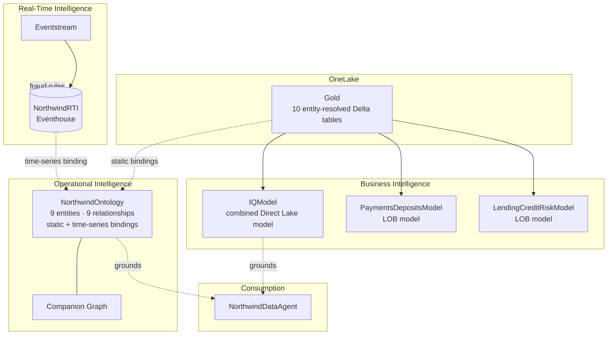

# Fabric IQ Hands-On POC — Northwind Financial

A hands-on lab repository that exercises **every pillar of Microsoft Fabric IQ (preview)** through one coherent finance scenario: a retail bank + payments processor whose two lines of business are unified by a shared, governed ontology and monitored in real time for fraud.

> **Design & full topic coverage:** [docs/Fabric-IQ-Banking-POC-Design.md](docs/Fabric-IQ-Banking-POC-Design.md) (see §15 for the live build-status matrix and the documentation-review addendum).

> **Public sample configuration:** deployment-specific tenant, subscription, capacity, workspace, artifact IDs, endpoints, and local paths have been replaced with placeholders. `IQModel` is the combined model; `PaymentsDepositsModel` is the Payments test target. References to `NorthwindModel` in `deploy/` are historical automation examples, not the current notebook build path.

> **Owner-accepted release (2026-10-12):** 26 AI matrix cases passed; M01 has correct fraud-rate/query evidence but unconfirmed verified-answer matching; S03 was not run. The owner waived the remaining checks, including fresh native notebook import and the complete current-workspace regression run. Earlier local offline checks passed 27 mocked happy-path assertions plus intentional-failure and session-cleanup fixtures. Waived checks are not passes or production certification. Graph, Planning, external integrations, and notification delivery were excluded from this acceptance scope.

## Configure Your Environment

Replace every `YOUR_*` value and each `00000000-0000-0000-0000-*` sample GUID before running deployment scripts or importing generated definitions. Sample GUIDs are format-valid placeholders, not deployed resources. Use your own tenant, subscription, workspace, capacity, lakehouse, model, and endpoint values; the archived runbook shows each value's role.

`YOUR_PROJECT_ROOT`, `YOUR_LOCAL_WORK_ROOT`, and `YOUR_USER_HOME` stand for local directories. Generic lab names such as `NorthwindLakehouse` and `NorthwindRTI` are intentional sample names. Internal lineage, relationship, entity, and binding identifiers remain stable. Notebook default-lakehouse attachments also contain placeholders: attach your own lakehouse after import. Report links containing sample GUIDs are illustrative and will not open a live demo.

Data under `data/generator/` is synthetic, uses `example.com` email addresses, and is included for the lab. Do not commit credentials, private environment configuration, or real customer data. No repository license has been selected or inferred.

---

## The scenario

**Northwind Financial** issues cards, runs deposit accounts, originates loans, and processes millions of card transactions. The POC builds **one governed business context** so people and AI agents reason in terms of `Customer`, `Account`, `Transaction`, `Merchant`, `Loan`, `FraudAlert` — across **two subject areas**:

- **Area A — Payments & Deposits** (`Customer`, `Account`, `Card`, `Transaction`, `Merchant`, `Branch`, `Product`, `FraudAlert`)
- **Area B — Lending & Credit Risk** (`Customer` *(shared)*, `LoanApplication`, `Loan`, `Collateral`, `DelinquencyEvent`, `RiskRating`)

The two areas are unified by a single **entity-resolved `Customer`** (same person appears in both source systems with different keys).

### The headline proof
The cross-domain question — *"which delinquent borrowers also had card-fraud alerts?"* — returns the **same answer (13)** from **three independent engines**, proving the "one governed context" story:

| Engine | Result |
|---|---|
| Spark SQL (gold tables) | **13** |
| DAX / Direct Lake (`IQModel`, after the cross-domain measure is added and verified) | **13** |
| GQL / ontology graph walk (`FraudAlert → Customer → Loan → DelinquencyEvent`) | **13** |

---

## Architecture



---

## Module map & build status

| # | Module | What it demonstrates | Status |
|---|---|---|---|
| 0 | **Foundation** | Gold-only Lakehouse build + **entity resolution** across two source systems | ✅ historical values verified; current lab notebook available |
| 1 | **Semantic model** | Combined `IQModel` plus optional LOB-specific Direct Lake models | 🟡 current models exist; relationship/measure validation required |
| 2 | **Prep for AI** | Descriptions/`isDefaultLabel`/display folders (TMDL) ✅; AI instructions · synonyms · AI data schema · verified answers (portal draft) | ✅ metadata verified · portal items drafted |
| 3–4 | **Ontology** | 9 entity types / 9 relationships, **2 subject areas**, static (lakehouse) **+ time-series (Eventhouse)** bindings | ✅ verified live |
| 5 | **Generate ontology from model** | Bootstrap ontology from the semantic model | 🟡 portal |
| 6 | **Graph** | Fraud-ring detection · centrality · cross-domain walk (GQL) | ✅ verified live |
| 7 | **RTI fraud** | Eventhouse + **4 real KQL fraud rules**; Eventstream + Operations Agent | ✅ detection verified · action layer 🟡 portal |
| 8 | **Data agent** | NL2Ontology Q&A; scaffold + instructions | ✅ scaffold verified · source-attach 🟡 portal |
| 9 | **Planning** | Driver-based plan-vs-actuals (incl. RTI fraud actuals); full EPM track | 🟡 portal (no-code) |
| 10 | **Agent grounding** | Foundry IQ · Copilot Studio · custom MCP agent | 🟡 portal / Foundry |
| 11–12 | **Governance / ALM** | Separate enterprise-security and deployment guidance | optional supporting labs |

✅ = built and verified against live Fabric via API. 🟡 = portal/preview by product design; lab guides walk the UI steps from the artifacts the API labs provision.

---

## Live items (tenant YOUR_TENANT)

The current demo is in workspace **`YOUR_WORKSPACE_NAME`** (`00000000-0000-0000-0000-000000000003`). These are the current validation targets, not the historical deployment IDs:

| Item | Type |
|---|---|
| `NorthwindLakehouse` | Lakehouse (gold tables and source Files) |
| `IQModel` | Combined Direct Lake semantic model (10 tables) |
| `PaymentsDepositsModel` | Payments/Deposits Direct Lake model |
| `NorthwindOntology` (+ its companion graph) | Ontology; graph branch excluded from this validation |
| `NorthwindRTI` | Eventhouse (KQL DB) |
| `NorthwindTxnStream` | Eventstream |
| `NorthwindDataAgent` | Existing data agent; fresh S03 acceptance was waived, not passed |
| `NorthwindFraudOpsAgent` | Operations agent; notification delivery excluded |

The walkthrough uses stable instructional names where appropriate and includes this live-name mapping. Do not treat the older IDs in `deploy/README.md` as current workspace IDs.

---

## Repository layout

```
fabric-iq-banking-poc/
├── README.md                      # this file
├── docs/Fabric-IQ-Banking-POC-Design.md   # full design + coverage matrix + build-status addendum
├── data/generator/                # deterministic synthetic-data generator (2 source systems, seeded fraud)
├── 00-foundation/                 # gold build + entity resolution (Spark)
├── 01-semantic-model/             # TMDL generator + normalize step
├── 03-ontology/                   # ontology generator (entities, rels, static + time-series bindings)
├── 06-graph/                      # GQL ring/centrality queries
├── 07-realtime-fraud/             # RTI event builder + KQL fraud rules
├── deploy/                        # idempotent provisioning + verification scripts (PowerShell)
├── tests/                         # positive + negative assertion suite across all engines
└── labs/                          # facilitator + attendee lab guides per module
    ├── 00-GETTING-STARTED.md                     # beginner runbook: setup + data upload + how to run
    └── Fabric-IQ-Banking-POC-UI-Walkthrough.md   # build the whole POC by hand in the Fabric UI
```

---

## Prerequisites

- A paid Fabric capacity (F2 or higher) or Power BI Premium capacity (P1 or higher) for Copilot. PPU alone and trial capacity are not sufficient for the Copilot portions of this lab.
- Tenant settings enabled: **Ontology (preview)**, **Data agent**, Copilot/AI.
- Permissions to create Lakehouse, Semantic model, Ontology, Graph, Eventhouse, Eventstream, Data agent.
- Azure CLI signed in; a subscription in the target tenant (token pinned via `--subscription`).
- Python 3.x (generator is standard-library only).

## Quick start

For the current YOUR_TENANT hands-on path, follow [labs/00-GETTING-STARTED.md](labs/00-GETTING-STARTED.md) and then [labs/Fabric-IQ-Banking-POC-UI-Walkthrough.md](labs/Fabric-IQ-Banking-POC-UI-Walkthrough.md). The `deploy/` scripts reproduce the historical `NorthwindModel` reference deployment and are retained for automation examples only.

1. Build or validate the 10 gold tables with `00-foundation/nb_load_files_to_tables.ipynb`.
2. Create or validate `IQModel`; run `01-semantic-model/nb_iqmodel_relationships.ipynb`; add and test `[Delinquent With Fraud]`.
3. Validate the two LOB models if they are part of the session.
4. Configure the ontology, graph, RTI, and one published data agent using the UI walkthrough.
5. Capture current Spark, DAX, GQL, KQL, and data-agent outputs before declaring the demo validated.

> Planning and agent grounding are covered in the main walkthrough. Governance and ALM are separate supporting labs.

## Tests

The existing files under `tests/out/` contain **35 historical passing assertions** from the `NorthwindModel` reference deployment. They are not fresh results for `YOUR_WORKSPACE_NAME`. Keep historical evidence separate from new runs.

Run the offline checks from the repository root in PowerShell:

```powershell
python -m pip install -r tests/requirements.txt
./tests/test_offline.ps1 -PythonExecutable python
```

These checks validate notebook schemas and cell IDs, parse the test scripts, exercise 27 mocked assertions, verify intentional failures are rejected, and check owned Spark-session cleanup on success and failure. They make no cloud calls and do not execute notebook cells. The GitHub Actions workflow runs these offline checks only.

The live runner [tests/run_all.ps1](tests/run_all.ps1) requires explicit `SubscriptionId`, `WorkspaceId`, `LakehouseId`, `ModelId` (combined IQModel), `PrepModelId` (Payments model), `QueryUri`, `SeedStartUtc`, and `SeedEndUtc`. Obtain the Query URI from the target KQL database's native details pane. Run against existing data; it starts a read-only Spark test session, queries the saved DAX headline measure, bounded seed KQL rules, and model metadata. The Spark truth check reads the uploaded `Files/NorthwindLakehouse/truth/truth_customer_crosswalk.csv`, not a removed bronze table.

Each runner invocation uses a new `tests/out/run-*` directory and rejects an existing directory. Standalone scripts throw on failed assertions. Graph execution requires explicit `IncludeGraph`, `GraphId`, and `ExpectedBothLobs`; leave it disabled for the current scope. [tests/test_kql.ps1](tests/test_kql.ps1) also supports `Mode Live` with the recorded send bounds, expected event count, and exact reference transaction/time/amount/merchant. Use a separate output directory for this check. Do not resend events or rerun the batch loader to obtain a passing count.

Current streaming evidence: one 300-event send produced 300 events / 300 distinct IDs in its send window and increased the existing table from 6713 to 7013. The exact reference was also visible in the ontology's existing bound-source preview. This is not graph execution or notification-delivery proof. The [UI walkthrough](labs/Fabric-IQ-Banking-POC-UI-Walkthrough.md) records the reference and the 28-case AI acceptance matrix.

| Engine | Positive (expected values hold) | Negative (safe/invalid cases correctly excluded) |
|---|---|---|
| Spark (gold) | entity resolution, both-LOB=600, cross-domain=13 | no over-merge, no mis-resolution, lending-only unmerged, strict subset |
| DAX (model) | cross-domain=13, KPIs | impossible-region filter=0, strict subset |
| GQL (optional) | walk=13, node counts, explicit both-LOB baseline | nonexistent key=0, subset |
| KQL (RTI) | bounded seed counts 6710/500/1373/194/148; separate live send-window checks | domestic/safe exclusion, selectivity |
| Prep-AI (model) | nonempty inventory, visible columns/measures described, measure folders | descriptions <=200 chars (repository convention, not a certified product limit) |
| Cross-engine | Spark == saved DAX measure (=13); GQL only when explicitly selected | — |

The owner accepted publication with the remaining live checks waived. Environment-specific configuration has been replaced with placeholders. Credential-pattern and archive checks found no likely secrets, but they are not a comprehensive security audit. Configure your own targets before use; sanitized deployment examples were not rerun against cloud resources. No license has been inferred or added.

---

## Facilitator notes

- **Runtime:** half-day covers Modules 0–8; full-day adds Planning + Governance + ALM.
- **Reset:** `deploy/reset_all.ps1` deletes the workspace items for a clean re-run.
- **Cost:** pause the capacity when idle; the Eventhouse and Direct Lake model are the main consumers.
- **Data realism note:** synthetic fraud-loss *rate* is intentionally high (seeded high-value fraud) so every rule fires; tune amounts in `data/generator/generate.py` for a more realistic dashboard.
