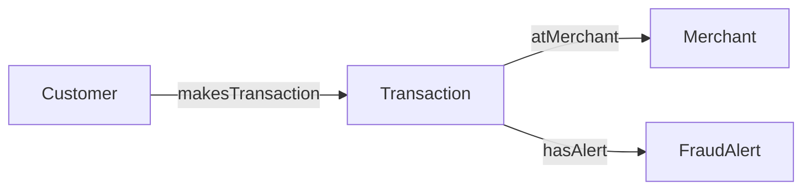

# Build a Customer Graph Demo Using FabricIQ

## Recommended Demo

**Story:** "Start with a transaction, see its customer and merchant, then follow a fraud alert through the same connections."

Build a **standalone Graph model** in `YOUR_WORKSPACE_NAME`, using four existing tables in `FabricIQ.gold`. No ontology, new source tables, data upload, or notebook is needed. Build and refresh before the meeting; show exploration during the customer demo.

**Preparation:** allow 30-45 minutes plus graph loading time.  
**Customer demo:** 10-15 minutes.  
**Optional extension:** connect customers to loans and delinquency events.

### What Was Verified

Read-only Fabric tools confirmed the following environment and table metadata. Sample rows were retrieved from the transaction, merchant, and fraud-alert tables. The tool retrieval timestamps were October 9, 2026 UTC.

| Item | Verified value |
| --- | --- |
| Workspace | YOUR_WORKSPACE_NAME |
| Workspace ID | 00000000-0000-0000-0000-000000000003 |
| Lakehouse | FabricIQ |
| Lakehouse ID | 00000000-0000-0000-0000-000000000005 |
| Lakehouse layout | Schema-enabled; demo tables are in gold, not dbo |
| Merchant risk flag | gold.dim_merchant.riskFlag is bit / Boolean |
| Customer join key | customerKey is present in customer, transaction, fraud-alert, loan, and delinquency tables |
| Account caveat | gold.dim_account does not currently contain customerKey |

**Verification boundary:** table metadata and sample rows were inspected, not full-table key uniqueness or graph queries. No remote Graph item was created or changed. Follow the checks below before presenting. Confirm that this remains approved synthetic/demo data; avoid adding unnecessary personal or account details.

## 1. Understand the Small Demo Model



- Customer tells you **who** made the transaction.
- Transaction tells you **what happened**.
- Merchant tells you **where it happened**.
- FraudAlert tells you **what was recorded for review**.

The arrows are deliberately named to read naturally. Use the exact case-sensitive labels below in queries. These are labels for the **new demo graph**, not labels assumed to exist in an older ontology graph.

### Node Mapping

| Node label | Source table | Node key | Properties to include |
| --- | --- | --- | --- |
| Customer | gold.dim_customer | customerKey | customerKey, region, segment |
| Transaction | gold.fact_transaction | txnId | txnId, customerKey, amount, currency, channel, isFraud |
| Merchant | gold.dim_merchant | merchantId | merchantId, name, category, country, riskFlag |
| FraudAlert | gold.fact_fraud_alert | alertId | alertId, severity, status, type |

Customer names, email, cardId, and account identifiers are unnecessary for this demo. Add properties explicitly; do not select all columns.

### Edge Mapping

| Edge label | Source table | Origin node | Origin key column in source table | Target node | Target key column in source table |
| --- | --- | --- | --- | --- | --- |
| makesTransaction | gold.fact_transaction | Customer | customerKey | Transaction | txnId |
| atMerchant | gold.fact_transaction | Transaction | txnId | Merchant | merchantId |
| hasAlert | gold.fact_fraud_alert | Transaction | txnId | FraudAlert | alertId |

**Important:** for an edge, both key-column selections refer to the **edge source table**. For example, makesTransaction uses customerKey and txnId from fact_transaction, not a column selected from dim_customer.

## 2. Check the Source Data

1. Open [Microsoft Fabric](https://fabric.microsoft.com/).
2. Confirm the intended tenant, select **Workspaces**, then **YOUR_WORKSPACE_NAME**.
3. Open **FabricIQ**.
4. In the Lakehouse Explorer, expand **Tables > gold**.
5. Open dim_customer, fact_transaction, dim_merchant, and fact_fraud_alert to review the columns in the mapping above.
6. Confirm that the graph creator has workspace authoring permissions and access to the source tables. Graph prerequisites include a supported region and an active Fabric F2-or-higher capacity or trial.
7. In the lakehouse's **SQL analytics endpoint**, check that each node key is unique and non-null across its full source table. You can do this with your existing SQL tools; a table preview alone does not prove uniqueness.
8. Check endpoint coverage: transaction.customerKey must match customer.customerKey; transaction.merchantId must match merchant.merchantId; alert.txnId must match transaction.txnId. All these keys were reported as varchar, so the observed types match.

Use customerKey for the shared customer identity, not customerId or borrowerId. Do not create a Customer-to-Account edge on customerKey: that column is absent from the current account table, and this small demo does not require Account.

## 3. Create the Graph Model

1. Return to **YOUR_WORKSPACE_NAME**.
2. Select **+ New item**.
3. Search for **graph**.
4. Select **Graph model**.
5. Enter `FabricIQCustomerRiskDemo` and select **Create**.
6. The editor opens in **Model** mode.
7. Select **Get data** in the top ribbon.
8. In the **OneLake catalog**, select **FabricIQ** in **YOUR_WORKSPACE_NAME**, then select **Add**.
9. Select the four tables under **gold** listed in the node mapping.
10. Select **Load**.

**Checkpoint:** the source picker exposes the required gold tables. If it does not, stop and check the source picker, permissions, and current schema support. Do not drop the schema, rebuild the lakehouse, or overwrite source data as a workaround.

If an item with this name already exists, inspect it first. Create a separately named demo item rather than overwriting someone else's graph.

## 4. Add the Four Node Types

### First Node: Customer

1. Select **Add node**.
2. Set **Node label** to `Customer`.
3. Set **Source table** to `gold.dim_customer`.
4. Set **Key** to `customerKey`.
5. Select **+ Add property** and choose customerKey, region, and segment. Keep their property names unchanged.
6. Apply the property selection if prompted, then select **Create**.

### Remaining Nodes

Repeat **Add node** for Transaction, Merchant, and FraudAlert using the exact node mapping in section 1.

**Checkpoint:** four node types appear on the Model canvas. These circles represent types, not individual customer or transaction records. Select a node to verify its table, key, and properties before continuing.

## 5. Add the Three Edge Types

### First Edge: makesTransaction

1. Select **Add edge**.
2. Set **Edge label** to `makesTransaction`.
3. Set **Source table** to `gold.fact_transaction`.
4. Set **Origin node** to `Customer`.
5. Set **Origin key** to `customerKey` from the source table.
6. Set **Target node** to `Transaction`.
7. Set **Target key** to `txnId` from the source table.
8. Leave edge properties empty and select **Create**.

### Remaining Edges

Repeat **Add edge** for atMerchant and hasAlert using the edge mapping in section 1. Keep the direction exactly as listed.

**Checkpoint:** Customer -> Transaction -> Merchant, with Transaction -> FraudAlert. The same source table can supply a node type and an edge type; you do not need separate relationship tables here.

## 6. Save and Load the Graph

1. Select **Save** in the top ribbon.
2. Wait for **Data load is in progress** to change to **Data load completed...**.
3. Record the completed load time.
4. Do not start the live customer demo while loading is still in progress.

Saving persists the model and ingests source data into the queryable graph. Structural edits trigger a full reload. Source updates are not automatically visible in the loaded graph; refresh it before the demo. To schedule later refreshes, use workspace Graph item **... > Schedule > Add schedule**, configure the frequency, and **Save**.

## 7. Rehearse Three Simple Questions

Run the following in the **Graph model code editor**, not a notebook, Warehouse SQL editor, or Eventhouse KQL editor:

1. Select **Modes > Query**.
2. Select **Query builder > Code editor** in the top ribbon.
3. Paste one query at a time.
4. Select **Run query**.

### Question 1: Can We Trace a Known Transaction?

This transaction was observed in the current lakehouse preview. Use it as an initial wiring check, not a fraud example.

```gql
MATCH (customer:Customer)-[:makesTransaction]->(transaction:Transaction)-[:atMerchant]->(merchant:Merchant)
WHERE transaction.txnId = 'TX-00044001'
RETURN customer.customerKey AS customer_key,
       transaction.txnId AS transaction_id,
       transaction.amount AS amount,
       transaction.currency AS currency,
       merchant.merchantId AS merchant_id
LIMIT 5
```

**Source-preview checkpoint:** customerKey = CUST-001159, merchantId = MER-0013, amount = 94.25, currency = USD. A graph result matching these values still depends on successful loading and matching customer/merchant endpoints.

**Say:** "We started with one transaction and followed its two relationships to the customer and merchant."

### Question 2: Which Flagged Merchants Have the Most Connected Activity?

```gql
MATCH (customer:Customer)-[:makesTransaction]->(transaction:Transaction)-[:atMerchant]->(merchant:Merchant)
WHERE merchant.riskFlag = true
RETURN merchant.merchantId AS merchant_id,
       merchant.name AS merchant_name,
       count(DISTINCT transaction.txnId) AS transaction_count,
       count(DISTINCT customer.customerKey) AS customer_count
GROUP BY merchant_id, merchant_name
ORDER BY transaction_count DESC
LIMIT 5
```

**Checkpoint:** record a merchant ID returned by this query. No ranked results or full-table riskFlag distribution were verified while writing this guide. If no rows return, inspect the source flags, graph loading, and endpoint mappings rather than assuming a particular count.

**Say:** "This shows activity at merchants already flagged in the source data. It prioritizes review; it does not prove that every transaction or customer is fraudulent."

### Question 3: Follow a Recorded Fraud Alert to Its Customer and Merchant

The alert AL-0000093 was observed in the current lakehouse preview with High severity and Open status.

```gql
MATCH (customer:Customer)-[:makesTransaction]->(transaction:Transaction)-[:atMerchant]->(merchant:Merchant),
      (transaction)-[:hasAlert]->(alert:FraudAlert)
WHERE alert.alertId = 'AL-0000093'
RETURN customer.customerKey AS customer_key,
       transaction.txnId AS transaction_id,
       merchant.merchantId AS merchant_id,
       alert.alertId AS alert_id,
       alert.type AS alert_type,
       alert.severity AS severity,
       alert.status AS status
LIMIT 10
```

**Source-preview checkpoint:** customerKey = CUST-002026, txnId = TX-00047093, type = CrossBorderHighValue, severity = High, status = Open. The merchant for this alert was not independently retrieved; check it during rehearsal. Source values can change, so reconcile after the graph refresh.

**Say:** "The graph connects the recorded alert to a transaction, its customer, and the merchant. The path is evidence for an investigator, not an automated decision."

## 8. Show the Same Story Visually

Use the recorded alert to keep the visual result small and meaningful.

1. Stay in **Query** mode and select the visual **Query builder** rather than Code editor.
2. Start a new visual query and select **Add a node > Transaction**.
3. Open the right-side **Components** pane using its puzzle-piece icon.
4. With Transaction selected, choose **atMerchant** to add Merchant.
5. Select Transaction again and choose **hasAlert** to add FraudAlert.
6. Add the incoming **makesTransaction** relationship and Customer from Components. Verify that Customer -> Transaction is preserved; do not reverse the model edge to make the builder work.
7. Select FraudAlert, then **Filter**.
8. Set alertId equal to `AL-0000093`, then select **Apply**.
9. Select **Run query**.
10. Close Components and collapse the builder pane to enlarge the results.
11. Show **Diagram** view. Select a node to inspect its properties and drag nodes apart so connections are legible.
12. Switch to **Table** view to show the same evidence as records.

**Checkpoint:** the diagram displays individual records, unlike the Model canvas's node types. Rehearse incoming-edge selection in your actual UI; controls can vary. If the builder does not offer the incoming edge from Transaction, begin at Customer and add makesTransaction, then atMerchant and hasAlert.

**Say:** "This is the difference between knowing the records exist and seeing how those records connect."

## 9. Save the Investigation

1. In Query mode, select **Create queryset**.
2. Enter `FabricIQCustomerRiskQueries`.
3. Set **Location** to **YOUR_WORKSPACE_NAME** and select **Create**.
4. Rename the saved query to `TraceFraudAlert` using its **... > Rename** menu.
5. Reopen the queryset from the workspace and verify that it reruns.

Querysets let appropriately authorized workspace users reuse the investigation. They are not a substitute for workspace and underlying-data access controls.

## 10. Optional: Extend the Demo Into Lending

Only add this after the simple payments demo works. The metadata confirms the following tables and columns are already present; no Account enrichment is required.

### Add Two Node Types

| Node label | Source table | Key | Properties |
| --- | --- | --- | --- |
| Loan | gold.fact_loan | loanId | loanId, balance, dpd |
| DelinquencyEvent | gold.fact_delinquency | eventId | eventId, dpdBucket |

### Add Two Edge Types

| Edge label | Source table | Origin node / key column | Target node / key column |
| --- | --- | --- | --- |
| ownsLoan | gold.fact_loan | Customer / customerKey | Loan / loanId |
| hasDelinquency | gold.fact_delinquency | Loan / loanId | DelinquencyEvent / eventId |

Use **Get data** to add these two tables, then **Add node** and **Add edge** using the mappings. Select **Save** and wait for the full graph reload to finish.

### Cross-Domain Question

```gql
MATCH (alert:FraudAlert)<-[:hasAlert]-(transaction:Transaction)<-[:makesTransaction]-(customer:Customer)-[:ownsLoan]->(loan:Loan)-[:hasDelinquency]->(delinquency:DelinquencyEvent)
RETURN count(DISTINCT customer.customerKey) AS customers_with_both,
       count(DISTINCT loan.loanId) AS connected_loans
```

**Say:** "We can now navigate from a fraud alert through payments to a customer, then into lending."

**Meaning:** customers with a recorded alert on a transaction they made, and a delinquency event on a loan they own. This does not establish causation or current delinquency. Specify status and time windows for production use.

**Rehearsal check:** compare distinct customer counts with the equivalent source-table joins through txnId, customerKey, and loanId. No cross-domain graph result is claimed as verified here. Do not sum loan balances over the matched paths: multiple alerts or events can repeat a loan.

## 11. Customer Presentation Sequence

| Minutes | Show | Main message |
| --- | --- | --- |
| 0-2 | Four-node Model canvas | Nodes are entities; edges describe their relationships. |
| 2-4 | Known transaction query | Trace a record to the customer and merchant. |
| 4-7 | Fraud-alert visual query | Explain a recorded alert through its connected evidence. |
| 7-10 | Flagged-merchant ranking | Summarize connections using distinct entities. |
| 10-12 | Saved queryset | Preserve the investigation for reuse. |
| 12-15, optional | Lending extension | Follow a connected question across business domains. |

Do not build all nodes and edges in front of the customer. Open the prepared graph and inspect one node and one edge mapping, then spend the session exploring results.

## 12. Final Rehearsal Checklist

- Graph loading completed; refresh time recorded.
- All node keys checked for uniqueness and nulls; edge endpoints reconciled.
- Known transaction and alert match the source-preview checkpoints or updated source values.
- A flagged merchant selected from actual graph results, not assumed from an older POC.
- Diagram is small and readable; filters are already rehearsed.
- Saved queryset reopens and runs.
- Optional lending counts match an independent source calculation.
- Intended presenter identity can access the graph and source data; do not assume semantic-model RLS protects this graph.
- Screenshots or a brief recording are available as a clearly labeled fallback.
- Customer data classification, source access, and capacity cost are approved. Graph uses Fabric capacity and cache storage.

## Official Documentation

- [Create your first graph](https://learn.microsoft.com/fabric/graph/quickstart)
- [Design a graph schema](https://learn.microsoft.com/fabric/graph/design-graph-schema)
- [Query the graph with the query builder](https://learn.microsoft.com/fabric/graph/tutorial-query-builder)
- [Manage and refresh data](https://learn.microsoft.com/fabric/graph/manage-data)
- [GQL language guide](https://learn.microsoft.com/fabric/graph/gql-language-guide)
- [Current limitations](https://learn.microsoft.com/fabric/graph/limitations)