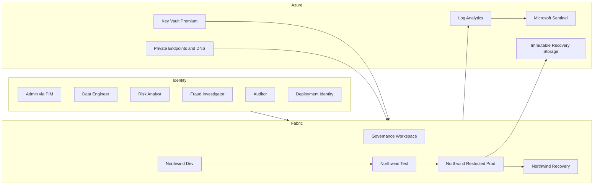

# Lab 13 - Secure Northwind Financial End to End

## Use Case

Northwind Financial is preparing its payments, deposits, lending, fraud, and regulatory analytics platform for production. An audit and a simulated compromised-analyst incident require the company to prove that it can:

1. Admit only trusted identities and devices.
2. Prevent unrestricted inbound, outbound, and cross-tenant access.
3. Enforce least privilege across workspace, item, OneLake, SQL, DAX, KQL, Spark, and connection planes.
4. Protect credentials and customer-managed encryption keys.
5. Classify, trace, monitor, and detect use of sensitive financial data.
6. promote changes without routine direct production authoring.
7. Contain a compromised analyst and recover deleted data and artifacts.
8. Produce evidence for customer-operated, shared, and Microsoft-operated controls.

The lab applies the [enterprise requirements](../../Microsoft-Fabric-Enterprise-Security-Requirements.md) and [implementation blueprint](../../Microsoft-Fabric-Enterprise-Security-Implementation-Blueprint.md) to the existing Northwind Financial assets.

## Delivery Model

This is a two-day capstone or six-session program. Some controls are tenant-wide, destructive, separately licensed, item-specific, or Microsoft-operated.

| Control type | Lab treatment |
|---|---|
| Customer-configurable | Configure and test in an isolated training tenant or sandbox. |
| Tenant-wide or destructive | Scope to a pilot group or disposable item; facilitator demonstrates when necessary. |
| Microsoft-managed SaaS | Retrieve and assess assurance evidence. |
| Unsupported or preview | Record an exception and compensating control; do not count it as a production compliance dependency. |

## Safety Rules

- Use synthetic Northwind data only.
- Do not enforce tenant-wide Conditional Access or public-access restrictions in a shared production tenant.
- Keep two emergency-access identities before enforcing Conditional Access.
- Confirm feature support before enabling Private Link, CMK, or outbound access protection.
- Test key revocation and deletion/recovery only on disposable assets.
- Never store tokens, secrets, full sensitive rows, or private keys as lab evidence.

## Prerequisites

- Fabric F capacity supporting the selected workloads.
- Entra ID P1/P2 for Conditional Access, Identity Protection, PIM, and access reviews as required.
- Microsoft Purview licensing for selected DLP, Audit, information-protection, and governance exercises.
- Azure subscription for Key Vault, Log Analytics, Sentinel, Private Endpoints, Storage, and optional gateway hosts.
- Azure DevOps or GitHub for Git and CI/CD.
- Separate eligible roles for Entra, Fabric tenant, capacity, workspace, Purview, Azure network/security, and audit administration.
- Completed POC Labs 00, 01, 03-04, 06, and 07.

## Existing Assets

- Tenant `YOUR_TENANT.onmicrosoft.com`, workspace `YOUR_WORKSPACE_NAME` (`00000000-0000-0000-0000-000000000003`).
- `NorthwindGold`: Lakehouse containing the 10 gold customer, account, loan, transaction, and fraud tables.
- `IQModel`: combined Direct Lake semantic model; `PaymentsDepositsModel` and `LendingCreditRiskModel`: LOB models.
- `DemoOntology` and its `DemoOntology_graph_...` companion graph.
- `NorthwindRTI`: Eventhouse/KQL database.
- `NorthwindTxnStream`: Eventstream where available.
- One explicitly selected and published data agent; the workspace currently contains multiple candidate agents.
- Historical Spark, DAX, GQL, and KQL positive/negative test output. Re-run controls against current item IDs before using the output as audit evidence.

## Target Topology

## Lab Groups and Identities

| Group or identity | Intended access |
|---|---|
| `FAB-Northwind-Prod-Admins` | Eligible workspace Admin through PIM-managed group. |
| `FAB-Northwind-Prod-Engineers` | Time-bound production engineering access. |
| `FAB-Northwind-Risk-Analysts` | Viewer/app consumer with region-filtered data. |
| `FAB-Northwind-Fraud-Investigators` | Curated fraud access and KQL Viewer. |
| `FAB-Northwind-Auditors` | Read-only evidence/report access; no Build or Reshare. |
| `FAB-Northwind-External-Reviewers` | Time-bound B2B access to one curated report. |
| `sp-fabric-northwind-deploy-<env>` | Environment-specific deployment identity. |
| Northwind workspace identity | Access to approved Azure sources and Key Vault where supported. |

## Exercise 0 - Discover and Classify

**Requirements:** `FAB-SEC-0001-0005`, `1801-1804`, `1901-1904`  
**Features:** Fabric Admin/Scanner APIs, OneLake Catalog, Purview Unified Catalog, Fabric domains/tags, Azure Resource Graph, secure configuration baseline.

### Tasks

1. Inventory all capacities, workspaces, items, owners, identities, connections, regions, and dependencies.
2. Classify customer PII, accounts, transactions, fraud indicators, and credit data as restricted.
3. Record environment, regulatory scope, RTO, RPO, and data owner.
4. Build an item-by-feature matrix for Private Link, CMK, outbound protection, CI/CD, monitoring, and recovery.
5. Record preview and unsupported dependencies in the exception register.
6. Introduce one harmless nonproduction drift, detect it, open a remediation record, and restore the baseline.

**Negative test:** An unowned or unclassified item must fail production readiness.  
**Evidence:** Inventory, classifications, feature matrix, drift alert, remediation, and exceptions.

## Exercise 1 - Trusted Identity and Privilege

**Requirements:** `0101-0105`, `0201-0204`, `0301-0306`  
**Features:** Entra groups, passwordless/MFA, Conditional Access, authentication strengths, device compliance, Identity Protection, PIM, access reviews, B2B expiry, emergency accounts, Customer Lockbox.

### Tasks

1. Replace direct assignments with role-based groups.
2. Require phishing-resistant authentication for privileged users and MFA for participants.
3. Pilot Conditional Access for Fabric/Power BI and require compliant devices for administrators.
4. Configure PIM approval, justification, notification, MFA, and expiry for production Admin.
5. Create and expire an external reviewer entitlement.
6. Configure emergency-account usage alerts.
7. Inspect Customer Lockbox configuration or assurance evidence.

**Negative tests:** A standard user cannot elevate; a scoped noncompliant device is blocked; privilege disappears after expiry; the expired guest loses report access.  
**Evidence:** Policy export, sign-in outcomes, PIM history, review result, and emergency-account alert.

## Exercise 2 - Tenant, Capacity, and Workspace Boundaries

**Requirements:** `0401-0404`, `0501-0504`  
**Features:** Fabric tenant/delegated settings, capacity roles and regions, domains, workspace assignment, workload settings, Capacity Metrics.

### Tasks

1. Compare tenant settings with a deny-by-default baseline.
2. Disable Publish to web and scope workspace creation, service-principal APIs, XMLA write, export/download, external sharing, and preview workloads.
3. Separate Dev, Test, Restricted Prod, and Recovery capacities, or document a lab simulation if only one capacity exists.
4. Separate Capacity Admin from workspace and data administration.
5. Configure Capacity Metrics and thresholds for saturation, throttling, and anomalous use.

**Negative test:** An unapproved creator cannot create a workspace, publish publicly, or use a restricted export path.  
**Evidence:** Tenant-setting comparison, capacity map, role separation, and alert.

## Exercise 3 - Private Inbound, Controlled Outbound, and External Access

**Requirements:** `0601-0604`, `0701-0704`, `0801-0802`, `0901-0904`  
**Features:** TLS 1.2+, tenant/workspace Private Link, private endpoint/DNS, workspace firewall, public-access restriction, outbound access protection, managed private endpoints, connection rules, workspace identity, trusted workspace access, gateways, shortcuts, cross-tenant sharing.

### Tasks

1. Confirm item-level feature support.
2. Configure or inspect private endpoints and DNS from an approved VNet.
3. Test portal, API, SQL, and OneLake private paths before restricting public access.
4. Enable outbound protection for supported items and allow only required Key Vault, source, Git, package, or event endpoints.
5. Configure workspace identity and trusted access to one Azure source.
6. Catalog gateways, cloud connections, shortcuts, and cross-tenant shares with owners and review dates.
7. Review Microsoft assurance for DDoS, WAF, segmentation, platform IDS/IPS, DNS, and time services.

**Negative tests:** Public/unapproved ingress fails; an arbitrary outbound request is blocked; source access stops after the connection identity is revoked.  
**Evidence:** Endpoint/DNS inventory, allowed/denied tests, outbound rules, connection catalog, and shared-responsibility assessment.

## Exercise 4 - Workspace and Item Least Privilege

**Requirements:** `1001-1004`, `1101-1104`  
**Features:** Workspace roles, item Read/Write/Share/Build/ReadData/ReadAll/Execute, Power BI apps/audiences, activity log, Scanner APIs.

### Tasks

1. Assign personas to the minimum workspace roles.
2. Remove consumers from Member and Contributor.
3. Publish curated Risk, Fraud, and Executive app audiences.
4. Restrict Build and Reshare to approved groups.
5. Produce effective access across workspace, item, app, OneLake, compute, and cross-tenant grants.
6. Configure quarterly access review.

**Negative tests:** Risk Analyst cannot edit/reshare; Auditor cannot Build or read unrestricted data; a direct user grant is detected.  
**Evidence:** Role exports, app mapping, effective-access report, and denial results.

## Exercise 5 - Data Security Across Every Engine

**Requirements:** `1201-1205`, `1301-1306`  
**Features:** OneLake roles and DefaultReader, OLS/CLS/RLS, SQL roles/GRANT/DENY/RLS/CLS/masking, semantic permissions and DAX RLS/OLS, KQL roles/policies, Direct Lake identity, Spark/OneLake controls, mirrored-data permissions.

### Scenario

Risk Analysts see customers and loans only for their assigned region. Fraud Investigators see suspicious transactions and masked customer attributes but no lending details. Auditors see aggregates and lineage but no raw PII.

### Tasks

1. Define OneLake regional and fraud consumer roles; constrain DefaultReader.
2. Apply supported row/column policies to curated Lakehouse data.
3. Create least-privilege SQL roles and policies.
4. Configure DAX regional RLS and identity-field OLS.
5. Assign KQL Viewer separately from ingestion and administration.
6. Document Direct Lake SSO or fixed identity and the evaluated principal.
7. Configure mirrored-data permissions independently if mirroring is used.
8. Run equivalent persona tests through OneLake API, Spark, SQL, DAX, KQL, report/app, and shortcuts.

**Negative tests:** Cross-region rows and restricted columns are denied; KQL Viewer cannot ingest; SQL restrictions cannot be bypassed through Spark/OneLake.  
**Evidence:** Policies and a path-by-persona positive/negative test matrix.

## Exercise 6 - Secrets and Encryption Keys

**Requirements:** `1401-1405`, `1501-1505`  
**Features:** Workspace/managed identity, workload federation, OAuth, Key Vault Premium/Managed HSM, private access, RBAC, diagnostics, Fabric workspace CMK, Power BI BYOK, secret scanning.

### Tasks

1. Inventory connection authentication and replace one static credential with identity-based access.
2. Store one unavoidable training secret in Key Vault with expiry, soft delete, purge protection, and diagnostics.
3. Retrieve the secret at runtime without exposing it in code, output, definitions, or Git.
4. Enable secret scanning and prove a synthetic secret blocks promotion.
5. Configure or inspect CMK for supported sandbox items.
6. Rotate a test key and validate continuity.
7. Demonstrate disable/recovery only on a disposable item.

**Negative tests:** Revoked credentials fail; unauthorized Key Vault access fails; synthetic secrets cannot pass the gate.  
**Evidence:** Authentication inventory, Key Vault/CMK coverage, scan result, rotation, and recovery record.

## Exercise 7 - Classification, DLP, Catalog, and Lineage

**Requirements:** `1601-1605`  
**Features:** Purview Information Protection, sensitivity labels, DLP, Audit, Fabric/OneLake Catalog, Purview Unified Catalog, domains, glossary, tags, lineage, data quality, endorsement/certification.

### Tasks

1. Apply the restricted-financial-data label to supported Northwind items.
2. Configure scoped default/mandatory labeling and downgrade justification.
3. Create a DLP policy for synthetic account/customer identifiers and trigger it safely.
4. Route alerts to Security and the data owner.
5. Populate ownership, description, glossary, domain, tags, classification, and lineage.
6. Enforce customer-key uniqueness, transaction completeness, and cross-engine consistency quality checks.
7. Certify the curated semantic model only after checks pass.

**Negative tests:** Missing labels fail readiness; failed quality removes certification; DLP alerts require owner disposition.  
**Evidence:** Labels, DLP alert, catalog/lineage, quality results, and certification.

## Exercise 8 - Secure CI/CD

**Requirements:** `1701-1706`  
**Features:** Fabric Git integration, Azure DevOps/GitHub, branch policies, pull requests, environment approvals, deployment pipelines, Fabric REST/CLI, `fabric-cicd`, variable libraries, workload federation, secret/SAST/SCA scanning.

### Tasks

1. Connect Dev to an approved protected repository.
2. Require review and successful validation/security checks.
3. Configure Dev/Test/Prod stages and environment-specific deployment identities.
4. Parameterize workspace, item, connection, and environment values.
5. Promote a harmless semantic-model metadata change.
6. Validate roles, bindings, and definitions after deployment.
7. Document unsupported items and manual/OAuth/rebinding steps.
8. Create and detect nonproduction drift.

**Negative tests:** Developers cannot write directly to Prod; a failing scan cannot merge; an unapproved deployment cannot pass the Prod gate.  
**Evidence:** Pull request, scans, approval, deployment logs, comparison, and manual-step register.

## Exercise 9 - Central Logging and Threat Detection

**Requirements:** `2001-2005`  
**Features:** Fabric/Power BI activity events, Purview Audit, Entra logs, workspace monitoring, OneLake diagnostics, Admin monitoring workspace, Key Vault/Private Link diagnostics, Log Analytics, Sentinel, Defender for Cloud Apps, immutable Storage.

### Tasks

1. Build the log-source matrix with collection, latency, retention, and ownership.
2. Centralize supported Fabric, identity, key, network, and gateway telemetry.
3. Export short-retention activity/audit data before expiry.
4. Configure immutable archival retention.
5. Detect privileged changes, public/external sharing, mass export, unusual user/service-principal access, control disablement, key changes, egress violations, and heartbeat failure.
6. Generate safe events and verify incident enrichment and routing.

**Negative test:** Simulated loss of a nonproduction log source generates a heartbeat incident within SLA.  
**Evidence:** Log matrix, ingestion proof, immutable retention, analytics rules, incident, and notification.

## Exercise 10 - Respond to a Compromised Analyst

**Requirements:** `2101-2104`  
**Features:** Sentinel incidents, automation rules, Logic Apps playbooks, Entra account/session controls, Fabric share/role management, credential rotation, network isolation, evidence preservation.

### Scenario

The Risk Analyst performs an unusual bulk export and externally shares a report. Sentinel raises an incident.

### Tasks

1. Correlate identity, device, IP, workspace, item, export, and sharing activity.
2. Preserve logs, permissions, definitions, and correlation IDs.
3. Block the identity and revoke sessions.
4. Remove external sharing and temporary direct grants.
5. Revoke affected workload credentials if needed.
6. Restrict egress or pause automation without destroying evidence.
7. Prove unaffected users retain service.
8. Execute the notification decision tree and post-incident review.

**Success test:** Compromised and guest identities lose access, evidence remains intact, and approved users retain access.  
**Evidence:** Timeline, containment, evidence manifest, notification decision, recovery validation, and corrective action.

## Exercise 11 - Vulnerability and Endpoint Responsibilities

**Requirements:** `2201-2204`  
**Features:** Service Trust Portal, Defender for Endpoint/Cloud/DevOps, repository security, SAST/SCA, SBOM, gateway/build-host vulnerability management, Microsoft testing rules.

### Tasks

1. Review Microsoft SDL, vulnerability, red-team, malware, and platform evidence.
2. Confirm gateway, build-agent, and administrator endpoints are in EDR and vulnerability management.
3. Produce an SBOM/dependency inventory for custom POC components.
4. Run code/dependency scans and triage findings.
5. Draft a penetration-test plan compliant with Microsoft rules of engagement.

**Negative test:** A scanner fixture or test-only vulnerable dependency blocks release according to severity policy.  
**Evidence:** Assurance review, endpoint/patch coverage, SBOM, scan/remediation, and approved test plan.

## Exercise 12 - Recovery and Audit Package

**Requirements:** `2301-2306`, `2401-2404`  
**Features:** OneLake replication where supported, Fabric retention/recovery, semantic-model backup/restore, Git definitions, deployment pipelines, isolated/immutable Storage, Key Vault recovery, Service Trust Portal, Customer Lockbox, GRC evidence.

### Tasks

1. Assign RTO, RPO, retention, recovery method/region, and owner to every item and dependency.
2. Enable or inspect all supported native recovery controls.
3. Keep reconstructable definitions in protected Git.
4. Create an isolated immutable copy of required synthetic data and metadata.
5. Delete and recover a disposable item.
6. Simulate production-workspace loss and rebuild a representative slice in Recovery.
7. Revalidate counts, permissions, labels, connections, and cross-engine results.
8. Measure actual RTO/RPO.
9. Map selected financial obligations to lab controls and attach Microsoft plus customer evidence.
10. Record cross-workspace, cross-region, long-term, and API-restore gaps with compensating controls.

**Negative tests:** Production admins cannot alter immutable copies; a restore without security configuration fails acceptance; certification alone cannot satisfy a customer-operated control.  
**Evidence:** Recovery inventory/logs, reconciliation, RTO/RPO, immutability test, regulatory crosswalk, assurance review, and exceptions.

## Coverage Matrix

| Surface | Requirement range | Exercise | Treatment |
|---:|---|---:|---|
| 0 | `0001-0005` | 0 | Configure/test |
| 1 | `0101-0105` | 1 | Configure/test |
| 2 | `0201-0204` | 1 | Scoped configure/test |
| 3 | `0301-0306` | 1 | Configure/test/evidence |
| 4 | `0401-0404` | 2 | Scoped configure/test |
| 5 | `0501-0504` | 2 | Configure/simulate/test |
| 6 | `0601-0604` | 3 | Configure where supported/test |
| 7 | `0701-0704` | 3 | Configure where supported/test |
| 8 | `0801-0802` | 3 | Microsoft assurance evidence |
| 9 | `0901-0904` | 3 | Configure/test |
| 10 | `1001-1004` | 4 | Configure/test |
| 11 | `1101-1104` | 4 | Configure/test |
| 12 | `1201-1205` | 5 | Configure/path-test |
| 13 | `1301-1306` | 5 | Configure/engine-test |
| 14 | `1401-1405` | 6 | Configure/rotate/test |
| 15 | `1501-1505` | 6 | Configure where supported/test |
| 16 | `1601-1605` | 7 | Configure/test |
| 17 | `1701-1706` | 8 | Configure/test |
| 18 | `1801-1804` | 0 | Automate/lifecycle test |
| 19 | `1901-1904` | 0 | Automate/drift test |
| 20 | `2001-2005` | 9 | Configure/simulate |
| 21 | `2101-2104` | 10 | Tabletop/technical exercise |
| 22 | `2201-2204` | 11 | Customer controls/Microsoft evidence |
| 23 | `2301-2306` | 12 | Disposable destructive test |
| 24 | `2401-2404` | 12 | Evidence/crosswalk |

## Completion Criteria

- Every control range has evidence or an approved exception.
- Positive and negative persona tests pass for every enabled access path.
- Network controls block intended negative tests.
- No secret exists in source, definitions, logs, or evidence.
- The simulated incident is detected and contained.
- Recovery restores security configuration as well as data and meets lab RTO/RPO.
- The audit package distinguishes Microsoft-operated, customer-operated, and shared controls.

## Suggested Schedule

| Session | Duration | Exercises |
|---|---:|---|
| Discover and govern | 3 hours | 0, 2 |
| Identity and access | 3 hours | 1, 4 |
| Network and data security | 4 hours | 3, 5 |
| Keys, governance, DevSecOps | 4 hours | 6, 7, 8 |
| Detect and respond | 3 hours | 9, 10, 11 |
| Recover and attest | 3 hours | 12 and final review |

A one-day demonstration can show the flow, but it cannot credibly exercise every administrator, negative test, retention interval, and recovery path.
